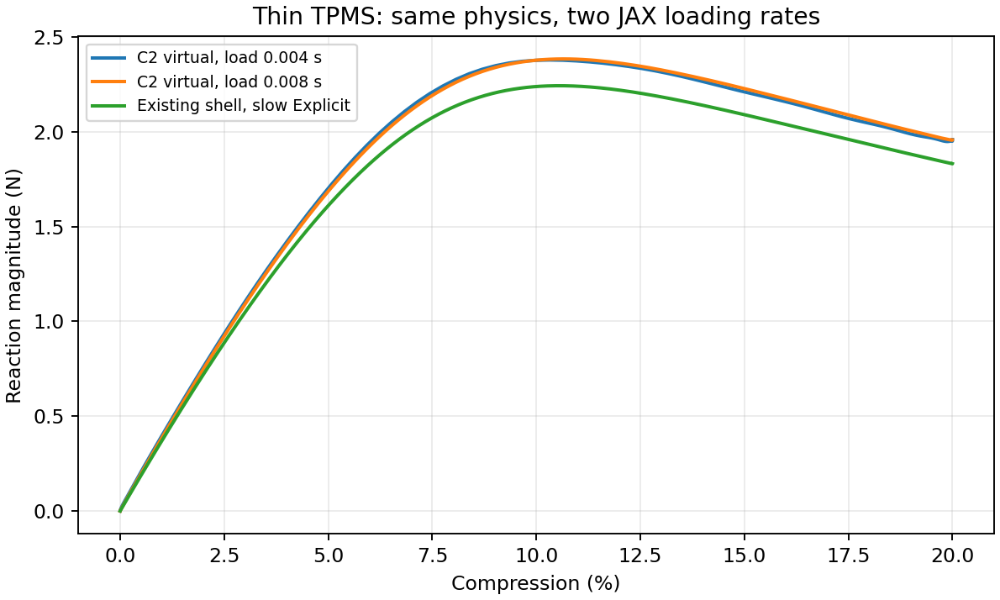

# 薄壁TPMS可导背景力学：方法、证据和可行性

文档维护2026-10-14，科研证据截至10月13日。本文集中说明方法、假定与可行性范围；当前成对结果见[20%报告](../validation/platen_xy_G_20261010_r51/experiments/midsurface_rim_20pct_20261010/README.md)，当前状态和任务分别见状态页及主规划。旧r6–r49调查及2026-10-07周总结保持日期快照。

## 1. 研究问题与当前回答

用固定背景网格计算薄壁TPMS压缩，并获得对真实几何设计变量的有效总导数，为后续逆向设计提供力学基础。当前仿真与梯度优先、训练后置。受控G/P前向及有限范围设计梯度已有通过证据，也存在D局部模式、瞬时力与历史20%导数失败；不能宣布通用大压缩和完整接触均已解决。

本页维护理论和模型假设。参数基础见[r53梯度综合报告](../validation/platen_xy_gradients_20261011_r53/analysis/parameter_summary/README.md)，真实方程系数的新结果见[r57](../validation/equation_coefficients_20261012_r57/analysis/README.md)与[r58](../validation/equation_coefficients_10pct_20261013_r58/analysis/README.md)，最新范围见[状态页](RESEARCH_STATUS.md)；旧XYZ调查在下文保留历史范围。

## 2. 几何如何放进固定背景网格

当前L=10mm、t=0.5mm，仅借用户三角壳中面。N32表示每轴32个背景单元，单元边长h=0.3125mm。HEX是六面体；HEX27采用27个二次插值节点，比线性HEX8能描述更丰富的位移和弯曲。当前每单元27个Gauss积分点，**节点数与积分点数相同是当前配置，不是同一概念**。二次节点间距0.15625mm不等于有3.2层单元；名义厚度跨约1.6个单元，局部倾斜/曲率也影响解析能力。

对参考Gauss点计算到周期中面的距离d，以

`φ(d,t)=1/[1+exp((d−t/2)/ℓ)]，ℓ=0.05mm/(2ln9)`

定义连续占据。φ接近1代表壁内，接近0代表孔隙，10–90%界面宽0.05mm。它是几何的数值近似，不是宣称实际壁是连续变化的多种材料。原几何不随变形重新阈值化，φ附着参考材料点。早期解析阈值c不是当前恒厚t。

与删空单元二值体素相比，连续场让厚度等参数的小变化连续地进入积分，减少硬阈值下导数几乎处处为零/跳变的问题。固定网格也便于数组输入和批量求解，不必每次重划复杂贴体网格。代价是窄界面需要足够积分、存在人工过渡材料与软域耦合，三角面最近距离本身还可能在面片切换时非光滑；连续φ并不自动使整条形态链可导。

[有限胞综述](https://arxiv.org/abs/1807.01285)与[几何投影非线性研究](https://doi.org/10.1016/j.cma.2024.117636)提供这种背景/虚域方法家族的依据。我们的固定Q2、sigmoid与C²核是具体研究实现，不是上述方法的精度认证。二值几何、贴体实体和壳均有独立价值，不能仅以是否方便求导判断力学优劣。

## 3. 材料、Gauss积分与周期边界

基材Neo-Hookean能量为

`W_NH=μ/2·(J^(−2/3)I₁−3)+κ/2·(J−1)²`，

其中F=I+∇u是变形梯度，J=detF是局部体积比，I₁=ΣF²；E=10MPa、ν=0.3，μ=E/[2(1+ν)]，κ=E/[3(1−2ν)]。初始切线匹配线弹性。占据权重s=η+(1−η)φ、η=1e−4使孔隙有很小人工刚度。

各单元由节点位移插值求∇u，在各真实Gauss点求F、φ、材料能量与应力，再以参考积分权重求和。全模型能量是各点`W×权重`之和，内力和切线由同一能量求导。Gauss点没有独立位移自由度；加点改善积分但不增加变形模式。HRZ把一致质量按既定规则集中到节点，厚度变动时占据和质量也变。

历史XYZ周期阶段采用`u(X)=H·X+w(X)`，w在XYZ相对周期面相同；宏观Hzz为负，Hxx=Hyy=0，周期节点归并并固定一个平移自由度。宏观横向应变零不意味着每个壁点都是平面应变。壳具有转角周期约束，实体没有独立转角，不能因此认为局部运动学已完全一致。PBC不构成周期镜像接触。

当前r51为上下无摩擦压板、仅XY周期，宏观横向伸缩自由、宏观剪切零，上下不周期。JAX采用完整BᵀMB投影质量和velocity Verlet。原有限宽切口接触与壳端缘不一致；用户选择的新方案把JAX接触权重聚合到壳中面端缘。当前Abaqus节点型接触本身也忽略端部接触厚度，截面厚度仍参与刚度与质量。两端均允许未检测的有厚度外侧越板，无完整壁面／自接触。原占据界面没有改变；详细图解见[20%报告](../validation/platen_xy_G_20261010_r51/experiments/midsurface_rim_20pct_20261010/README.md)。

## 4. 为什么加入显式与C²虚域处理

大转动、屈曲和跳跃使静力Newton路径困难，项目显式入口复用JAX-FEM材料/内力，以中央差分和HRZ质量推进。显式避免每步全局Newton，但仍有稳定步长、惯性和质量近似；慢加载或完成20%并不自动说明准静态或空间精度正确。

原NH在J≤0时含无定义项。软孔隙在大变形下容易畸变，曾出现经典虚域转动不客观、客观混合尾部材料无定义等失败。当前objective_void显式选项采用φ=0.001/0.01分界与客观人工虚域，在低占据混合区用C²续接补全能量。实际F/J不夹断，实体φ≥0.01仍要求实际J>0；续接不是把真实材料翻转修正为物理有效。

纯核/接口45项及局部/短块导数有证据，代表两条20%路径能求值；仍保留虚域翻转，不证明全局无接触、全过程处处有效或完整设计AD。required_positive_J与旧NH_active统计域不同，不能直接同比。默认NH保持，候选明确选择。

## 5. 已完成工作的逻辑

先做均匀实体、周期线弹性与同离散材料场验证，再检查解析／数组输入和导数，随后转向恒厚薄壁与大压缩。HEX27较早期HEX8改善弯曲响应；虚域客观性与C²续接修复低占据区求值，但不代替物理自接触。diverse_28取得有限范围前向结果，diverse_04暴露迁移峰位和推进困难。

旧r30–r43把初始偏硬拆开检查膜／弯曲、局部积分、穿厚度运动学、界面陡峭度与二值占据。得到多因素影响和积分敏感性的证据，没有完成唯一归因。r44／r45说明初始接近不保证峰位和大压缩一致；生产占据、材料与网格未按壳曲线拟合。细节统一见[旧机制审查](MECHANISM_ANALYSIS.md)和完整差异调查（本机成品：`W/output/TPMS背景有限元与Abaqus差异排查完整总结_20261009.docx`）。

r50标准G/P/D改变构型后暴露全路径差异；r51进一步把边界改成压板／自由XY。通过短程接触位置干预、时间步与速率检查、局部同实体基准，发现端部支持／离散的重要影响。辅助刚臂和原生壳厚接触均未成为共同有限宽G方案。用户选择共同中面端缘简化，独立从零完成G20%并达到本轮目标。短程原始过程只见[研究过程](../validation/platen_xy_G_20261010_r51/RESEARCH_LOG.md)，最新结果只见[20%报告](../validation/platen_xy_G_20261010_r51/experiments/midsurface_rim_20pct_20261010/README.md)。这些阶段的边界、分母及完整／中断范围不能混用。

## 6. 前向结果及百分比如何读

| diverse_28对同一既有慢壳 | 原HEX8 | 原HEX27慢路径 | C²虚域慢路径 |
| --- | ---: | ---: | ---: |
| 20%保载反力幅值/N | 2.24186 | 2.00459 | 1.95699 |
| 保载反力差 | 22.41% | 9.45% | 6.85% |
| 曲线指标 | 13.47% | 5.87% | 5.05% |
| 输入功差 | 15.51% | 6.87% | 5.98% |

壳保载约1.83145N，原压缩反力为负，表报幅值。保载取后半段平均，差异以匹配壳反力为分母。曲线指标在0.1–20%上均匀取1000点，反力差RMS除以固定Standard壳峰2.25891N；5.05%不是每一点均低于5.05%。输入功沿位移积分，单位N·mm。三厚度最差反力/曲线/功8.28%/7.48%/7.31%，仅代表这三个点。

C²快/慢加载0.004/0.008s，另保载10%时长，主体墙钟10.74/21.14min；快慢保载、曲线、功差0.0418%/0.6088%/0.0060%。这支持该代表工况并非宏观惯性主导，不证明空间精度或所有局部振动。壳能量漂移约1.33%未过旧严格1%门槛，因此保留工程参照限制。

diverse_04同速率观察峰为壳11.8241%、JAX15.9409%，峰力差35.23%；后续从零只到17.5363%预算停。N64一次试验到14.7320%触步长底线，不能称完成20%或网格收敛。峰附近跳跃动能升高可能正常，但数值失败仍须单独解释。壳不能作为无误差真值，初始差缩小也不会自动消除峰错位。

r44随后完成二值N32的完整20%及保载，初始对壳1.47%但曲线/功/保载差35.90%/40.21%/47.89%；取消过渡不是全部大压缩误差的解释。r45二值N64 T1ms只至13.59%预算停，反力仍增载，未捕获峰。r46只读复盘表明共同0–10%平均差N32/N64为0.80%/1.90%，共同0–13.59%为22.12%/4.85%；T4/T1ms不同，不作纯网格排名。N64末端35.39%是点差，不是峰力差。详见当前状态和机制审查，原验收与失败保持。

## 7. 梯度优势究竟保留到哪里

JAX-FEM可对离散残差和能量自动求导，隐式平衡可伴随，时间路径可JVP/VJP；高维设计理论上能避免逐参数完整差分。但导数是对当前离散模型的导数，不能替代前向精度，也不能自动处理非光滑分支、接触或面片切换。[JAX-FEM论文](https://arxiv.org/abs/2212.00964)验证一般固体/逆问题，不认证当前薄壁20%。

| 原NH厚度总导数 | JVP/(N/mm) | 完整路径FD/(N/mm) | 结果 |
| --- | ---: | ---: | --- |
| 10%反力 | −10.648858 | −10.648356 | 差约0.0047%，通过 |
| 15%反力 | −11.656391 | −11.655845 | 差约0.0047%，通过 |
| 20%保载平均反力 | +76.093668 | −10.797551 | 符号失败 |

原JVP主体约49.77min，差分厚度扰动±0.0025mm；新核局部导数不能继承旧完整路径认证。总设计导数需包含占据、HRZ质量、仿射惯性、推进与目标，已有JVP不含拒绝/减步控制决策导数。固定状态偏导、单次FD或错误末态伴随不能称有效AD。

厚度/界面宽度→占据→动态响应→加载功的完整链已有G小压缩证据；r53也已补上一个周期形态坐标到最近三角面距离的解析JVP并通过完整加载功核对，瞬时力仍未通过，r53中包含旧形态坐标a的完整VJP尚未执行。训练后置是合理排序，不代表以后训练没有其他困难。

### 当前压板模型的完整求导链

r57/r58在原有厚度、界面和旧形态a之外，实际接入diverse_28方程系数(c1,c2,c0)：通过受约束的局部隐式根移动中面，再计算距离、占据、材料、质量、移动端缘及完整时间历史。物理壁厚仍独立定义；三个系数共同正比例缩放不改变零面，只有两个独立形态自由度。该局部几何链只适用于固定三角连接、相同根分支及稳定局部分区。三系数完整0至10%加载功VJP已通过实际几何双档FD核对，10%瞬时力尚未通过；具体数据只在[r58原报告](../validation/equation_coefficients_10pct_20261013_r58/analysis/README.md)维护，不改写下面r53的失败或未执行范围。

G/P厚度、G界面与一个周期形态坐标已有分目标核对；加载功与瞬时力的通过范围不同，r53中包含旧形态坐标a的完整VJP尚未执行。完整结果见[梯度报告](../validation/platen_xy_gradients_20261011_r53/analysis/parameter_summary/README.md)，不以压缩≤12%保证全部目标或构型平滑可导。

厚度t和界面宽w通过φ(d,t,w)进入占据。它们改变材料内力，也改变HRZ集中质量、XY宏观投影惯性与端部占据加权接触面积；总导数须包含这些变化及从零推进的所有时间步。中面未移动时可以固定端缘位置与归并拓扑，但不能冻结设计相关面积/质量。构型系数改变中面时，距离、端部位置和接触映射也可能改变。

原压板build仍读取冻结NPZ；r53的轻量参数适配器从同一中面距离重算占据、HRZ质量、XY投影惯性与端缘面积，并显式传入共享内力及推进函数，没有复制一套材料/求解器。基线场与保存态加速度已核对；原用于步长估计的状态JVP没有被冒充设计梯度。最近三角形距离和最近节点聚合仍在JAX外，缓存数组对几何系数没有自动导数。r53现为固定端缘的周期形态系数a补充最近三角面距离的解析JVP：唯一最近点处d′=−n·ΣλᵢVᵢ′，通过JAX自定义规则参与后续共享字段求导。几何链对独立移动曲面的双档FD已通过，完整G5%路径已结束，加载功通过、瞬时力未通过；它是变形G中面的局部形态族，不代表所有解析权重/拓扑可导。形态阶段采用周期、固定拓扑的连续参数化；解析水平集除以梯度范数只是距离近似，不直接继承当前恒厚距离带的验证。

当前求导采用固定步长、固定终点的原20%/4ms加载前缀，不对自适应接受/拒绝和步数取整求导。延伸路径同时复用原状态、累计功和完整参数切向，因此仍保留从零开始的总导数；只复用状态而把其参数依赖固定会遗漏历史。反向VJP在G5%用分块checkpoint和重算实际完成，回传两个参数的加载功导数，耗时约90.89min；r53的t/w更大压缩证据仍是JVP，不能外推这些参数的反向已测。少数参数下没有显示普遍速度优势，高维扩展仍需实测。接触活跃集合/屈曲分支变化处，局部导数可能不稳定或不唯一，缩短范围不是数学保证。

AD/FD一致只验证当前JAX模型求导实现；进入真实厚度或形态设计前，仍应以受控前向扰动检查参考模型敏感度方向与量级。w/β是几何平滑数值参数，不能拿来拟合壳，也不能把它的可导性当作构型设计已完成。具体次序与口径只维护在[近期规划](RESEARCH_PLAN.md)。理论工具见[JAX自动微分说明](https://docs.jax.dev/en/latest/notebooks/autodiff_cookbook.html)及[checkpoint说明](https://docs.jax.dev/en/latest/gradient-checkpointing.html)。

## 8. 当前客观判断与适用范围

G薄壁单胞在共同的中面端缘等效压板加载、XY周期与自由横向伸缩条件下，JAX背景实体和Abaqus壳的0–20%压缩响应较接近：全曲线RMS差3.42%、加载功差3.86%、末段保载均力差5.76%，达到本轮预先约定的三个约10%目标。 当前Abaqus参考也采用中面端缘接触，匹配的是共同加载理想化。该模型可以作为评价背景实体前向能力的独立简化方案；壳运动学、罚接触与惯性仍有区别，不能称完全相同离散问题。

两端采用相近的端部接触理想化，单元运动学、罚律、接触插值和惯性离散仍不同。G结论限定于本次G构型与参数；完整有限厚度接触、自接触、跳跃峰位及该接触模型20%/形态设计总梯度尚未验证。当前G持续增载，没有验证跳跃降载峰；有限厚度切口越板说明简化对真实试验有实质影响。旧XYZ周期diverse_04峰差和20%设计导数符号失败保持。

同物理局部保形实体节点／高斯接触末端差−0.0193%／−1.2442%，为材料与接触实现提供局部依据；不替代G背景占据和动态验证。G/P前向及G限定范围梯度支持继续研究，通用构型、完整接触和大压缩/形态梯度仍分别待验证。当前已按用户先看总结的选择暂停新计算，≤12%梯度[唯一主规划](RESEARCH_PLAN.md)及状态页保留实际完成范围。

详细曲线、指标定义、接触解释及文件位置见[本次报告](../validation/platen_xy_G_20261010_r51/experiments/midsurface_rim_20pct_20261010/README.md)和[文件地图](FILE_MAP.md)。

本机10月7日至12日完整Word梳理见W/output/TPMS固定背景可导力学计算研究_阶段完整技术报告_20261007至20261012.docx。当前前向范围包括G/P/04宏观通过、D参考失败、28/02及05部分路径限制，HEX8四组未全过；本页旧数值保持对应历史范围，最新事实见[RESEARCH_STATUS.md](RESEARCH_STATUS.md)。

## 9 真实曲面方程系数的完整反向 2026年10月13日

r57/r58新增真实diverse_28方程f=c1 cosX cosZ+c2 sinX sinY sinZ+c0=0，基线(-3.4,4.6,2)。严格中面投影、受边界约束的局部隐式延拓和周期三角距离保留t0.5mm，几何、占据、质量、端缘插值、初态和全部推进参与求导。它不同于r53旧形态坐标a，不改写a的失败。

0至0.5%及0至10%的三系数完整加载功VJP均通过。r58复用各扰动前缀自己的状态及c2切向；反向覆盖新增97块和旧40块，不清零累计功，不将前缀梯度冻结。最大AD/FD差0.00285%，双档FD稳定；c2 JVP/VJP一致。三个原始系数只有两个独立形态自由度，共同比例缩放的零方向检查符合预期。

10%瞬时力尚未通过：c2 AD/FD约20.90%，FD减半11.23%；c1/c0仅FD且不稳。加载功是动态输入功，不是弹性储能。通过只认证同一离散动态模型的局部导数，不认证Abaqus敏感度、任意参数变化、拓扑、自接触或20%梯度。

详细新结果见[r58原报告](../validation/equation_coefficients_10pct_20261013_r58/analysis/README.md)，近期本机总结见W/output/TPMS近期研究与梯度验证阶段总结_20261013.docx。当前只整理并暂停新计算；旧科学记录保持。
