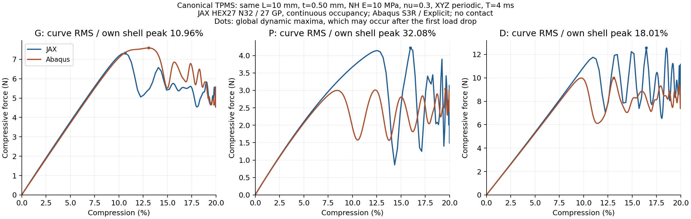

# G/P/D常见薄壁TPMS对照 r50

已具备成对提取数据：G, P, D。本批六个物理动态尝试已结束，下表仅覆盖实际提取的路径范围。

G初始差+0.95%、共同曲线差10.96%；P初始差+1.29%、共同曲线差32.08%；D初始差+1.70%、共同曲线差18.01%。初始匹配与大压缩全路径精度分别评价，曲线差的定义及实际覆盖见下表。

本批在固定厚度和物理条件下检验方法对常见构型的适用范围。JAX采用原C²连续占据显式入口，Abaqus采用同解析中面的S3R/Explicit（G/P三角重连差异见下文）；壳是工程参考，不是真值。

本批三组均完整到20%及保载。5%压缩同点反力差为G+2.11%、P+1.81%、D+1.60%；初始阶段一致性较好。G在首次明显降载时较早，P/D较晚，峰后振幅也不同；现有设置不能普遍满足约10%的全程目标。D保载时间均力仍高约18%，不能把另外两组末端接近外推全部构型。以上针对本批快速动态对照，不是实验真值或准静态认证。

## 对照图

[无惯性初始刚度图](initial_response.png) · [双方动能比例图](energy.png) · [逐点误差CSV](point_errors.csv)

| 构型 | 初始几何 | 全程及初始段放大 | 20%保载末态形变 |
| --- | --- | --- | --- |
| G | [中面](G/geometry.png) | [反力曲线](G/response.png) | [形变](G/deformation.png) |
| P | [中面](P/geometry.png) | [反力曲线](P/response.png) | [形变](P/deformation.png) |
| D | [中面](D/geometry.png) | [反力曲线](D/response.png) | [形变](D/deformation.png) |

## 计算结果

| 构型 | 初始K偏差 | JAX/壳覆盖 | 共同曲线RMS/匹配壳峰 | 共同功偏差 | JAX/壳墙钟分钟（含首启预留） |
| --- | ---: | --- | ---: | ---: | --- |
| G | +0.95% | 20.00% / 20.00% | 10.96% | -7.76% | 38.00 / 13.45 |
| P | +1.29% | 20.00% / 20.00% | 32.08% | +21.89% | 12.14 / 5.13 |
| D | +1.70% | 20.00% / 20.00% | 18.01% | +14.48% | 24.26 / 9.02 |

## 峰和数值诊断

| 构型 | 观察最大力位置 JAX/壳 | 峰力差 | 最小采样实体J | 回退块 | 末端动能比 JAX/壳 | 壳能量漂移/功 |
| --- | --- | ---: | ---: | ---: | --- | ---: |
| G | 10.64% / 13.06%（已观察内部峰） | -3.53% | 0.0818 | 3 | 2.77% / 9.78% | 2.24% |
| P | 15.97% / 19.60%（已观察内部峰） | +38.56% | 0.2845 | 0 | 10.00% / 3.59% | 1.51% |
| D | 16.45% / 13.09%（已观察内部峰） | +25.72% | 0.1380 | 2 | 7.03% / 2.21% | 3.13% |

上表位置是加载段观察全局最大力，峰后反弹可能超过首次降载前的峰，不能自动当作首屈曲点。P和D尤其需要区分：P图中壳约8–9%开始明显降载，JAX约12–13%；D壳约8–9%，JAX约10–11%。全局最大力可能出现在后段振荡。这里的区间是曲线图读数，未据此新设验收判据。

实体J为主要占据域采样点的局部体积比，正值是本批接受规则的一部分，不能证明全域无接触或每个时间步都无失效。低占据虚域的实际翻转数量与最小全域J保存在metrics.json；未夹断实际F/J。末端动能比例和壳能量漂移单列：完成动态路径与通过准静态/能量质量筛查不是同一结论，原checks全部保留。

RMS是共同压缩窗口内两条反力曲线差的均方根，单位N；百分比以该构型的壳加载段观察最大力为分母。部分壳路径不冒称完整峰。功是反力对宏观压缩位移的积分。保载均力统一在4.2–4.4 ms固定窗口按时间梯形积分除以窗长；原逐行均值附存metrics，不修改提取器原记录，短窗口均值不等于稳态反力。曲线比较采用保存历史的线性插值，观察峰位受历史输出间隔限制，未经临界应变收敛认证。相同厚度不代表相同用料量；三种构型不按反力大小直接排名。

## 输入和执行边界

中面使用文献常见三角函数近似（不是严格解析极小曲面），令X=2πx/L、Y=2πy/L、Z=2πz/L：G为sinX cosY+sinY cosZ+sinZ cosX；P为cosX+cosY+cosZ；D为cosX cosY cosZ−sinX sinY sinZ。三者等值均为0、相位为0，厚度按到周期中面的距离定义，不用同一隐函数阈值冒充恒厚。

L10 mm、t0.50 mm；NH E10 MPa/ν0.3、基材密度1e−9 tonne/mm³；XYZ周期、宏观横向应变零；双方4 ms五次平滑加载到20%，保载0.4 ms。JAX N32 HEX27/27点、HRZ，η1e−4、10–90%界面宽0.05 mm；占据固定于参考高斯材料点。无接触/塑性/质量缩放，Abaqus默认体积黏性明列，JAX无附加阻尼。

宏观XYZ周期关系一致，但平移固定点的具体实现不同：JAX在背景周期类(0,0,0)固定波动q=0；壳固定首个非从属实体节点u=0，G/P/D位置分别为(0,0,5)/(0,2.5,5)/(0,0,2.5) mm。两端不是完全相同的离散动力学；本批未单独量化这一差异的动态影响，不据此直接归因全部峰差。固定点从现有代码和实际输入核对，计算中未改动。

启动前选择复用r12已完成20%的adaptive显式路径，代替草案的state-step-control：后者带历史高KE硬停，与本批允许动态跳跃的范围不一致。原生产程序未改，有限回退下限仍为初始dt/16，实际F/J不夹断。此选择在任何新动态结果前冻结。

几何采用每轴64区间提取，属于中面三角化分辨率，不是N64背景求解。去除孤立顶点并按周期等价同步处理0.01 mm以内短边；所有保留顶点仍在解析零等值面，独立商空间拓扑闭合。D与切面的相切内部点不属于开边界接缝；接缝按实际开边界边和周期边角检查。准备阶段错误和修正保留在preparation_attempt*，未在这些尝试提交动态计算。

G壳首次启动出现极细三角形，稳定时间步约3e−10s，未形成有意义加载路径即停机。G/P随后保持原解析零面顶点、仅采用内蕴Delaunay重连，周期商空间闭合和定向均通过；D原网格未改。G/P两侧三角面不完全相同，双向全部面心抽样距离最大分别0.003849/0.001433 mm（非全局Hausdorff界）；原JAX距离/占据字段不重算。修复前后Standard初始刚度变化均小于0.01%，不是按动态结果拟合网格；初始刚度接近不证明失稳峰位对三角化扰动不敏感。G原ODB及首启记录保留，320s保守成本预留计入其25分钟总预算，新求解上限1080s；P/D求解1400s预留退出及提取。六个物理动态算例，其中G壳因前处理问题多一次启动。

初始启动曾把JAX平台限制为cuda，排除了CPU预处理；修正为cuda,cpu，复用三项已完成的Standard初始结果。environment_launch_attempt01记录零JAX Problem/零动态任务，不计作力学失败或额外动态算例。

## 结果文件

正式原始记录目录：`/home/xuehu/projects/tpms_jax/validation/canonical_tpms_20261009_r50`；Windows阅读副本：`output/r50_canonical_tpms_20261009`。原ODB在`E:/ABAQUS/2026temp/Abaqus_Work/tpms_jax_abaqus/`，当前动态目录为`canonical_tpms_20261009_r50_G_dynamic_quality`、`..._P_dynamic_quality`、`..._D_dynamic`；G首启原ODB保留在`..._G_dynamic`，不被覆盖。

- metrics.json：完整指标、峰/末端、能量、J、质量、停止原因。
- summary.csv、point_errors.csv：汇总和5/10/15/20%定点差。
- G/P/D各目录response.png/svg、deformation.png、geometry.png、几何审查及原结果。
- energy.png：双方动能比例，包含保载。
- protocol.json、batch_receipt.json、budget_summary.json：配置、启动记录和逐任务预算；六项累计动态预算记账约102.00 min，几何/初始检查另计。
- scientific_integrity.json：旧2243项记录、九项生产环境文件及原Word核对均未变。

这批曲线比较同时包含实体背景与壳运动学、占据几何、集中质量/耗散和动态分岔差异，不能把曲线差唯一归因于JAX程序或某一个因素；G/P初始复查也不证明峰区对微小三角化扰动不敏感。

约10%是探索性目标，不能只看平均误差忽略峰区差异。初始匹配不外推失稳/接触；未进行新设计AD或训练，原完整20%梯度限制保持。根据本批结果决定后续，不自动增加IWP、N64或调参扫描。
