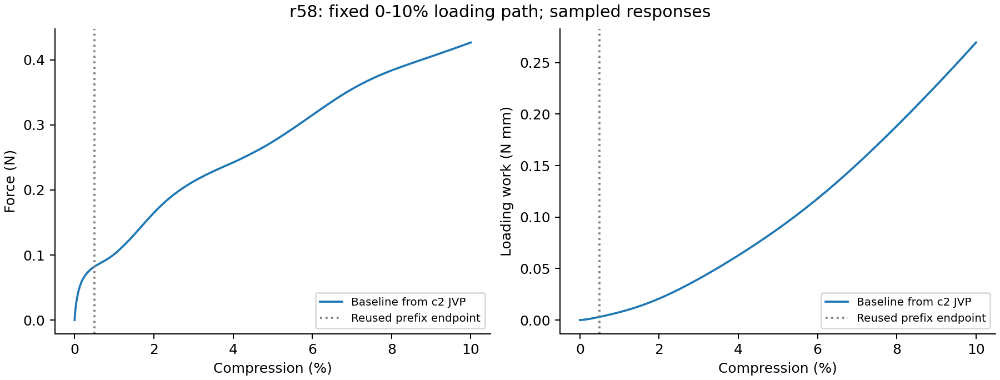
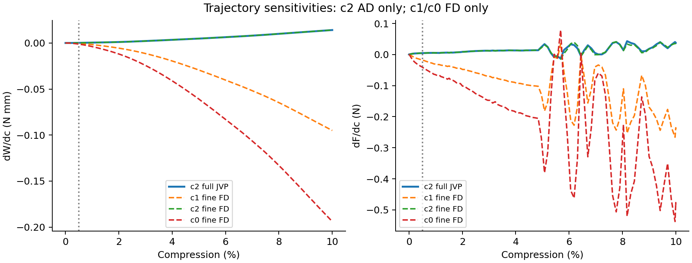
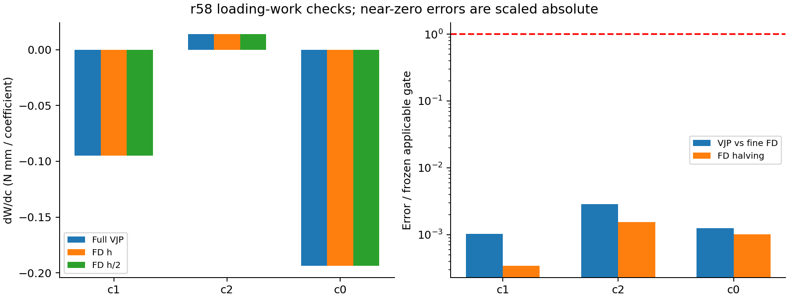

# r58：diverse_28真实方程系数0–10%梯度验证

**完整0–10%加载功三系数梯度通过。** Worker阶段：completed；汇总验收：True。阶段进行中时，缺少后续结果表示待完成，不记为失败。本脚本仅CPU读取和绘图，没有启动FEM、AD、FD或任何自动队列。

## 对象、完整链条与复用范围

曲面方程为f=c1 cosX cosZ+c2 sinX sinY sinZ+c0=0，X=2πx/L（Y、Z同理）。基线(c1,c2,c0)=(-3.4,4.6,2)，三个系数均无量纲。厚度0.5mm来自真实周期三角中面的距离，界面宽度0.05mm固定；函数值不是物理距离，c0不是厚度。三个原始坐标只有两个独立形态自由度：共同正比例缩放不改变零面。

复用受保护r57的0–0.5%实际几何FD终态、c2状态及切向、原始正向检查点和累计功。各FD沿自己的扰动状态继续，累计目标及其导数不清零。新增完整功VJP必须从10%反向经过全部新增块及原0–0.5%块，累积场伴随，再做一次初态和一次参数拉回；并非仅对0.5–10%增量求导。完整设计链条包含隐式几何根、三角面距离、占据、材料、质量、宏观惯性、端缘插值/面积、初始加速度、全部推进与目标。

仍为N32 HEX27/27点/HRZ、共享NH、共同中面端缘等效压板、XY周期和自由横向宏观伸缩；没有新增全壁面或自接触。终点10%，时间2ms，保持原20%/4ms加载曲线；总步数34485，前缀10113步，新增24372步。主步长5.79977453e-08s；末块实际步长5.74998434e-09s，汇总按各块dt逐段核对，不把末尾补齐步当成同一dt。

## 门槛、覆盖和独立核对

主目标W=∫F dδ（N·mm）：三个系数完整VJP，各核对±h及±h/2真实扰动FD；c2另做完整JVP。h=(3.4e−5,4.6e−5,2e−5)。非近零AD/细FD差与FD减半差均≤1%；|细FD|×参数尺度/目标尺度<1e−6时，改用≤1e−5的缩放绝对误差。参数尺度(3.4,4.6,2)，目标尺度功1N·mm、力1N。近零核对量不是百分比。

末端力只是辅助：c2有完整JVP及双档FD；c1/c0只有FD，没有力VJP。辅助力不通过不会自动改变预先限定的加载功门槛，也不能写作三个力梯度AD全部通过。c2完整功JVP门槛重新计算为True；完整力JVP为False。

本汇总逐一复核13条路径的complete、实际参数、原前缀逐行相等、块步数/时间、全部终态10%/2ms、检查点存在和完整前缀反向标志；独立重算VJP/FD、FD减半、JVP/FD及VJP/JVP并比对worker记录。保护文件96项，变更/缺失0项。短块对偶仅为先行检查，不代替完整路径。详细检查及每条路径原因见[metrics.json](metrics.json)。

## 数值结果

|系数|完整功VJP|功FD(h)|功FD(h/2)|AD/细FD核对量|FD减半核对量|近零|通过|
|---|---:|---:|---:|---:|---:|---|---|
|c1|-0.0950223341|-0.0950236263|-0.0950233038|1.02048625e-05|3.39418128e-06|False|True|
|c2|0.0140674098|0.0140675946|0.0140678106|2.84924466e-05|1.5354239e-05|False|True|
|c0|-0.193893011|-0.193897383|-0.193895424|1.24487146e-05|1.00999899e-05|False|True|

功导数单位N·mm/单位无量纲系数。非近零核对量0.01=1%；近零项用缩放绝对量。未计算AD在CSV中留空，不能解读为零。[完整数值与辅助力表](gradient_table.csv)。

c2功VJP/JVP核对量8.95267331e-14，通过True。共同缩放方向∇W·p=-1.36418654e-14N·mm，相对各项绝对值之和1.75894239e-14；此项仅诊断，不事后增加或放宽门槛。

- 辅助末端力c1：AD=未完成/未记录，细FD=-0.239063896N/单位系数，AD核对=None，FD减半=False。

- 辅助末端力c2：AD=0.0370744054，细FD=0.0306644713N/单位系数，AD核对=False，FD减半=False。

- 辅助末端力c0：AD=未完成/未记录，细FD=-0.483773122N/单位系数，AD核对=None，FD减半=False。

## 新增成本与失败记录

r57历史总墙钟143.550571min仅作为复用来源，未再次计入r58新增费用。r58新增c2 JVP延续32.8928499min，已完成FD延续累计206.202743min，新完整VJP反向102.190316min（包含重新反向旧前缀的实际新费用）。r58最终总墙钟345.597295min；预处理、编译、I/O等可能不在分项内，不能用分项和替代总墙钟。未完成时仅记录观察时距协议开始345.675296min，不冒充最终计算成本。总预算480min。新检查点1.732GiB，复用旧检查点0.714GiB。

已出现执行失败：未发现本轮failure.json。所有部分路径保留。若worker停止而反向未完成，不能把已有JVP或双档FD当作三系数完整VJP通过；不追加FD阶梯、不放宽门槛、不自动恢复计算。

## 解释边界与证据位置

通过只支持diverse_28该基线附近、此次固定0–10%离散动态路径的加载功设计梯度一致性。有限采样最小必要域J=0.854071347，不构成全过程正J证明；低占据实际负J不能被此量掩盖。几何导数依赖固定三角连接、同根分支和稳定端缘/最近三角面分区；不能推广到任意系数改变、拓扑改变或20%路径。固定路径AD不含接受/拒绝、减步及步数取整决策导数。

AD/FD通过验证同一离散模型的导数，不证明Abaqus或真实结构的敏感度、屈曲峰位或接触精度。三个有梯度的坐标不等于三个独立形态参数；有符号系数的梯度也不等于其绝对值的梯度。原r53失败及暂停状态保持，heartbeat、Abaqus、训练和Git继续暂停。

正式WSL：/home/xuehu/projects/tpms_jax/validation/equation_coefficients_10pct_20261013_r58；复用来源：/home/xuehu/projects/tpms_jax/validation/equation_coefficients_20261012_r57。协议/执行计划见../input，完整VJP见../AD/work_VJP_result.json，详细核对见metrics.json与gradient_table.csv。Windows output目录仅同步阅读证据和图片，不复制大数组或检查点。worker原始终态在worker_status_before_analysis.json保留；本汇总不更新项目导航。
