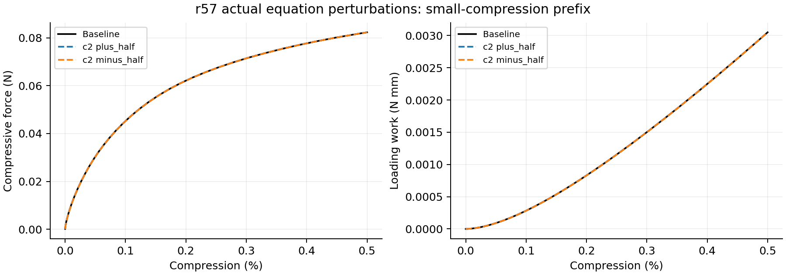
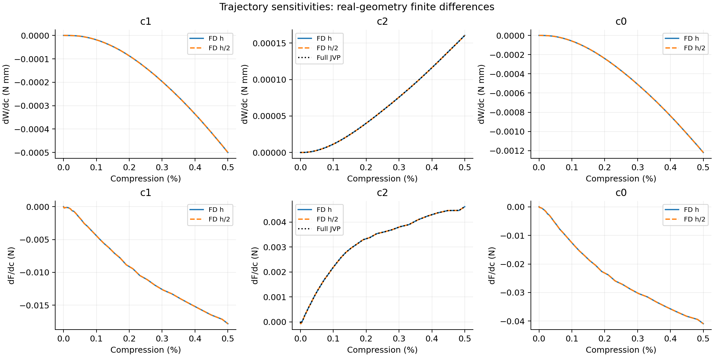
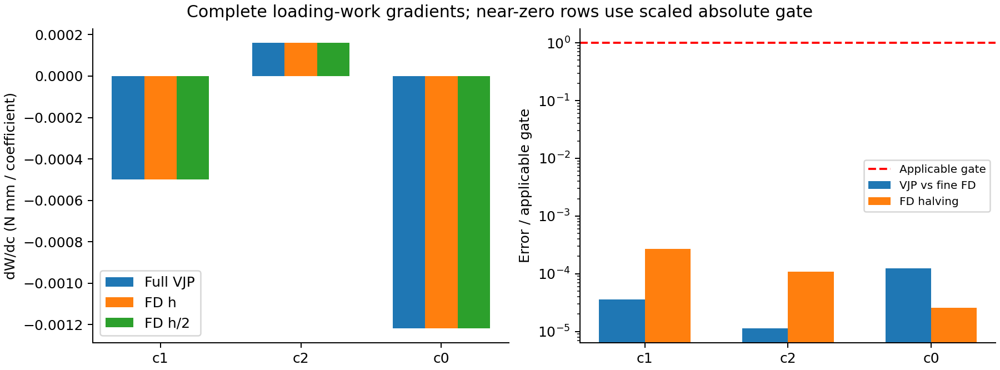

# r57：真实曲面方程系数梯度验证

**完整加载功三系数梯度通过。** 当前阶段：completed。本轮只测试diverse_28三个真实方程系数，原r53失败与暂停状态保持，不恢复heartbeat、Abaqus、训练或Git。

## 研究对象与求导范围

方程为 f=c1 cosX cosZ+c2 sinX sinY sinZ+c0=0，X=2πx/L（Y、Z同理）；基线(c1,c2,c0)=(-3.4,4.6,2.0)，均无量纲。c1和c2改变两种周期基函数的权重，c0改变零面的水平位置。厚度仍由到中面的真实三角面距离定义，固定0.5mm；界面宽度固定0.05mm。未把函数值当作真实距离，未把c0当作厚度。

三个原始系数只有两个独立形态自由度：把三个系数同时乘相同非零正数，零面不变。共同缩放是应为零的检查方向；不能把三个有梯度的坐标解释为三个独立结构参数。

原三角中面顶点先严格投影到f=0，最大移动约0.0042715mm；此新基线不同于原近似三角面，但未改变原r55文件。随后沿受边界约束的固定法向求局部非线性根，保持三角连接。隐式顶点导数进入三角面距离，再进入sigmoid占据、材料、质量、XY宏观惯性、移动中面端缘接触插值与面积、初始加速度及全部时间推进。真实FD从每个扰动的非线性几何和零初态重新运行，不以线性化几何代替FD。

加载为最新共同中面端缘等效压板、XY周期、横向宏观伸缩自由；N32 HEX27/27点/HRZ及共享NH材料与内力未改。无完整壁面或自接触。终点按短块成本事前从1%/0.5%选择，使用原20%/4ms加载曲线的前缀，未加快到新的加载率。

## 实际范围与门槛

冻结终点：0.5%；时间：0.5865312ms；步数：10113；固定步长：5.7997745e-08s。
完整目标是加载功W=∫F dδ，单位N·mm。对三个系数做完整VJP，并分别与±h、±h/2的实际几何全路径FD核对；c2额外做完整JVP。末端力F只对c2做AD核对，c1/c0只有FD。

非近零导数的AD/细FD差与FD减半差均需≤1%；当|细FD|×参数尺度/目标尺度<1e−6时用≤1e−5的缩放绝对误差。参数尺度(3.4,4.6,2)，目标尺度功为1N·mm、力为1N。近零项不能把缩放绝对误差叫相对百分比。

几何字段检查：True；短块JVP/VJP对偶相对误差：4.6432555e-08。短块通过不能代替完整路径。
完整FD路径已完成12/12；三系数完整功VJP：已完成。

## 系数结果

|系数|完整功VJP|功FD(h)|功FD(h/2)|AD/细FD核对量|FD减半核对量|通过|
|---|---:|---:|---:|---:|---:|---|
|c1|-0.00050003434|-0.00050003586|-0.00050003451|3.5466534e-07|2.6942477e-06|True|
|c2|0.00016043916|0.00016043897|0.00016043915|1.124467e-07|1.0769742e-06|True|
|c0|-0.0012190685|-0.0012190703|-0.00121907|1.2305839e-06|2.573654e-07|True|

功导数单位N·mm/单位系数。核对量为小数（非近零0.01=1%）；近零标志、辅助力导数、无量纲敏感度及原值详见[完整表](gradient_table.csv)。

c2完整功VJP/JVP核对量9.7919293e-13，通过：True。共同缩放方向∇W·p=-5.3776428e-17N·mm，相对各项绝对值之和为1.1028181e-14。

末端力辅助结果：

- c1：AD=未计算，细FD=-0.017833235N/单位系数；AD核对通过=None（None表示未做AD）。
- c2：AD=0.0046147311，细FD=0.0046145674N/单位系数；AD核对通过=True（None表示未做AD）。
- c0：AD=未计算，细FD=-0.040931864N/单位系数；AD核对通过=None（None表示未做AD）。

## 成本、失败与证据

完整JVP 13.628844min，12条FD累计85.25min，完整VJP 30.93751min；总墙钟143.55057min。总预算180min，从首次协议开始计，包括保存计划错误的时间。检查点占用0.714GiB；反向复用代表JVP的原始正向检查点，未另算基线。

首次在保存execution计划时出现字典自引用，发生于完整路径启动之前；原源码、日志、几何和短块结果保留在history/serialization_stop_before_full_paths。只修复复制字典并继续原预算，模型、FD步长和门槛未改。当前失败文件：无新的执行失败。

原科学文件保护检查：13项，变更0项；冻结r57执行源码变更0项。完整检查点步数/终态一致：True。数值采样中的最小必要域J=0.99246768，有限采样不等于全过程证明。

## 能得出什么，不能得出什么

若完整验收通过，证据支持本构型基线附近、此次小压缩固定推进路径下，对真实曲面方程系数的完整加载功设计梯度可正确回传。局部几何延拓只在固定三角连接、相同根分支、稳定最近端缘分区和背景面单元内成立；最近三角面切换仍会限制导数光滑性。小扰动不代表任意大幅系数变化或拓扑变化可导。

AD/FD核对验证的是同一离散动态模型的导数，不能单独证明它等于Abaqus或真实结构的敏感度，也不能推广到20%、屈曲跳跃、自接触或所有瞬时力目标。固定路径导数不含接受/拒绝、减步或步数取整决策的导数。负或正梯度表示增加该原始有符号系数时目标的局部增减，不能自动解释为增加该系数绝对值的效果。

正式源码、输入、大数组、原路径和检查点：WSL /home/xuehu/projects/tpms_jax/validation/equation_coefficients_20261012_r57。Windows为阅读副本；协议与执行输入在../input，详细数值在metrics.json。旧r53门槛和失败未改，不自动恢复其他计算。
