# r51近期研究完整过程记录

当前20%成对结果已另行完成，见[独立实验报告](experiments/midsurface_rim_20pct_20261010/README.md)。以下主体保留原短程调查发生时的文字、失败及建议；其中“尚未20%”指当时，不覆盖最新状态。

本文件保留2026-10-10各次实验的原有叙述、图片、失败和当时建议，按实际发生顺序阅读。历史“下一步”不是当前任务；请先看[当前结论总览](README.md)。原文逐字节备份见本批整理凭据，下面只调整入口说明与正式仓库中的相对链接。

# G薄壁单胞压板压缩：模型改进与首次短程对照 r51

更新：2026-10-10。本轮已经把双方模型改为压板传力、XY周期及自由横向宏观变形，并完成一组2%压缩和保载。**前向计算可以完成，短程对照还不够接近：加载曲线RMS差11.51%，末半保载平均力高18.47%。当前不能把压板模型宣布验证通过，也不能把这个差异直接归于JAX-FEM材料核。** 接触目前只覆盖初始两端切口；因此第4步完整20%没有启动。

## 本轮的物理问题

旧r50计算的是三向周期单胞，并固定宏观横向应变为零。本轮研究的是不同边界问题：10 mm高的单胞由上压板下移0.2 mm压缩，下压板固定，接触无摩擦，侧面仍周期对应，横向宽度可以随响应自行变化。这项改动是在向用户要求的压板压缩推进，不是重开旧r6至r49的全部误差扫描，也不是复现原F盘塑性、摩擦和原壁厚。

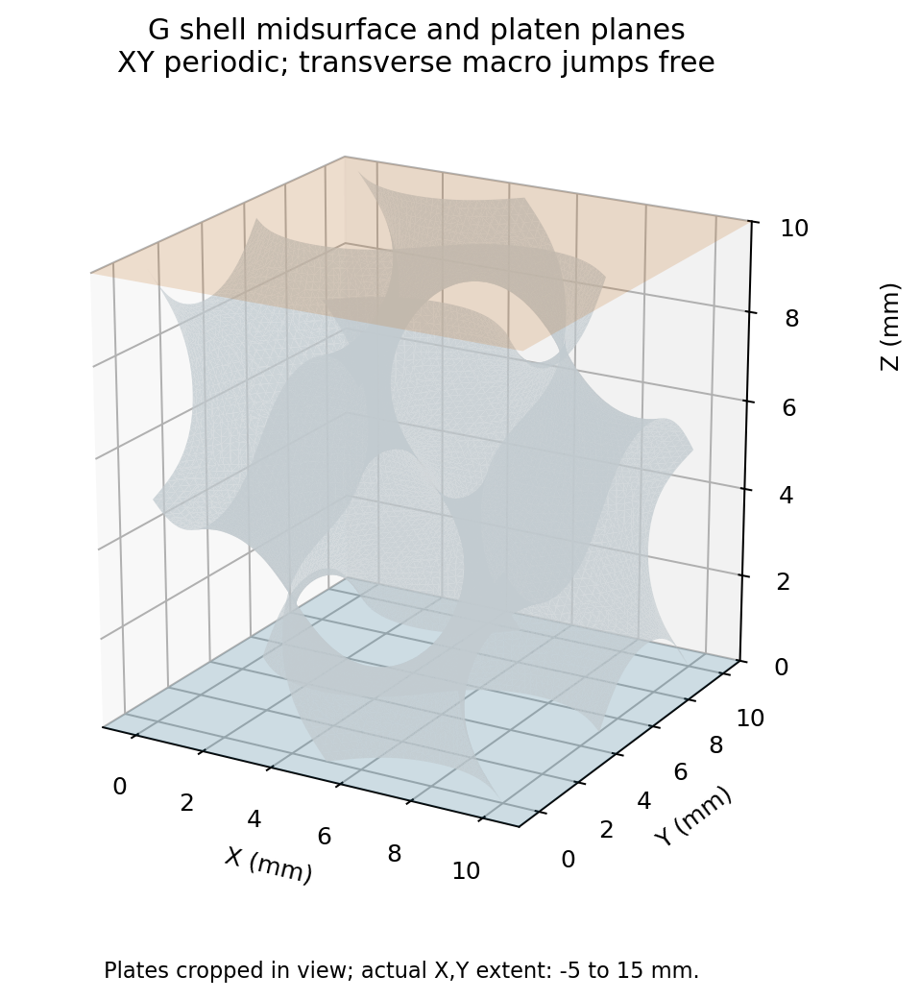

图中是实际G壳中面。为便于观察压板裁切显示；实际两块刚性方板的X/Y范围均为−5至15 mm，刚性参考点位于(5,5,0)和(5,5,10) mm。壳网格没有重新改变。

## 两端究竟改了什么

| 条件 | Abaqus | JAX端 |
| --- | --- | --- |
| 几何/材料 | r50 G中面，S3R，厚0.5 mm；NH E=10 MPa、ν=0.3 | 原G距离/占据缓存；N32 HEX27，每单元27积分点；相同基材 |
| 密度 | 1e−9 tonne/mm³ | 同一基材密度，继承原占据相关HRZ质量 |
| 软孔隙与界面 | 壳之外无填料 | η=1e−4、10–90%占据界面0.05 mm，objective_void/C²不改 |
| XY周期 | 重新生成341组独立节点关系、2046条平移/转动方程 | 合并XY等价节点，上下端独立 |
| 横向 | ax、ay为自由宏观位移跳量；宏观剪切零 | 同样自由，不预先规定泊松收缩；包含完整质量投影耦合 |
| 压缩 | 压板参考点U3从0平滑到−0.2 mm | 移动平面从Z=10到9.8 mm，靠法向接触传力 |
| 物理时间 | 1 ms加载＋0.2 ms保载 | 完全相同的秒数和五次平滑加载函数 |
| 初次接触定义 | 每端172个切口中面节点，与刚性板的罚接触 | 初始Z=0/10切面上的3×3面高斯积分，按占据φ加权 |
| 接触刚度 | Abaqus自动罚刚度 | kn=320 MPa/mm，启动前按10E/h确定，h=10/32 mm |
| 本轮未用 | 摩擦、自接触、质量缩放、壁节点额外固定点 | 同样未用；也没有将整个背景面绑定在压板上 |

壳的C10=1.923076923 MPa、D1=0.24 MPa⁻¹，对应上述E与ν。没有用壁厚、材料模量、η或阻尼拟合响应。

XY周期表示：X两侧对应点位移差为(ax,0,0)，Y两侧为(0,ay,0)。ax和ay是随求解变化的未知量，因此允许横向宏观膨胀；相应剪切跳量固定为零。Z方向不再周期配对，也没有原QZ控制量。侧面波动位移仍周期，XY方向的u_z差也为零。壳转角采用周期关系。

JAX中写成u=周期波动＋横向仿射位移。新增ax/ay后，原对角HRZ节点质量投影为BᵀMB，会出现宏观变量与波动变量的惯性耦合。本轮用Schur补求解这一投影质量，未猜一个额外的宏观点质量。显式推进使用velocity Verlet，材料残差继续调用共享JAX-FEM核。

端面接触只在穿透时传递法向压力p=kn·max(−g,0)，g为材料点与压板的法向间隙；分离时力为零。JAX接触势为∫φ·kn·max(−g,0)²/2 dA，力由相同离散势生成；接触权重没有η下限，所以不让软孔隙以实体接触面积传力。每端占据加权的参考接触面积约12.9999 mm²，而名义截面积仍为100 mm²。面面积在本原型中采用参考构形，不是更新后的实际面积。

**必须保留的模型差别：** 壳端缘节点接触没有有限厚度的接触外包络，但壳截面计算厚度仍为0.5 mm；JAX端是有分布宽度的连续占据截面，接触可在厚度截面内重新分布。因此两端截面传力、转动约束、接触离散和罚刚度并不完全等价。原G壳重连三角面与JAX距离面的小差别也保留。此次没有完整壁面接触或自接触，不能覆盖壁面后续折叠接触压板的所有情况。

## 先验证新增的基本机制

没有直接以TPMS的力接近与否代替程序验证。先做了投影质量代数检查和接触虚功检查，再计算一个可与解析小应变关系比较的均匀立方体。均匀检查N=2、压缩0.01%，不是当前TPMS的网格精度证明。

| 检查 | 结果 | 能支持的结论 |
| --- | ---: | --- |
| 稠密BᵀMB与Schur求解相对残差 | 2.51e−16 | 新增惯性耦合在此代数检查中一致 |
| 接触势有限差分与组装力的虚功差 | 3.94e−8 | 此接触离散的力与势一致 |
| 分离后接触力 | 0 | 原型允许分离，没有端面绑定 |
| 均匀实体保载反力相对E·A·ε | −0.721% | 基本压板传力与小应变解析解接近 |
| 均匀实体横向应变相对ν·ε | −0.627% | 横向变量确实可自由响应 |
| G壳最终XY平移/转角方程残差 | 1.86e−9 mm / 0 rad | 新节点关系正确执行 |

Abaqus datacheck通过，但保留了原网格4128个畸变单元警告；没有宣称网格质量被重新认证。Explicit同时提示contact pair未来弃用，以及刚性表面偏置不予执行；本输入两板没有设置非零偏置。位移边界警告为通用的跨步跳变提示，本轮只有一个平滑加载步。

## 成对短程结果：可以计算，尚未达到对照目标

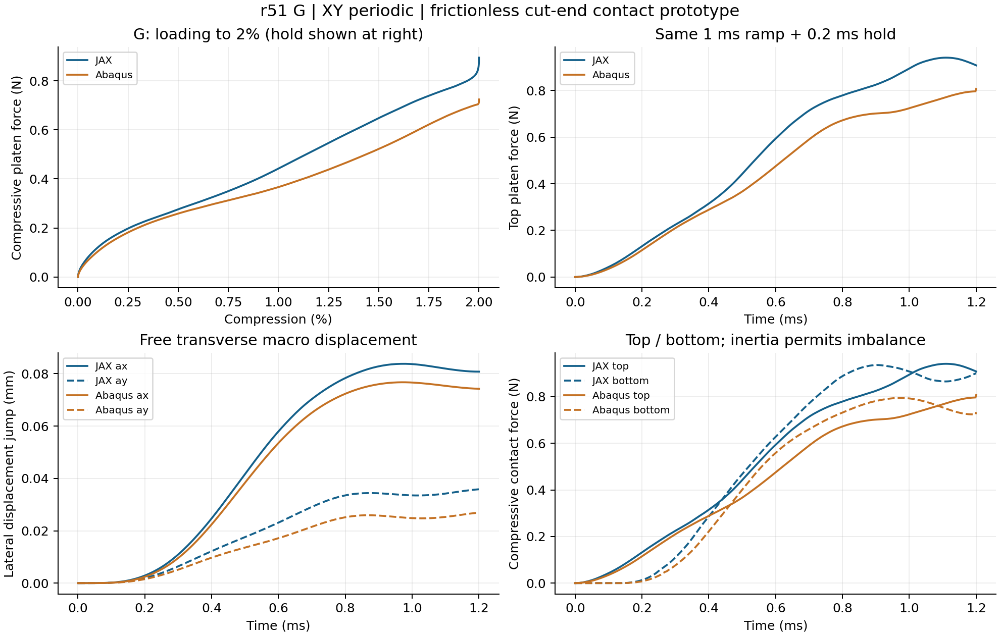

左上仅画0–2%加载，右上包含0.2 ms保载；原始响应没有滤波、力缩放或曲线平移。压缩量由压板位移除以初始10 mm高度定义，压缩力取上压板参考点反力的压缩正值。下端力单独显示；动态时两端不必每一时刻相等。

| 量 | JAX | Abaqus | 比较方法/结果 |
| --- | ---: | ---: | --- |
| 1%压缩时上端力 | 0.442219 N | 0.366708 N | JAX高20.59% |
| 2%加载终点力 | 0.894502 N | 0.724118 N | JAX高23.53% |
| 最后0.1 ms保载时间均力 | 0.930617 N | 0.785531 N | JAX高18.47% |
| 外功，保存反力–位移积分 | 0.091028 N·mm | 0.077025 N·mm | JAX高18.18% |
| 末态ax / ay | 0.080793 / 0.035861 mm | 0.074255 / 0.026927 mm | 都允许膨胀，但幅值未完全接近 |
| 动态任务墙钟 | 7.56 min | 4.42 min | 均满足本轮40/25 min停止线 |

加载RMS为：在0–2%压缩上取501个等间隔比较点，将力差平方平均后开方，再除以本次壳加载段最大力0.724118 N，结果11.51%。这是独立的新2%窗口，不能与旧r50的完整20%RMS直接排名。约10%是研究工作目标，本轮曲线和保载均力均未满足，不能改分母或只选末端点宣布通过。保载平均采用最后0.1 ms的时间积分均值；它仍是短时动态平均，不等于无惯性刚度或平衡解。

JAX从零完成10731步，初始及末端dt均约1.1183e−7 s，零拒绝块；实际需正J材料域在保存观察中的最小J约0.96996，无负J虚域点。Abaqus动态作业前处理与计算合计4.42 min，单独datacheck0.68 min；均匀JAX检查另用6.24 s。物理加载1 ms不等于墙钟1 ms，双方实际时间逻辑没有重新定义。

## 能量、穿透与接触覆盖限制

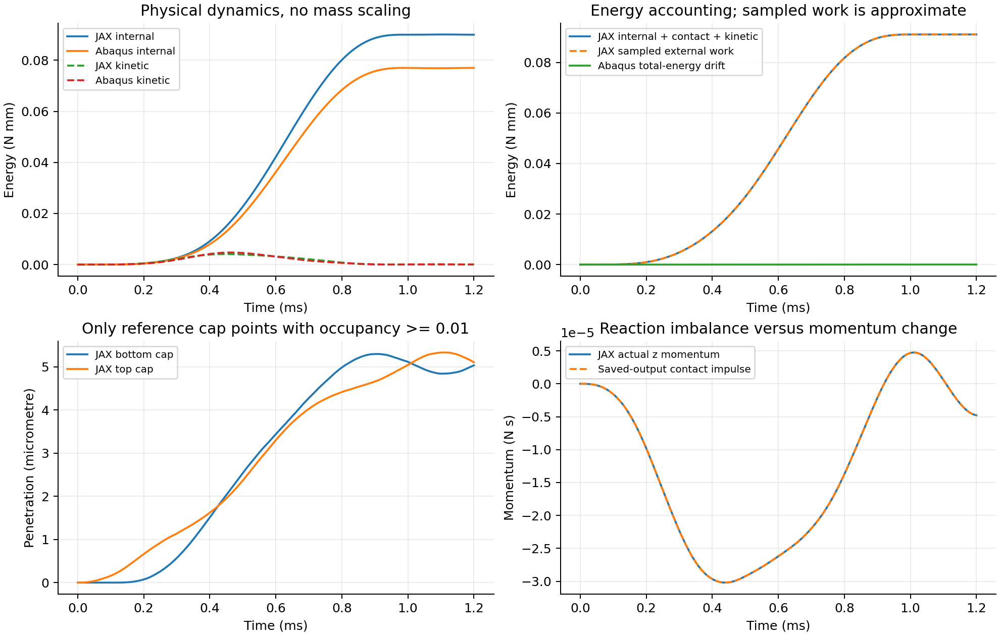

JAX总内能＋接触能＋动能与保存反力积分外功的最大相对差约0.00122%；保存接触冲量与动量变化的相对差约0.0209%。Abaqus总能量漂移相对外功约0.0325%，保存反力积分与ALLWK差约2.84e−7。这些检查未发现明显无解释能量增长或传力符号问题；保存输出的梯形积分不是每一步精确守恒认证，也不能证明两套模型完全一致。

末态JAX动能/内能约0.122%，壳约0.0162%；加载早期动能比例较高，不能仅凭末态低动能宣布整个路径准静态。

| 末态接触量 | 下端 | 上端 |
| --- | ---: | ---: |
| JAX占据加权平均穿透 | 0.0002165 mm | 0.0002183 mm |
| JAX φ≥0.01采样最大穿透 | 0.005033 mm | 0.005105 mm |
| JAX φ≥0.5采样最大穿透 | 0.001898 mm | 0.001929 mm |
| JAX φ≥0.9采样最大穿透 | 0.001269 mm | 0.001281 mm |
| 壳切口节点最大穿透 | 0.0001031 mm | 0.0001087 mm |

最大穿透与平均穿透代表不同的量，不能互换。JAX两端平均穿透之和约为压板总位移的0.22%，接触罚势约占外功1%；这些量没有显示平均法向接触柔度足以单独解释18.5%的力差。**这只是优先级判断，不是排除接触影响：有限壁厚截面的压力分布和弯矩约束，仍可能明显改变薄壁端部响应。** 壳中面端缘与有宽度实体端面在这方面不同。

纯末态后处理发现：φ≥0.01/0.5/0.9的体高斯采样点均未跑到板外；壳非端缘中面节点也未越过板面。这只说明本次保存末态未发现此类越界，不能证明全过程、连续域、壳厚度外包络或20%阶段没有漏接触。

## 当前判断及接下来的顺序

本轮证明：固定背景方法能够实现可分离无摩擦压板和自由横向周期的短程前向计算，新增投影惯性/接触传力具有基础证据；**尚未证明它在该压板边界下能相对准确替代Abaqus。** 目前能量记账较好，优先处理的是双方端部问题定义与截面传力的一致性，不能从“算通”跳到“验证通过”。由于同时改变了Z边界、横向宏观约束和传力方式，本轮也不能用来唯一解释旧XYZ误差。

本轮四步状态：①整理/输入/datacheck完成；②边界适配及基础验证完成；③G成对2%短程完成但对照未通过；④20%未启动。没有追加P/D、N64、材料扫描或训练。

后续建议保持三项顺序：

1. 先明确采用“理想切平实体截面”还是“壳厚度外包络”的压板接触定义，针对端部压力与转动约束做一个匹配诊断；同时核对自由宏观变量和质量响应，保持材料、厚度和体内占据场不变。不以调罚刚度、η或材料模量逼近壳曲线。
2. 接触几何及覆盖有共同依据后，先补齐全部可能碰板的材料壁面接触，再做一组G短程复算；先评估反力、横向位移、端部模式和穿透，避免直接批量长路径。
3. 短程合理后再按本来第4步进入G的20%及保载，提前明确自接触是否已需要和双方统一物理时间；之后才安排该模型的梯度验证。上述是下一阶段建议，不是已提交任务。

共享材料核仍由JAX构建，并不等于新增接触模型已保留有效设计总梯度。单边罚势在接触切换处不是全局光滑；占据接触权重、HRZ质量、投影质量及时间推进都需要纳入设计导数。本轮没有新设计AD或训练；原完整20%梯度失败记录保持。

## 文件与复现

正式位置：`/home/xuehu/projects/tpms_jax/validation/platen_xy_G_20261010_r51`，只有这一套实验工具和求解适配。

| 正式子目录 | 内容 |
| --- | --- |
| input/ | 冻结protocol.json、cut_face_contact.npz、原源文件哈希、启动规划 |
| tools/ | prepare、platen_model、run_jax、run_abaqus、extract_abaqus、analyze；均仅本轮用途 |
| checks/ | 输入审计、均匀解析验证、质量/虚功检查、实现与提取错误原记录、完整性核对 |
| abaqus/ | platen_2pct.inp、datacheck/solve/extract收据、提取响应/场 |
| jax/short_2pct/ | 实际dt/惯性参数、逐观察路径、末态、成本；完整0–2%＋保载 |
| analysis/ | 本说明、三图、两端原始响应CSV、metrics.json、末态覆盖审计 |

原生INP/ODB：`E:/ABAQUS/2026temp/Abaqus_Work/tpms_jax_abaqus/platen_xy_G_20261010_r51_2pct/platen.inp` 和同目录`platen.odb`。INP SHA256为`c31665438fc03919e3620c5fafaa8ebef5af83327b0adce240b49333cc3231e1`。

正式工具执行：WSL环境Python运行tools/run_jax.py；Windows环境Python运行tools/run_abaqus.py的datacheck/solve/extract子命令；只读analyze.py生成此图表。工具拒绝覆盖原输入/动态路径；若需新算例必须另建尝试位置，不能在本目录原位重跑。具体原命令及成本见收据和日志。

实现期有一次均匀检查在推进前因局部函数名冲突中止，改名后通过；首次ODB提取因NumPy布尔值不能序列化中止，修复只读提取器并加强产物验证后成功。均保留原脚本和失败记录，没有借此重算G模型。均匀检查后的动量输出曾补正单位因子，原值与修正凭据保留；G路径从启动即使用修正后的单位。

原生产/环境9项及r50冻结156项哈希核对零变化；原INP/ODB、论文、历史Word/PPT未搬动。Windows传输稿归档到history，Windows output仅保存本说明和阅读图表。未commit/push。

数据：[机器可读指标](analysis/metrics.json)、[JAX完整保存响应](analysis/jax_response.csv)、[Abaqus响应](analysis/abaqus_response.csv)、[末态接触覆盖](analysis/terminal_contact_coverage.json)。

接触定义依据：[Abaqus表面厚度与node-based接触说明](https://docs.software.vt.edu/abaqusv2025/English/SIMACAEITNRefMap/simaitn-c-surfacepropassign.htm)说明contact pair对node-based表面不考虑非零接触厚度，General Contact的厚度自动缩减不改变结构截面厚度；[Explicit接触约束算法](https://docs.software.vt.edu/abaqusv2025/English/SIMACAEITNRefMap/simaitn-c-expcontactconstraints.htm)解释罚接触与运动约束的关系。网页为2025公开理论说明，实际求解警告/输入由本机2026 datacheck和完整作业记录确认。

## 端部接触差异诊断补充 2026年10月10日

G的2%端部诊断显示：保持材料、占据、N32和HRZ不变，将JAX截面接触权重聚合到已有壳中面端缘后，加载RMS由11.51%降至0.21%、保载均力差由+18.47%降至0.39%。原截面接触T2ms成对RMS为10.77%、保载均力差为18.25%。这是本次端部接触作用位置及离散方式影响的强证据，不是新的物理压板模型或20%/梯度认证。三个新增动态任务均完成，当前无活动任务。

### 对照怎样构造

原JAX模型在有宽度的占据截面上积分压力；壳模型只使用每端172个中面端缘节点接触。诊断将原18432个端面积分点的占据面积权重，按最近壳端缘节点聚合为上下共344个接触点。JAX仍在原HEX27体积网格上计算材料变形和内力，通过Q2形函数在这些端缘位置求位移并分配接触力。体积Gauss占据、壁厚、材料核、HRZ质量、XY周期与自由横向宏观变量全部保持。两端接触总面积权重仍各为12.99988397 mm²，法向罚系数仍为320 MPa/mm；均匀压入时总接触刚度不变至舍入精度。

这有意改变了接触的作用位置和空间离散，让实体体积域承受中面端缘式的载荷。它是用于辨别原因的零宽接触诊断，不代表真实有厚度的切平端面，也没有让实体或整个背景面与压板绑定。最近节点选择和权重聚合没有得到设计梯度认证。

另一组成对诊断保留双方各自原接触定义，仅将加载时间从1 ms改成2 ms；目标仍2%，保载仍0.2 ms。Abaqus输入仅有加载时间与对应总步时间两处变化。没有调整厚度、模量、软孔隙、阻尼或曲线比例来拟合结果。

### 完整加载与保载结果

| 对照 | 加载RMS/原壳峰 | 加载RMS/匹配壳峰 | 2%终点力差 | 末0.1ms保载均力差 | 外功差 |
| --- | ---: | ---: | ---: | ---: | ---: |
| 原截面接触 T1ms | 11.51% | 11.51% | 23.53% | 18.47% | 18.18% |
| 端缘接触诊断 T1ms | 0.21% | 0.21% | -0.38% | 0.39% | -0.07% |
| 原截面接触 T2ms | 11.23% | 10.77% | 19.31% | 18.25% | 18.26% |

加载RMS在0–2%压缩上取501个等间隔点。原固定壳峰分母为0.7241182387 N；匹配壳峰分别来自同时间加载的壳曲线。两种分母都保留，避免通过换分母改善结论。终点力、保载均力和外功差均按JAX/Abaqus−1计算，正值表示JAX较高。保载均力是最后0.1 ms的时间积分平均，仍不是无惯性平衡解。外功由各自上压板反力沿位移积分，没有滤波、缩放或平移。

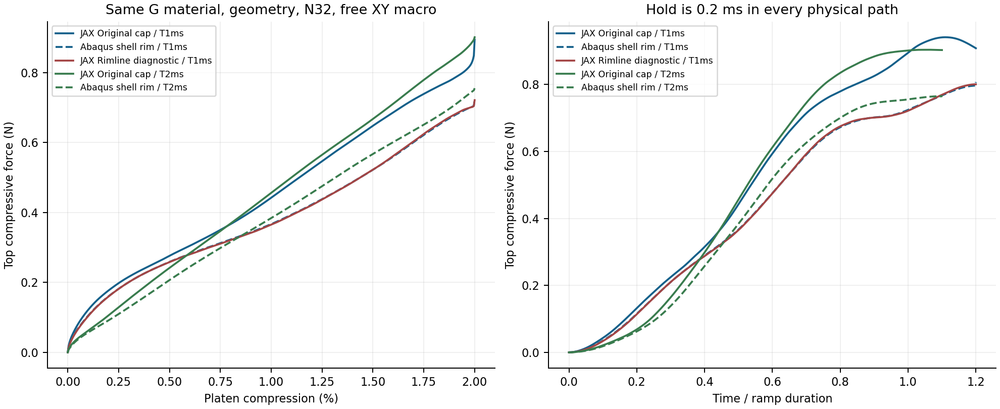

端缘诊断不仅反力接近：在18789个相同壳中面节点处插值JAX末态位移，不作刚体对齐或比例修正，位移向量RMS差除以壳位移向量RMS后，由8.97%降到2.25%；绝对位移向量RMS差由0.010139 mm降到0.002541 mm。末态横向跳量ax、ay仍有约几个百分点差异，因此没有宣称全部局部响应完全等价。

将双方加载时间都从1 ms延长到2 ms，没有消除原截面接触模型的偏差。 T2ms原截面接触的加载曲线RMS和保载均力见上表；时间影响不能与端部定义影响混为一项，也不能用单侧慢加载结果代替成对比较。

### 力学解释与可下的结论

原截面接触末态中，占据面积权重约38%正在承压，说明压力不是均匀铺在整个壁厚截面上。按最近壳端缘分组，当前构形力臂对应的局部力矩绝对值之和除以端面合力约为0.17 mm。这是诊断性等效长度，不是整个试样的净偏心，也不是直接求得的壳节点力矩。有限宽截面内压力重新分布能够抵抗端部转动；中面节点式接触不直接表达这种跨厚度的压力力矩。

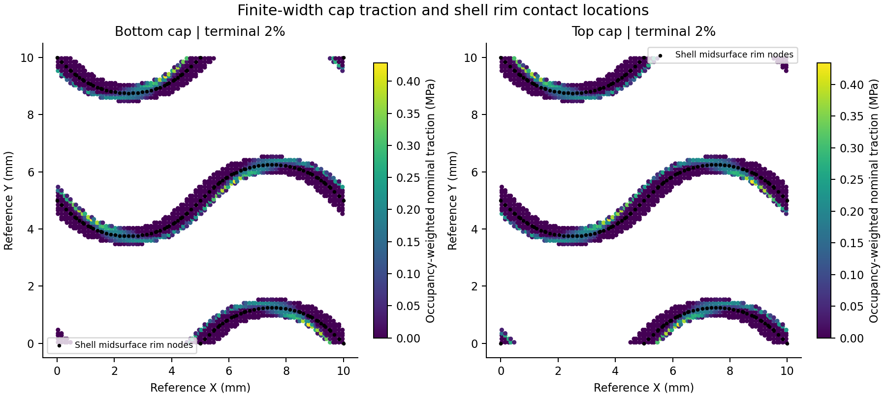

在共享材料、体积网格和质量完全保留的情况下，改变接触支撑位置使反力、功和变形场同时明显接近。这是本次G小压缩差异主要与端部接触建模有关的强证据，削弱了把本次约18%偏差直接解释为基材公式错误、密度错误或背景网格必然偏硬的判断。实验同时改变了接触力的空间支撑和压力离散，尚未单独分离局部力矩、接触集中化及离散质量的全部贡献。原diverse_04约5%初始偏硬及旧失稳峰位调查继续保持原结论。

Abaqus明确规定，node-based contact pair不考虑非零接触厚度，但壳截面计算厚度可以保持0.5 mm；[官方接触厚度说明](https://docs.software.vt.edu/abaqusv2025/English/SIMACAEITNRefMap/simaitn-c-surfacepropassign.htm)支持这一模型区别。壳中面端缘接触与切平的有限厚度实体端面，不能仅凭厚度参数相同就视为同一个接触问题。

### 数值状态和适用范围

端缘JAX耗时13.17 min，原截面T2ms JAX耗时13.02 min，T2ms Abaqus求解启动至结束5.51 min，另输入检查0.48 min。均在预定40/25 min预算内。两项JAX均零拒绝块，保存观察的需正J材料域最小实际J分别为0.957844和0.971328。端缘诊断的采样能量缺口/外功为0.000526%，采样动量缺口/峰动量为0.039834%；这些是保存输出上的诊断，不是逐步守恒认证。

集中到端缘后最高频率改变，按相同稳定步长估计规则，JAX步长从原1.1183e−7 s降为6.0371e−8 s。没有强行沿用旧步长，也未做独立时间步收敛试验。本轮没有补算压板无惯性初始刚度，没有完整壁面/自接触、20%新路径或新设计AD。端缘诊断不能直接升级为真实有限厚度压板替代结论；原有限宽模型的短程未通过状态保留。

下一步应先确定双方共同的物理端部几何和接触外包络，用简单薄壁端部检查跨厚度压力与转动，再回到G小压缩对照。共享材料核和N32保持；共同接触问题合理且短程通过后，才考虑完整20%。

正式工具仍仅在`/home/xuehu/projects/tpms_jax/validation/platen_xy_G_20261010_r51/tools`；新参数、状态和原始结果在同批`diagnostics/contact_origin_20261010`。T2ms原生INP/ODB为`E:/ABAQUS/2026temp/Abaqus_Work/tpms_jax_abaqus/platen_xy_G_20261010_r51_T2ms_diagnostic`。原r50、原r51结果、生产核和学习ZIP保留，未提交或合并Git。

## 历史小误差与当前压板差异的共同步长检验

2026年10月10日。当前G短程大偏差最有力的来源是端部接触作用区域及离散定义。历史diverse_28的成功结果成立，但其三向周期、横向宏观应变零、无压板接触，与当前G的XY周期、自由横向变形和单边压板接触不同。不能把这两个问题的误差直接当作同一算法退化，也不能用当前接触归因解释旧diverse_04的失稳峰差。

### 历史diverse_28实际达到的范围

原慢路径完整20%及保载：10%、15%、20%处反力分别高6.21%、6.58%、6.86%；全曲线均方根差为壳参考峰力的5.05%，外功差5.98%。原参考为该批记录中的Abaqus Standard壳，并非本次压板壳/Explicit。原数据见正式仓库validation/void_continuation_20261006_r12/T0p008_analysis/comparison.json；本轮只摘录来源与指标，没有重算或改写该证据。

同一G在r50无压板条件下，无惯性初始刚度差约0.95%，小压缩反力接近；当前压板的18%左右保载差并不支持把问题首先归结为G本身、材料模量、HEX27或N32必然不准确。边界变化本身不是两程序差异的解释：双方应求同一边界问题；当前切口端面和壳中面端缘的传力定义尚未统一，才是本轮直接证据支持的差异源。

### 本轮新增测试与结果

新增一条完整2%加0.2ms保载路径；半幅接触方案仅完成准备和稳定步长检查，没有动力曲线。材料、厚度0.5mm、体积分占据、HEX27 N32/27点、HRZ、XY自由宏观变量、kn320 MPa/mm、1ms加载均保持。无新Abaqus作业，复用原G压板壳2%参考；没有20%或新设计AD。

| 接触定义与步长 | 加载RMS/原壳加载最大力 | 2%时反力差 | 末半保载时间均力差 |
| --- | ---: | ---: | ---: |
| 原截面接触，原约112ns步长 | 约11.50% | +23.53% | +18.47% |
| 原截面接触，共同约60ns步长，本轮新增 | 11.50% | +23.53% | +18.47% |
| 壳中面端缘诊断，同一约60ns步长，前轮已有 | 0.21% | -0.38% | +0.39% |

此表本轮统一1001个压缩量采样点，反力差分母为对应壳反力；加载RMS分母固定0.7241182387N，保载时间窗1.1至1.2ms。上一轮501点RMS为11.51%，仅为采样口径的微小差别，两口径均保存在metrics.json。保载均值仍是动态时间平均，不是无惯性初始刚度。

新增共同步长路径用时13.01min、19878个接受步，零拒绝；共同名义步数19877，末端因浮点累计出现一次短分步，初始dt与原端缘诊断相同。加载曲线因步长缩小的最大变化仅为原壳峰力的0.0155%，保载均力相对原截面结果改变0.0023%。当前短程中，步长变化不足以解释接触诊断从18.47%到0.39%的改善。

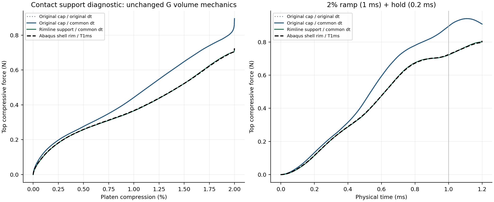

### 为什么有限宽切口与壳端缘会不同

实体端面有有限宽度；壳中面端缘在本次节点接触对中没有接触厚度。无摩擦只去掉切向接触力，有限宽端面上的竖向压力若偏向局部截面一侧，仍能形成相对于中面的弯矩，改变薄壁端部转动与弯曲。这是对现有结果的力学解释；现有实验同时改变接触支撑位置与空间离散，尚未把转动力矩、压力采样等贡献单独分离。

原截面每端占据加权面积约13.00mm²，统一压入时的罚刚度约4160N/mm；端缘诊断保留总权重与kn，统一压入的总力和能量相同，改变的是非均匀变形下的接触作用。因此，面积总量和穿透小并不能证明端部约束相同。原末态只约38%的占据加权端面在接触，压力并非均匀分布。

Abaqus文档明确，节点接触对不考虑非零接触厚度；General Contact则另有接触厚度、偏置及自动缩厚规则，接触厚度缩减不改变壳截面计算厚度。直接打开一般接触或增大接触厚度，未必就对应背景实体被z=0和10mm平面切断的几何；还要统一截断位置与初始间隙。[节点及壳接触厚度](https://docs.software.vt.edu/abaqusv2025/English/SIMACAEITNRefMap/simaitn-c-surfacepropassign.htm)，[壳接触对周边延伸](https://docs.software.vt.edu/abaqusv2025/English/SIMACAEITNRefMap/simaitn-c-contactpairsurfaces.htm)。这些为官方算法说明，实际运行版本为本机2026。

### 半幅接触映射为何停止

第二个诊断保持原权重，将接触点移至原截面点与其最近壳端缘节点的中间位置；此映射不是半厚度实体，也不是新的物理接触面。准备阶段估计允许dt约2.27ns，预设共同步长约60.37ns超过该估计，保护触发，未进行动力推进、未生成结果曲线。同一物理时长下的步数成本尺度粗估约增至27倍，未作超预算尝试。

几何复查显示，半幅映射有0.716%的接触权重被移到几何占据小于0.001的区域，原截面对应约0.0041%，端缘为零。弯曲非凸薄壁上，通往最近端缘节点的直线可穿过空隙。完全相同HRZ质量下的接触单独算子复核，半幅的0.3安全系数dt约2.270ns，与完整初始切线估计2.270ns一致，支持步长骤降来自该人工接触离散；这不是已算出的物理失稳或JAX-FEM整体失败。保护估计由同输入重新评估保存，原首次停止发生在写入input.json之前。

半幅方案放弃，不增加虚域质量、不调kn使其强行通过；其输入、能量虚功检查与停止记录全部保留。端缘诊断本身也仅是作用位置的对照，最近节点映射不提供有效形态AD。

### 改善顺序与研究判断

当前小压缩有接近的机会，已有端缘诊断及共同步长对照是直接证据；这支持继续背景有限元路线，但不证明有限厚度真实压板、任意构型或20%完整路径已准确。三维实体与壳的厚度方向假设、接触面几何与积分、自动罚刚度和动态惯性仍有区别；对当前18%差优先级最高的是端部物理定义，材料模量、厚度、η和全域N64不作为拟合手段。

下一次先以小型有限厚度薄壁端部实体基准统一平切几何、压板初始位置、压力与转动传递；再把通过的同物理定义用于G小压缩对照。若有限宽实体基准支持背景结果，壳端缘便不能作为该物理问题的唯一真值；若背景端部积分偏硬，再针对接触面切割、积分和压力离散改进。当前不越过短程门槛提交20%，不启动训练或新AD。原20%总导数失败与既有10%/15%厚度导数范围保持。

本轮正式数据：validation/platen_xy_G_20261010_r51/diagnostics/contact_support_control_20261010。input保存冻结协议、前字节和准备配方；jax/cap_common_dt为完成路径，jax/half_support_common_dt只有admission_failure；analysis保存统一曲线、CSV、位移与接触算子诊断、完整性检查。正式新增只读配方在本批tools/analyze_contact_control.py与probe_contact_support.py，沿用原求解器，未复制求解框架。原64项保护文件和G的3个源数组哈希一致；旧结果、INP/ODB及原学习包保持。

## 同实体端部基准：接触作用区域本身可显著改变反力

2026年10月10日新增两项Abaqus/Standard静力计算，均已完成0–2%压缩。这是局部倾斜薄壁机制试验，不是G构型，不替换G的XY周期及自由横向宏观变量，也不是JAX精度验证。结果进一步支持：当前G的主要差异线索是有限宽切口与壳中面端缘的接触定义，而不是首先改动材料或N32。

### 为什么这样做

前轮G诊断把JAX接触载荷聚合到壳中面端缘后，加载曲线RMS由11.51%降至0.21%，保载均力差由18.47%降至0.39%；共同60ns步长也未消除原截面模型的偏差。这说明接触作用位置重要，但仍同时涉及JAX和壳两种离散。本轮在同一个Abaqus实体模型中只改变接触节点的空间支撑，去掉跨软件、壳/实体材料运动学与动态惯性的混杂。

### 模型与唯一变量

局部试件高度10mm、法向壁厚0.5mm、挤出宽度1mm；中面x=5+0.2(z−5)，顶部与底部均由水平面切平。水平截面宽0.509902mm，保证真实法向厚度为0.5mm。采用同一套160个C3D20R二次实体单元、1343节点，厚度方向4层、高度40层、挤出方向1层；NH E=10MPa、ν=0.3，C10=1.9230769MPa、D1=0.24MPa⁻¹。

底部固支，全部节点U2=0形成挤出方向平面应变；上方水平刚性压板沿Z下移0.2mm，其余刚体自由度固定。两者均无摩擦、允许分离，采用Standard有限滑移节点—面硬接触；这一设置的默认约束执行方法为direct。使用NLGEOM静力增量求解，无惯性、质量缩放或自动稳定化。这里的1是静力伪时间，不是1秒动态加载。它与G的XY自由横向边界不同，只用于端部机制辨别。

全切口模型启用顶面全部23节点；中线模型只启用厚度中间一行3节点。两者节点、单元、材料、底部约束、压板、位移增量以及输出完全一致。已按INP内容逐行核对，去掉接触表面节点/面积记录后，其余记录完全相同。接触节点分摊的总面积均为0.509902mm²；在本次direct硬接触中，它不是用来拟合刚度的罚参数。中线接触有意不约束截面其余点，不是物理完整端面。

### 结果与解释

| 指标 | 有限宽全切口接触 | 仅中线接触 |
| --- | ---: | ---: |
| 2%压缩时压板反力 | 0.001141463N | 0.000915310N |
| 顶部截面转角 | −7.5841° | −6.9687° |
| 顶部中点横向位移 | 0.899667mm | 0.790656mm |
| 合力相对当前截面中点的X力臂 | −0.252886mm | 0mm |
| 所启用接触节点的最大穿透 | 保存坐标精度下为0 | 保存坐标精度下为0 |
| 整个实体切口的最大穿透 | 保存坐标精度下为0 | 0.031082mm |
| 全路径最大反力不平衡/各自末端力 | 2.93×10⁻⁷ | 3.82×10⁻⁷ |
| 末端内能与外功相对差 | 0.00977% | 0.00743% |
| 求解启动至结束墙钟时间 | 26.44s | 25.94s |

有限宽模型末端反力比中线模型高24.71%；全曲线RMS差为有限宽模型最大力的15.43%，外功高30.43%。RMS在0–2%压缩范围取201个等间隔点，未滤波或拟合；末端反力和外功百分比均以中线模型为分母。若反过来以有限宽模型为分母，中线末端力低19.81%。这些数值属于这个局部试件，不能转移为G的误差归因比例。

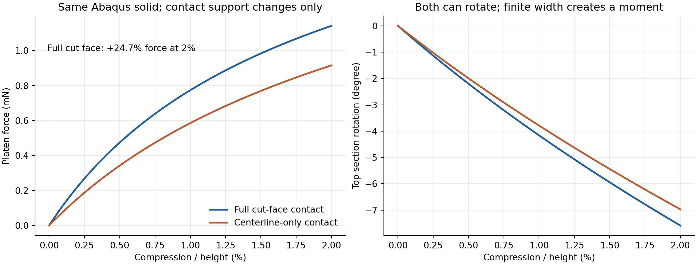

有限宽切口转动后，接触主要发生在一侧边缘。竖向法向力相对中面具有力臂，能够产生局部弯矩；无摩擦只消除切向力，并不消除这个压力力矩。中线接触仅在中面附近传力，未接触实体边缘可穿过压板0.031mm。因此，即便本构与厚度相同，两种接触也不是同一物理边界问题。原G有限宽接触与壳中面节点接触之间的差异有了独立的同求解器机制依据。

这里不能简单说全切口模型的末端转角一定更小：在相同压板位移下，全切口的中点也下移得更多，实际末端转角绝对值反而略大。以相同0.000915310N反力比较，有限宽模型约在1.320%压缩、转角−5.320°处达到该力，而中线模型要到2%、−6.969°。这与有限宽端部传力改变柔度一致，不等于把端部转角直接固定。

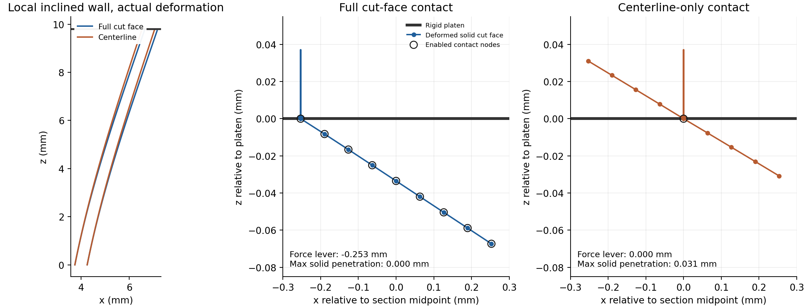

### 数值记录与适用边界

两项均完成53个静力增量、54个保存帧，未出现求解错误。contact normal force与压板RF的最大差约为末端力的10⁻⁷量级；接触力中心也与底部反力矩反推位置相符，末端差约10⁻⁶mm。Abaqus给出节点型表面切向基不随实体旋转的警告，已保存；本轮无摩擦且压板法向固定，不依靠切向牵引作机制结论。节点接触和二次表面仍有空间离散限制，未做接触网格收敛，不能据此认证准确的局部压力分布。

初次全切口datacheck因20节点连接表缺少续行逗号失败，尚未求解；已保留输入与失败收据，修正两份INP后在新目录检查通过。两项正式datacheck合计43.53s，求解合计52.38s，提取合计5.17s；加上首次失败检查13.78s，总计已记账启动约114.86s，不包含编写和绘图时间。它是输入格式修正，不是物理或数值失稳。连接表修改后的旧元数据哈希也已更正，修正前副本和记录保留；ODB和已提取科学结果未改写。

本轮新有限元任务只有这两项Abaqus静力基准，无新G动态路径或新JAX求解。原96项保护文件（含材料核、旧科学结果及前轮诊断）哈希一致。原G的有限宽短程对照仍未通过约10%目标；本轮不证明JAX有限宽接触准确，不证明20%或设计梯度，也不解释旧diverse_04的失稳峰位。

理论参照：[Abaqus/Standard接触约束执行方法](https://docs.software.vt.edu/abaqusv2025/English/SIMACAEITNRefMap/simaitn-c-contactconstraints.htm)与[Explicit节点接触厚度及一般接触的缩厚规则](https://docs.software.vt.edu/abaqusv2025/English/SIMACAEITNRefMap/simaitn-c-surfacepropassign.htm)。在线说明为2025版，实际求解器为本机2026。后者说明节点接触对不考虑非零厚度，不能只把壳截面厚度0.5mm写入输入就认为已经表达有限宽切口。

### 接下来如何改进

优先把当前材料核和有限宽接触表达式用于这个简单实体基准，与Abaqus相同平切端面比较，先辨别JAX接触积分、罚柔度及端部变形是否合理；再确定G双方共同的实体切口或具有明确转动传力的壳端部接触几何，做2%短程。不要仅靠把接触点聚合到中面、调厚度/模量/η或打开默认General Contact来追求曲线吻合。共同物理定义和短程通过后，再按既有门槛考虑较大压缩；目前不提交20%、全壁面/自接触或AD训练。

正式新数据在本批diagnostics/end_section_benchmark_20261010；input保存冻结协议、网格与失败记录，abaqus/cap、rim保存提取结果，analysis保存两图、路径CSV、metrics、日志摘录与完整性记录。两个原生INP/ODB分别在E:/ABAQUS/2026temp/Abaqus_Work/tpms_jax_abaqus/r51_end_section_benchmark_20261010_cap_v2与同根r51_end_section_benchmark_20261010_rim。新增提取与分析配方只在原r51 tools，未复制通用求解框架；run_abaqus仅增加可选提取脚本参数，原默认行为保持。Windows仅阅读图表，制作辅助脚本归档；未提交或合并Git。

## 对应JAX局部实体验证：相同有限宽端部时，反力与变形接近

2026年10月10日，新增两条JAX局部静力路径，均完成0–2%压缩。没有新增G动态或Abaqus作业，没有改动共享生产材料核。当前G压板成对模型仍双方采用显式动力学；本小基准与前轮Abaqus/Standard实体参考均采用无惯性的静力计算，专门检查有限宽端部的材料、接触和变形，不混入动态效应。

### 对应模型与剩余离散差别

沿用前轮10mm高、法向厚0.5mm、宽1mm、dx/dz=0.2的倾斜薄壁，顶部水平切平，底部固支、挤出方向U2=0，上压板下移0.2mm，无摩擦且可分离。这是局部保形实体，不是G，也不把其底部/平面应变条件用于G的XY自由横向模型。

JAX在相同4×1×40个砖块分区上采用HEX27，2187节点，每单元27个体积Gauss点；Abaqus原参考为160个C3D20R、1343节点。因此物理几何和网格分区相同，插值和积分并非完全相同。JAX直接复用DensityHyperelasticity共享材料/应力核，设全部体积占据ρ=1，原objective_void此时严格退化为同一NH实体材料；人工虚域扩展未参与。E=10MPa、ν=0.3、壁厚0.5mm均不调整。这个试验不验证连续占据、软孔隙或背景网格薄壁解析度。

接触采用与G相同的法向罚律：p=kn·max(−gap,0)，kn=320MPa/mm，参考端面积分；允许分离，切向力为零。组装通过现成JAX-FEM表面力接口，不是G显式批处理入口的逐行重放。Abaqus实体参考采用direct硬接触；罚接触柔度与两种实体单元的差异仍明列，没有称作完全同离散。上下文中的“对应”指同一有限宽平切物理端部及其加载。

两条JAX路径只改变端面采样位置和面积权重：节点方案使用原Abaqus顶面的23个节点位置，每节点总分摊面积与其一致；跨单元重复节点的权重均分，零权重的新增Q2面中心不参与。高斯方案使用每个顶面3×3点，共36个积分点，直接保留库的参考面积权重。两个方案总面积均为0.5099019514mm²。没有改变体积网格、材料、底部边界、罚系数或加载增量。

复用已安装JAX-FEM Newton及SciPy稀疏直接求解器，每条40个0.005mm位移增量；原每增量最多15次Newton修正保护保持，没有追加失败迭代。残差绝对容限1e−10N，实际J不夹断。单项内部850s预算、外层900s硬停止，实际仅几十秒。程序计时含建模、编译、求解和保存，不含启动至模块导入完成的数秒。

### 总反力、转动、位移和功的对照

| 指标 | JAX对应节点接触 | JAX端面高斯接触 |
| --- | ---: | ---: |
| 2%总压缩力 | 0.001141243N | 0.001127261N |
| 对Abaqus有限宽实体末端力差 | −0.0193% | −1.2442% |
| 曲线RMS/固定Abaqus最大力 | 0.0261% | 0.9989% |
| 上压板反力—位移外功差 | −0.0407% | −1.5216% |
| 同位置实体节点位移向量RMS差 | 0.0002122mm | 0.0037004mm |
| 位移RMS差/参考位移RMS | 0.0463% | 0.8081% |
| 末端截面转角 | −7.5709° | −7.5528° |
| 当前截面合力力臂 | −0.252874mm | −0.238585mm |
| 保存状态最小实际J | 0.993759 | 0.993817 |
| 最大自由残差L2 | 3.29e−11N | 9.30e−11N |
| 程序计时 | 33.65s | 40.33s |

参考Abaqus有限宽端面末端力0.001141463N、转角−7.5841°、力臂−0.252886mm。JAX力为全部上压板接触力之和，Abaqus为上压板RP总反力；压缩量取压板下移/10mm。曲线在0–2%取201个等间隔点，分母固定为Abaqus有限宽最大力0.001141463N；末端和功差均为JAX/Abaqus−1。外功由双方各自RF—位移保存路径梯形积分，未将JAX接触能遗漏后冒充总能量。两种保存步距不同，线性插值后的差值图有极小锯齿，不代表动力振荡。

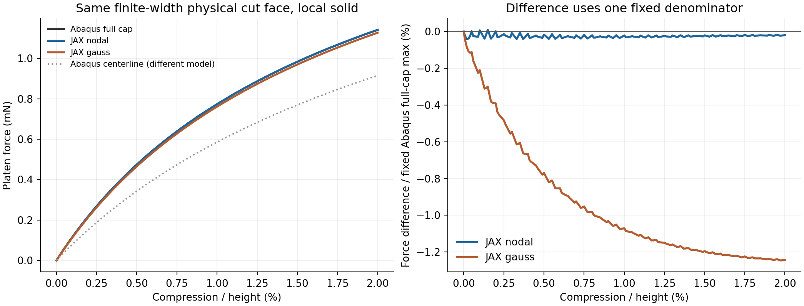

反力接近之外，末端位移在Abaqus原1343个相同物理节点位置逐点比较，不做刚体配准或比例修正。位移向量RMS差分别仅为参考RMS的0.0463%和0.8081%，端部转角也接近。两条都通过启动前定义的局部工作门槛：末端力差和曲线RMS均≤5%，实际J为正，自由残差≤2e−9N。这是限定问题的前向验证，不是工业认证或网格收敛证明。

### 端面高斯积分还有什么限制

节点方案接触点与全部顶部节点的最大穿透均约0.000104mm；高斯方案有效接触点最大穿透约0.0000995mm，但全部顶部节点最大穿透为0.001957mm，即约1.96微米。这是因为Gauss点位于单元面内部，最外侧接触边缘没有直接采样；其压力合力相对中面的力臂也比节点方案少约0.0143mm。两者差异不能都归为罚刚度。未进行独立的接触积分收敛或罚系数扫描，不能量化两部分的精确比例。

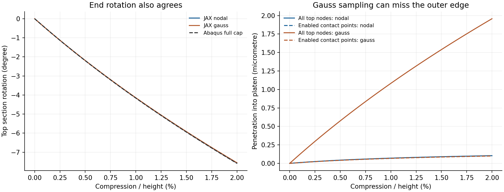

两方案的最大静力反力不平衡/各自末端力为2.48e−11和1.11e−10；末端梯形外功与实体内能＋罚接触能的差约−0.0141%和−0.0139%，属于保存步距下的功积分检查，不称逐步严格能量守恒。实际J在全部实体积分点保持为正；这仍不是连续空间全域无自交认证。本轮没有动力质量、HRZ、投影惯性、全壁面接触或设计梯度试验。

### 对G模型改进的含义与下一执行点

本轮进一步削弱了“共享材料核或有限宽法向罚接触普遍导致约18%偏硬”的解释：在这个简单的共同有限宽实体问题上，JAX与Abaqus的力、变形和转动可以同时接近。高斯方案与节点方案的末端力仅差约1.23%，也不足以直接解释前轮G的18%保载差。但这不能外推到G：局部基准保形且ρ=1，没有其背景薄壁占据和低质量软域，静力也排除了显式惯性差异。

联合此前G端缘诊断和共同步长结果，当前优先级仍是统一双方端部接触的物理作用区域与转动传力。不要通过降低厚度、模量、η或阻尼去追壳曲线，也不把人工中线接触的吻合直接升级为有限厚度真实压板方案。下一次先确定并检验有限厚度切口与壳端缘共同的接触外包络、初始间隙和力矩传递，再回到G的2%显式成对路径；不能仅打开默认General Contact就假定完成统一。短程传力合理后才考虑较大压缩。

本轮新增仅两条局部JAX静力路径，均从零完成2%，无新增Abaqus作业或G动态。原G短程未过、原完整20%与梯度边界全部保持。112项旧生产/科学记录保护哈希一致，当前无活动任务。正式数据沿用同一批diagnostics/end_section_benchmark_20261010：input/jax_protocol.json为冻结条件，jax/nodal与jax/gauss为输入、接触数组、路径及场，analysis/jax_comparison为图表、CSV、指标和完整性记录。新代码仅本批tools/run_end_section_jax.py与analyze_end_section_jax.py，不新建通用求解框架；Windows只保留阅读副本和归档制作配方，未提交或合并Git。

## G有限宽端部对齐尝试：运动验证通过，显式周期约束实现尚未通过

2026年10月10日本轮继续端部原因研究，保留原JAX N32/HEX27、占据、材料核、HRZ及原2%路径。**完成两项小型显式探针；三版G输入均通过datacheck，但都在显式约束打包阶段停止，没有开始时间推进、没有新G反力曲线。** 本轮不能报告G误差已经降低或有限厚度压板已验证，原保载均力差18.47%状态不变。新的保存态几何检查进一步支持有限厚度端部的重要性，也发现简单刚体臂本身不是足够完整的实体截面近似。

### 试验要辨别什么，怎样保留共同条件

此前让JAX载荷集中到壳中面端缘后反力接近，但中面接触不能代表有宽度的切口。因此本轮反向构造诊断：保留JAX原有限宽接触点，在壳端缘增加仅用于接触的无质量辅助点，让这些点跟随附近壳节点的平移和转动，把法向力及其力臂形成的弯矩传回壳。各壳节点有独立局部接触点组，没有把整个端面连成一块刚板，没有把壳单元改为刚性，也没有固定壳端部转角。

用x_c=x_s+u_s+R_s r表示接触点位置，r是参考接触点相对壳节点的力臂，R_s是壳转动。接触力向壳节点传递合力f和力矩r_current×f；随机虚功检查相对差1.85e−16。使用原端面占据面积权重，保留φ≥1e−10的4976个点，省略的数值尾部面积仅占2.77e−12，每端参考面积仍为12.99988397mm²。原壳网格、材料、厚度、密度、2046条XY方程、自由ax/ay、压板位置和1ms加载＋0.2ms保载均核对保留。

一个容易误设的单位细节是：[Abaqus/Explicit节点型接触对说明](https://docs.software.vt.edu/abaqusv2025/English/SIMACAEMODRefMap/simamod-c-nodebasedsurf.htm)规定，其接触计算面积恒为1，不能依赖节点表面记录中的面积去乘压力。因此本轮把JAX的kn=320MPa/mm与每点面积A_i相乘，直接写成每点力—穿透刚度k_i=kn A_i，单位N/mm。为控制输入规模，刚度保留6位有效数字：最大逐点相对舍入4.45e−6，总刚度相对变化约−7.76e−8。没有按曲线选罚刚度。

本轮另显式设置接触阻尼为零，与JAX法向势一致；[官方接触阻尼说明](https://docs.software.vt.edu/abaqusv2025/English/SIMACAEKEYRefMap/simakey-r-contactdamping.htm)给出的原罚接触默认临界阻尼比例是0.03。因此相对原壳输入，这个诊断包同时改变接触支撑、力矩传递、明确的罚律与接触阻尼，不能把潜在曲线改善全部唯一归为一个因素。没有改厚度、模量、η、体内占据或JAX质量去拟合参考。

### 两项显式运动探针通过，三项G启动在推进前停止

小探针在一个壳节点规定平移−0.01mm、转角0.1rad，接触点初始偏置0.25mm；解析末态高度为−0.01−0.25sin(0.1)mm，刚度2N/mm，对应力0.06991671N。它验证偏置点的有限转动和力的单位，不是新的G精度验证。

| 计算 | 求解启动至结束 | 实际状态 |
| --- | ---: | --- |
| BEAM MPC显式探针 | 27.78s | 完整1.2ms；位置误差1.77e−8mm，反力相对误差约−5.05e−7 |
| 局部刚体组显式探针 | 27.66s | 完整1.2ms；位置误差9.67e−10mm，反力相对误差2.77e−8 |
| G：BEAM MPC＋周期像参考节点 | 25.88s | 打包停止，4050变量的大约束系统，无时间推进 |
| G：局部刚体组＋周期像参考节点 | 36.00s | 同类打包停止，4050变量，无时间推进 |
| G：周期像折回、去掉参考节点链 | 35.25s | 同类打包停止，4002变量，无时间推进 |

三版G都不是材料失效、显式发散或20%失稳；datacheck还不包含全部显式打包保护。最后一版仅利用水平无摩擦平面对XY平移的不变性，把周期像接触点折回，初始法向间隙和局部力臂严格保留，没有删掉原XY周期关系。失败ODB的触发集合主要包含原壳周期边界节点和两个自由横向控制点。去掉周期像参考节点没有消除问题，不能把全部困难归于那53个参考点；新增转动传力与原自由周期约束的耦合仍是实现障碍。

[Abaqus约束计算成本说明](https://docs.software.vt.edu/abaqusv2025/English/SIMACAECSTRefMap/simacst-c-constraintenforce.htm)指出，显式时间积分中的重叠运动约束仍可能需要隐式方程组。求解器因预估性能严重下降而停止，本轮没有把这项错误改为warning强行运行。两种局部运动表达的通过，也不能证明它们与G的全部周期方程组合后可高效推进。

首次探针只读提取曾把底板反力符号写反，导致检查布尔值为false；已按底板压缩正值RF3修正，保留原提取结果、原工具与修正凭据。没有重算或改动探针输入。全部5项datacheck合计约149.78s；5项求解启动合计约152.56s，其中三项仅到打包停止。两次收据提取约0.81s，合计约5.05min，不含编写、保存态提取和绘图。没有新JAX动态任务。

### 原保存态说明了什么：中面端缘并没有约束整个厚度截面

为继续辨别物理原因，只读提取原G壳ODB的末态位移和转角，把原有限宽接触采样点按上述局部刚体关系重建。下表是相同2%＋保载末态的**几何重放**，没有重新求平衡，也没有形成新压缩曲线。φ表示接触点处的材料占据，φ≥0.5偏向主要实体；φ≥0.01还包含部分过渡区。

| 上端几何量 | 原壳状态上的有限宽重建 | 原JAX实际有限宽端面 |
| --- | ---: | ---: |
| φ≥0.5采样最大越过板面 | 0.023448mm，约23.45微米 | 0.001929mm，约1.93微米 |
| φ≥0.01采样最大越过板面 | 0.027369mm | 0.005105mm |
| 占据面积加权平均越过板面 | 0.004493mm | 0.000218mm |
| 承压方向的占据面积比例 | 50.37% | 37.50% |

原壳中面端缘自身的最大穿透只有约0.000109mm，但端缘转动后，有限宽重建截面的外侧点会更明显地越过压板。壳端缘最大转角约4.52°。这与此前同实体局部基准中“中线接触允许实体边缘穿透”的机制一致，支持两种端部定义尚不相同。它没有量化真实有限宽壳模型重新求解后的反力，更不能把23.45/1.93这个比值称为力学误差。

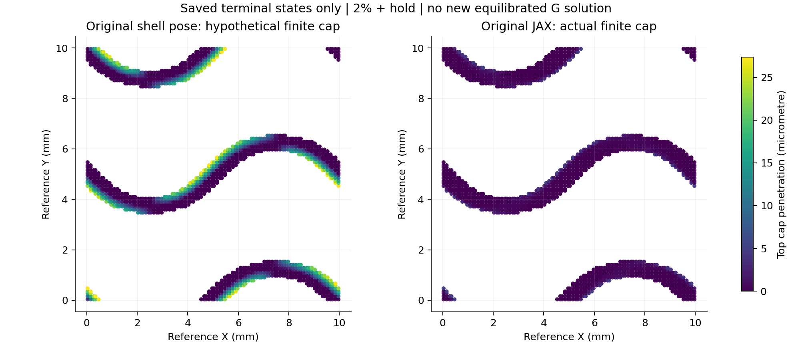

CSV还保存了在冻结几何上套用罚律得到的载荷需求，例如上端约18.69N。这个数不是原壳反力，也不是新模型的预测反力：若真的增加这些接触，结构会重新变形，不能把未重新平衡的罚力作为压缩响应。原JAX实际端面重建的力则与其已保存反力一致到约1.4e−10相对差，仅用于检查后处理单位与插值。

### 另一个发现：简单刚体臂也不能直接代替实体截面变形

在原JAX状态中，于相同壳端缘位置插值Q2变形梯度，取其极分解转动重建刚体端面，再与真实Q2端面位置比较。面积加权Z差的RMS约0.000734mm，即0.734微米；主要实体采样最大差约0.003784mm。这个差比原JAX上端平均接触穿透0.218微米还大，说明对高罚刚度接触而言，微米级截面位置差也值得处理。

极分解转动不是独立求得的壳转角，差异可能包括截面伸缩、剪切/翘曲、最近节点近似和曲面离散，不能把0.734微米全归为某个唯一因素。它足以说明：只把接触点刚性挂到最近壳节点，即使绕过打包困难，也不能直接声称与三维实体截面完全等价。

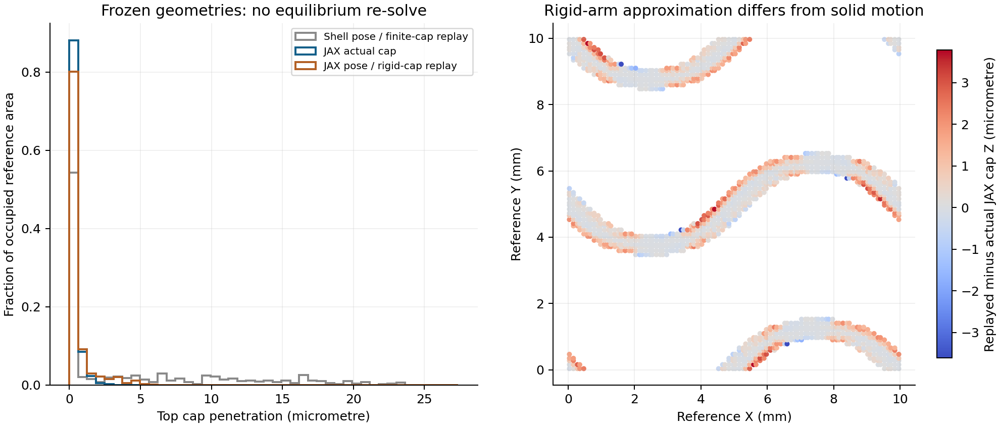

### 研究判断、当前停止点与后续顺序

本轮增加了端部几何证据，但没有新增G前向对照通过证据。共享材料核在局部同实体问题上接近Abaqus的结论保持；G背景域、离散质量、完整壁面/自接触和梯度范围没有扩大。当前更合理的解释仍是优先处理接触作用区域及截面传力，不能据此宣称JAX已没有任何实质问题或所有18%差异都已唯一解释。

**本轮不再追加这种大量辅助转动约束的G尝试。** 下一步先在小型薄壁端部基准上选出能保留截面变形、且与自由XY周期兼容的简洁接触表达。需要比较壳厚度外包络时，要先核对切平端部、初始间隙及厚度缩减；打开默认General Contact不能直接称统一。若采用Abaqus/Standard静力机制检查，应成对定义同一端部并单独报告，不把静力曲线与JAX动态结果混作成对显式验收。局部表达有依据后，再回G做2%显式短程；目前没有提交20%或新设计AD。

正式数据：validation/platen_xy_G_20261010_r51/diagnostics/shell_cap_arm_20261010。input保存三版冻结条件、接触映射、原壳保存态、前字节与修正凭据；abaqus保存两探针与三版G的收据和日志摘录；analysis保存本轮指标、CSV和两图。三版G的原生INP/失败ODB分别位于E盘原根的r51_G_cap_arm_20261010、r51_G_cap_rigid_20261010、r51_G_cap_wrapped_20261010，原成功G的INP/ODB保持原位。未执行的G提取/比较配方移入input/unexecuted_tools，不留作活动求解入口。Windows只有阅读图表和归档制作配方。

## 原生壳厚度接触筛选：不能直接替代平切实体端面

本轮的进展是进一步明确了**正在比较的端部并非同一个有限厚度物体**，而不是发现JAX材料核存在新的错误。完成三项小型Abaqus/Explicit指定运动探针，以及已有G保存态的只读分析；没有新增G变形路径、20%或设计梯度计算。三项探针全部正常计算结束，但共同平切端部的几何门槛均未通过，因此不采用这些设置作为G新生产接触。

### 为什么检查原生壳接触

前轮辅助刚臂能传力和力矩，但在自由XY周期G中触发大型约束系统保护；不继续堆叠MPC或关闭保护。本轮检查是否可直接使用原生壳接触，保留壳截面自由度而避免辅助节点约束。官方算法说明指出：General Contact会调整接触厚度及壳边缘位置；取消缩减又可能形成壳边缘的圆钝外延，通常称为“牛鼻”。壳截面计算厚度与接触算法厚度必须分开理解。

这里引用[原生接触表面说明](https://docs.software.vt.edu/abaqusv2025/English/SIMACAEITNRefMap/simaitn-c-contactgeneral.htm)、[厚度与边缘控制说明](https://docs.software.vt.edu/abaqusv2025/English/SIMACAEITNRefMap/simaitn-c-contactcontrolsassign.htm)、[接触表面属性](https://docs.software.vt.edu/abaqusv2025/English/SIMACAEITNRefMap/simaitn-c-surfacepropassign.htm)。公开2025文档用于算法依据，下面输入实际由本机Abaqus 2026运行验证。

**这项自动缩厚不是原G的18.47%差异的新归因。** 原G采用的是零厚度的节点端缘接触对；本轮General Contact只是筛选一种可能的改进表达，不能倒过来声称原模型已用了它。

### 三个探针的受控定义及结果

1 mm×1 mm竖直壳片，S3R、厚0.5 mm，81节点/128三角形，面内网格边长0.125 mm；NH E10 MPa、ν0.3、密度1e−9 tonne/mm³。先在0.2 ms内绕顶端中线转动0.1 rad（5.73°），再将水平刚板在1 ms内由Z=0.3 mm降至−0.03 mm，保载0.1 ms。全部壳节点位移/转角指定，末态是精确刚体转动；这是接触几何探针，**不是自由变形、屈曲或材料刚度对照**，没有XY周期条件。

只包含壳与板之间的原生General Contact，不含壳自接触；三项均采用kn=320 MPa/mm、接触阻尼0和STRUCTURAL转动项。唯一改变的是接触厚度缩减控制。`SELF`是控制参数名称，不表示本次加入了自接触。

如果实体端部是0.5 mm厚的平切截面，刚体转动后的最高点应为 `z_max=(t/2)sinθ=0.02495835 mm`。下降压板应在这一高度首次接触。预先固定的局部几何门槛为高度偏差不超过0.001 mm，且不能以非物理边缘外延代替真实端面；它不是G的力学精度门槛。首次接触以压板压缩反力超过1e−7 N定义，使用相邻历史采样值括住启动高度，不拟合曲线。

| 接触厚度缩减设置 | 实测首次接触时板高 mm | 相对平切实体的高度偏差 mm | `.sta`记录的最严重缩厚系数 | 几何门槛 |
| --- | ---: | ---: | ---: | --- |
| 默认 | 0.000110～0.000345 | −0.024849～−0.024613 | 0.10607 | 未通过 |
| SELF，保留部分边缘处理 | 0.052056～0.052435 | +0.027098～+0.027476 | 0.10607 | 未通过 |
| NOPERIMSELF，取消边缘/已排除自接触区域的缩减 | 0.212356～0.212744 | +0.187398～+0.187785 | 本例未报缩厚 | 未通过 |

三项截面输出STH均保持0.500000 mm，指定末态位移最大差约4.0e−8 mm，均未发生初始节点位置调整。0.10607是日志报告的**最严重局部接触缩厚系数**，不能理解为整个壳的厚度统一改变，更不能把截面刚度厚度改成0.053 mm。

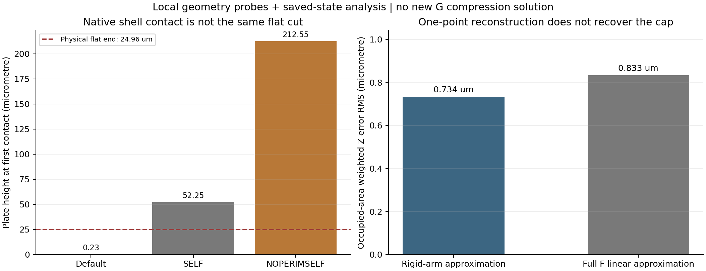

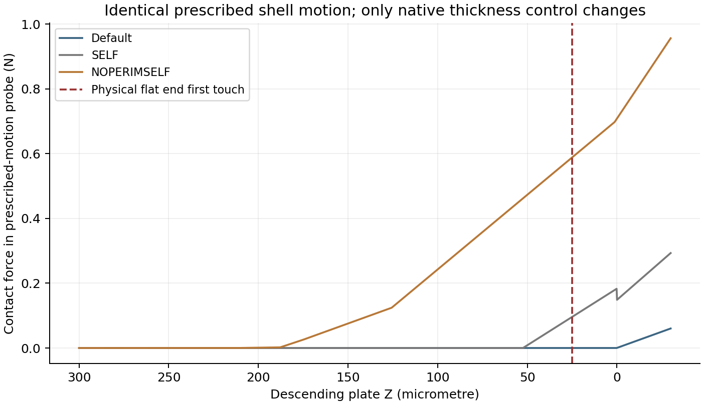

图中三条反力是指定相同运动、采用不同算法接触外包络后的结果，不是TPMS压缩性能曲线；不以这些力值评价材料或拟合G。默认设置接近中面端缘启动，取消缩厚又提前启动。由此可以排除“只打开0.5 mm壳厚接触即可与平切实体等价”这一简单修正。它不说明Abaqus算法普遍不准确，而是其几何近似与当前目标端面不同。

### G的初始端部也需要明确是怎样切出来的

使用现有G中面三角网格，对每个初始端缘按相邻三角面的法向±0.25 mm增厚，再与Z=0/10 mm平面比较。每端168条实际边界线段、总线长23.0883 mm；法向增厚的端缘外包络超出平面的线长加权均值约0.10343 mm，最大0.14610 mm，约97.29%的边长对应外伸超过0.01 mm。

这只是**理想化面片法向增厚的几何重建**，不是Abaqus实际接触厚度、初始穿透输出或新平衡解；它未使用插值壳指向矢量。其作用是说明：中面在Z=10 mm结束，再赋予法向厚度，并不等于将完整实体用Z=10 mm平面切平。当前JAX背景实体被Z=0/10边界裁切，原壳节点端缘接触又忽略了厚度覆盖。若直接切换原生厚度接触而保持板位，可能同时改变初始间隙/重叠、算法接触外包络和力臂，因果判断会更混乱。不能把0.14610 mm直接当作已发生的接触穿透量，也不能用它定量解释18.47%的反力差。

### 简单增加端部伸缩修正也没有恢复真实Q2端面运动

沿用原G在2%压缩＋保载末态的全部4976个有效端面采样及占据面积权重。已有刚性臂重建仅使用最近壳端缘节点位置处的平移与极分解转动R；本轮进一步使用同一点的完整变形梯度F，比较 `x_parent+R*r` 与 `x_parent+F*r` 对真实Q2端面位置的重建。

| 保存态重建方式 | 两端占据面积加权Z差RMS | 主要实体采样φ≥0.5的最大Z差 |
| --- | ---: | ---: |
| 刚性臂R | 0.734 μm | 3.784 μm |
| 同一点完整F线性重建 | 0.833 μm | 4.646 μm |

`(F−R)r`所代表的局部非刚性修正，其Z分量RMS约0.200 μm；剩余非仿射/采样映射误差RMS约0.833 μm，两者相关，不能把RMS直接相加或换成独立贡献百分比。分解恒等式误差3.47e−18 mm。剩余项包含Q2在有限端宽上的变化、最近端缘节点选择与曲面几何效应，本轮没有将它们逐一隔离。

因此，前轮“截面变形不能忽略”的判断需进一步限定：**不能认为只补上某一点的厚度伸缩/剪切就能修好刚臂代理。** 当前结果反而表明，该单点代理及非仿射端面运动本身需要处理。这里只重建既有保存态，没有重新满足接触平衡；不将重建罚力当新反力，也不把它转成18.47%差异的定量分摊。

### 现在能够得出的判断与下一执行点

已有证据按强弱可整理为：同一局部实体改变接触覆盖会改变反力；同物理局部实体的JAX/Abaqus小压缩对照约1%以内；G只移动接触作用位置而保持材料/占据/质量，可将保载差从18.47%降到0.39%；本轮又确认默认壳厚度接触与真实平切端部不等价。**当前首要任务是统一端部物体和传力定义，而不是继续调材料参数或将差异直接归咎于JAX。** 仍不能宣布18.47%已被唯一、完整解释，不能认证G压板模型、通用20%或大变形梯度。

下一阶段宜采用三步、以几何门槛先行：①固定目标为Z=0/10平切的有限厚度实体，整理与保留原S3R工程参考的区别；②优先研究能复用现有G中面的补充保形实体参考，只做几何/端面/网格和成本可行性检查，不先写新壳接触框架；③若参考可建立且成本合理，再做一组G 2%同物理端部对照，报告实体与连续占据、单元及惯性离散仍有的差异。**补充G实体参考尚未生成或提交，不取代原S3R基线；新增求解须先冻结输入和预算。** 不自动进入20%、形态AD或训练；若几何/成本不合适，明确停点，不继续堆壳辅助约束。

### 位置、成本与保护

正式目录：`validation/platen_xy_G_20261010_r51/diagnostics/native_shell_contact_20261010`。`input/`含三个冻结协议、网格、来源、保护快照及导航备份；`abaqus/default|self|noperimself/`含INP、提取结果、接触字段、日志和凭据；`analysis/`含两张图、CSV、保存态分解、初始G厚度外包络、预算及完整性JSON。只有三项独立的准备/提取/分析工具，复用原Abaqus入口，无通用求解框架或生产材料核修改。

原生INP/ODB依次在 `E:\ABAQUS\2026temp\Abaqus_Work\tpms_jax_abaqus\r51_native_shell_default_20261010`、`r51_native_shell_self_20261010`、`r51_native_shell_noperimself_20261010`，文件名`platen.inp`、`platen.odb`。三次datacheck累计83.06 s，三次指定运动求解89.92 s，提取7.48 s，合计180.47 s（约3.01 min）；编写与只读分析另计。

299项原科学/输入/工具文件核对保持；上轮已记录的RF3提取符号修正按其归档哈希纳入保护，不算新改动。本轮首版派生分析仅因加入初始厚度外包络而重生成，原版保存在本批`input/initial_derived_analysis`；原求解不重跑、不覆盖。当前无活动任务，原G保载+18.47%、20%和梯度边界保持。
