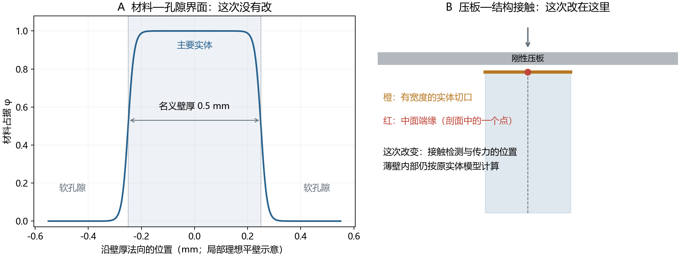
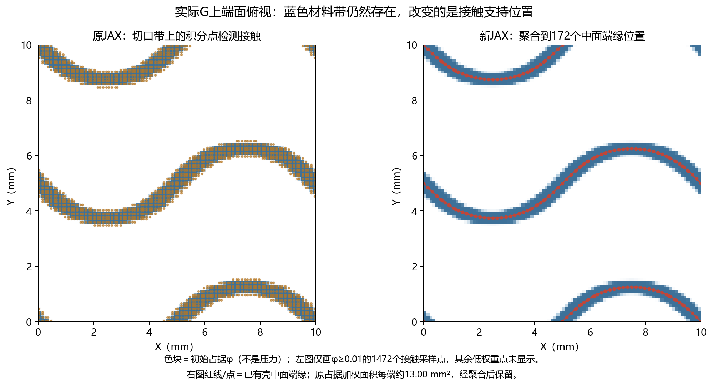
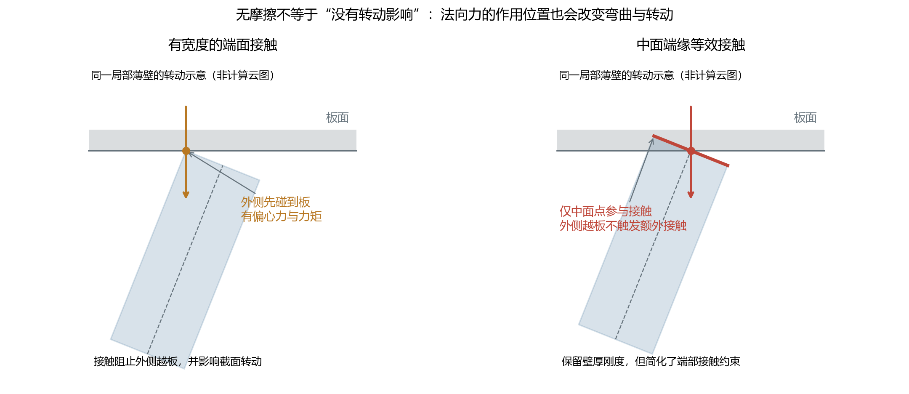
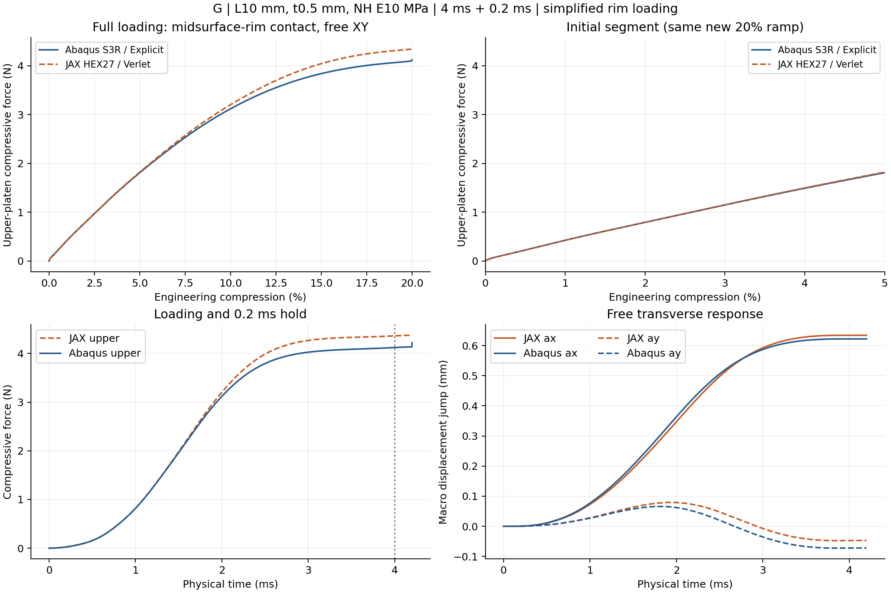
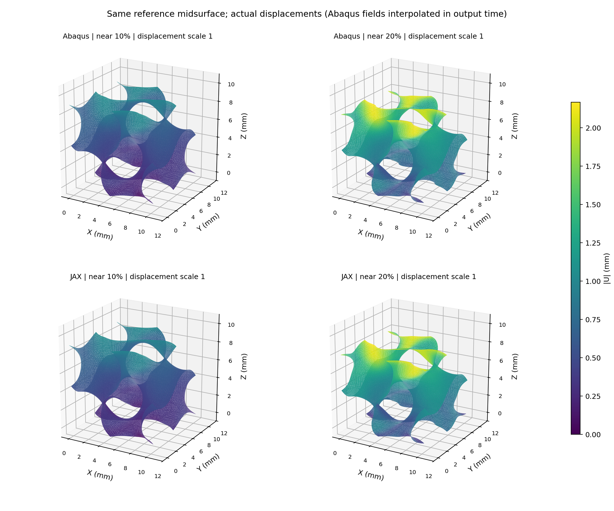
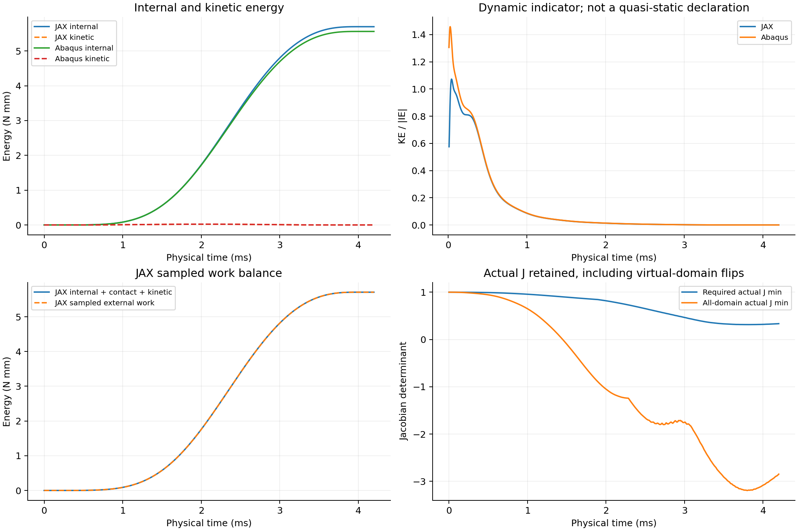

# G中面端缘等效压板20%对照：实际结果

更新2026-10-10。**完整20%及保载已完成，全曲线、功与保载三个预定标量目标均在约10%内。** 本轮双方采用共同中面端缘接触理想化；当前Abaqus参考本身也简化了有限厚度端部接触。G薄壁单胞在共同的中面端缘等效压板加载、XY周期与自由横向伸缩条件下，JAX背景实体和Abaqus壳的0–20%压缩响应较接近：全曲线RMS差3.42%、加载功差3.86%、末段保载均力差5.76%，达到本轮预先约定的三个约10%目标。 本轮不覆盖完整有限厚度端面或自接触试验。原有限宽G 2%未通过的事实与全部历史结果保持。

## 做了什么

仅G一组，L=10 mm、t=0.5 mm、NH E=10 MPa/ν=0.3/密度1e−9 tonne/mm³。Abaqus保留原S3R壳，JAX保留HEX27 N32、27点、连续占据、η=1e−4、界面0.05 mm、HRZ及原objective_void/C²材料核。双方从零用4 ms五次平滑下压2 mm，到20%，再保载0.2 ms；XY周期、横向ax/ay自由、无Z周期。

JAX仅把原占据端面权重聚合到已有壳中面端缘，复用原接触数组和kn=320 MPa/mm，没有改体内材料/质量或拟合参数。Abaqus保留原节点端缘的自动罚接触。接触允许分离、切向无摩擦，端缘并未绑定到压板。两端接触支持趋同，但壳/实体运动学、连续占据、接触插值/罚律及惯性仍不同，残差不能全部归为体内离散误差。

## 共同中面端缘接触：简化了什么

本次Abaqus与JAX都通过初始上下中面端缘与压板接触。Abaqus仍用0.5 mm壳截面计算刚度和质量，但输入的节点型接触对不把厚度展开为有宽度的实体接触端面。JAX仍用有厚度的背景实体积分，只把端部接触支持聚合到已有壳中面端缘。这里统一的是端部加载理想化，不是把实体改为壳，也不是同一个离散动力学模型。

材料—空隙界面描述哪里是薄壁；压板接触界面描述哪里可以向压板传力。原连续占据φ、0.05 mm过渡宽度、η、材料核、Gauss积分与质量保持原样。接触权重没有η下限，按占据φ加权；低占据尾部仍有相应小权重。

原JAX每端9216个3×3面高斯采样位置检查接触，其中上端φ≥0.01的1472点在下图显示；新方案归并到每端172个已有壳端缘位置。每端约13.00 mm²占据加权参考面积保留。JAX通过Q2形函数插值端缘位移并把接触力分配到背景节点，接触参考面积不随变形更新。

将每个原积分点的“面积×占据”权重归并到最近端缘位置。接触力为`F_i=kn·W_i·max(−g_i,0)`：W_i是归并面积，g_i是板面间隙，kn=320 MPa/mm。分离时零力，穿透时恢复力；允许无摩擦滑动和分离，没有绑定端缘，也没有强制所有端缘同位移。总权重保留不等于总力保留，因为各位置的间隙和接触激活会改变；反力由求解计算，未对齐或缩放壳曲线。

薄壁端部转动后，有宽度端面的一侧可能先撞板，形成偏心压力与相对中面的力矩；中面端缘接触不检查这部分外侧位置，改变了端部转动和弯曲约束。影响可向内部变形、总反力和屈曲路径传播，不能假定对全部构型都只使力增大或减小。

因此当前Abaqus也可能出现重建厚度外侧越过板面，而中面端缘仍处于接触；本次未测定Abaqus外侧越板量。壳法向增厚外包络与真实平切实体端面不是严格同一几何，不能直接套用JAX的越板数值。

JAX20%保存态端缘罚接触最大穿透约0.0056 mm，未直接参与接触的有限宽切口φ≥0.5点最大越板约0.246 mm。后者是接触覆盖简化，不能仅靠增大端缘罚刚度补上。当前无完整壁面、无自接触、无周期镜像接触；相近反力不证明这些未建机制已经正确。

官方依据：[Abaqus表面厚度与节点型接触对](https://docs.software.vt.edu/abaqusv2025/English/SIMACAEITNRefMap/simaitn-c-surfacepropassign.htm)、[Explicit罚接触](https://docs.software.vt.edu/abaqusv2025/English/SIMACAEITNRefMap/simaitn-c-expcontactconstraints.htm)。本次具体定义仍以input/protocol.json和实际INP为准；示意图说明机制，俯视图来自冻结输入，均不是新求解或压力云图。

## 结果与指标解释

实际可比较加载范围0–20.0000%。全曲线RMS为力差均方根除以本次壳加载峰4.123236 N；它不是每点误差上限。旧2%壳峰0.724118 N分母仅保留追溯，本次不据其验收。

| 指标 | 实际结果 |
| --- | --- |
| 全曲线RMS / 本次壳峰 | 3.419% |
| 同窗口加载功偏差 JAX/壳−1 | 3.859% |
| 末0.1 ms保载上板均力偏差 | 5.761% |
| 加载最大力偏差 | 5.829% |
| 加载最大力位置差 | -0.0000 个压缩量百分点 |

加载最大点不自动等于首次屈曲峰，具体过程看原始曲线，不能只用一个峰值判断路径一致。

本次两条加载曲线整体持续增载，没有出现清晰的跳跃降载峰，因而不验证屈曲峰位匹配。10%和20%时中面位移差RMS分别为0.01566和0.02054 mm（相对壳位移RMS为2.72%和1.76%）。20%时，未受端缘接触约束的有限厚度切口高占据点可越过板面约0.246 mm；这是简化端缘加载的明确物理限制，不能据本结果声称真实有限厚度压板试验已经验证。

| 工程压缩量 | JAX上板力 N | 壳上板力 N | 相对偏差 |
| --- | --- | --- | --- |
| 2% | 0.792304 | 0.793117 | -0.103% |
| 5% | 1.822749 | 1.810387 | 0.683% |
| 10% | 3.203866 | 3.120263 | 2.679% |
| 15% | 4.045524 | 3.841486 | 5.311% |
| 20% | 4.363574 | 4.123236 | 5.829% |

| 分段 | RMS / 同一本次壳峰 |
| --- | --- |
| 0–2% | 0.026% |
| 2–10% | 0.915% |
| 10–20% | 4.763% |

## 变形和有限厚度边界的限制

变形用原中面位置比较，JAX采用完整三维Q2插值；Abaqus位移在相邻输出帧之间按相同时间插值，时间间隔见field_comparison.json。未做刚体对齐、放大或缩放。最后一列是JAX参考平切端面高占据点φ≥0.5越过板面的最大值；它不等于被约束端缘点的罚接触穿透。这一差别是端缘加载的物理简化代价。

| 对应压缩量 | 位移差RMS mm | 位移差/壳位移RMS | 实体端面越板最大 mm |
| --- | --- | --- | --- |
| 5% | 0.006735 | 2.337% | 0.060570 |
| 10% | 0.015656 | 2.722% | 0.123232 |
| 15% | 0.022409 | 2.579% | 0.187665 |
| 20% | 0.020536 | 1.761% | 0.245970 |

无完整壁面压板接触、无自接触或周期镜像接触。本次没有执行全过程自交搜索，不能把正材料J或相近曲线当作无接触证明。真实有限厚度实体参考仍为延期候选，没有并行生成或提交。

## 数值状态与成本

JAX接受块采样中材料域最小实际J=0.314456，全域最小实际J=-3.194252，虚域负J采样点最大数2208。没有夹断真实F/J。原始拒绝、减步及5/10/15/20%局部稳定步长估计见jax目录；这些是有限采样及局部估计，不是全过程严格稳定性证明。

JAX采样功—能量偏差/最大采样功约5.03×10⁻⁷（0.0000503%）；壳ETOTAL漂移/外功为1.201%。两指标定义不同，不直接当作软件精度排名。动能变化按动态路径解释，不预先称准静态。

| 成本 | 墙钟分钟 |
| --- | --- |
| Abaqus输入准备、检查、求解与原提取 | 18.11 |
| JAX构建、编译、检查和推进 | 50.35 |
| 额外只读位移帧提取 | 1.37 |
| 本轮启动至最终图表检查与整理的整体用时 | 87.08 |

额外提取与JAX前期有时间重叠，所以分项之和不等于总墙钟。全部原科学保护文件670项未变。原有限宽2%对照、旧20%范围及旧设计梯度失败记录保留；本轮未验证新设计总梯度。

正式输入/状态/原始路径位于WSL `/home/xuehu/projects/tpms_jax/validation/platen_xy_G_20261010_r51/experiments/midsurface_rim_20pct_20261010`；Abaqus原生INP与ODB在E:/ABAQUS/2026temp/Abaqus_Work/tpms_jax_abaqus/r51_G_midsurface_rim_20pct_20261010。原生platen.inp与正式abaqus/platen_20pct.inp哈希对应。metrics.json、costs.json、force_comparison.csv和逐端路径CSV随本报告保留。
