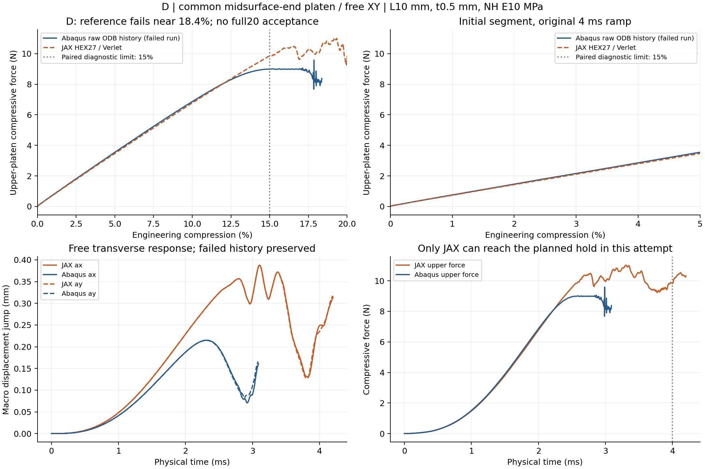
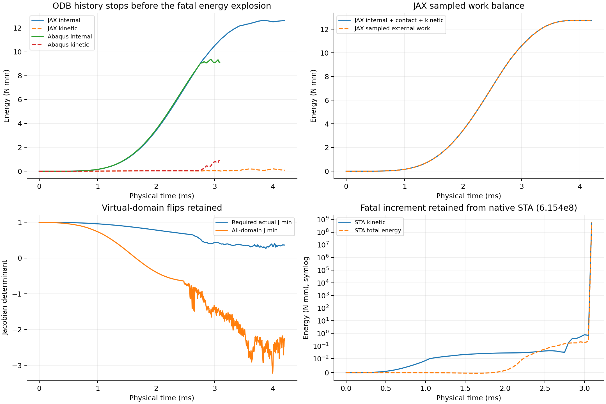
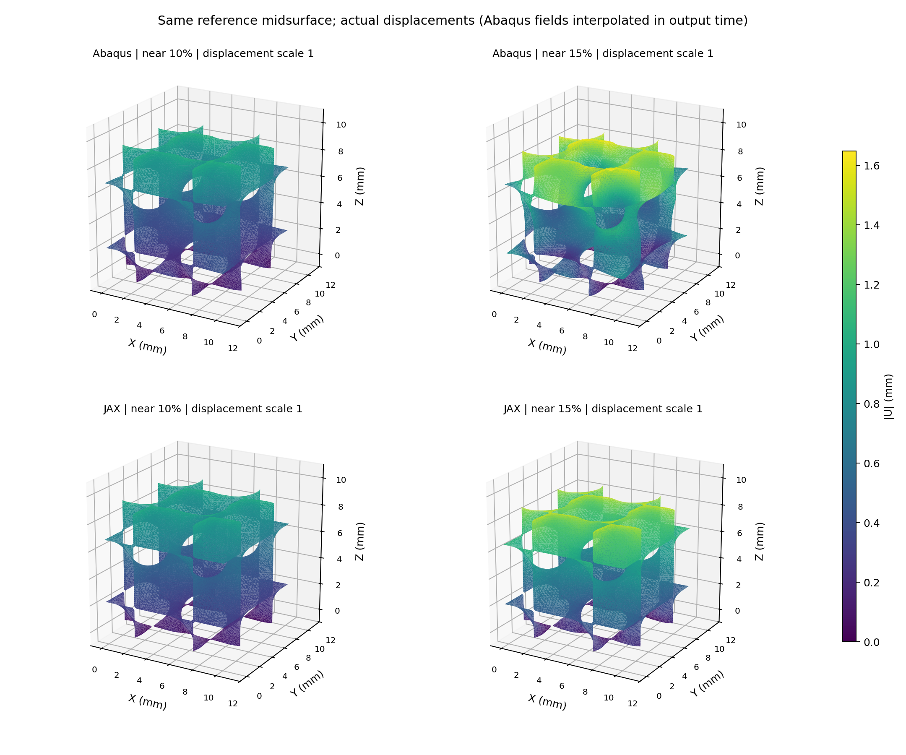
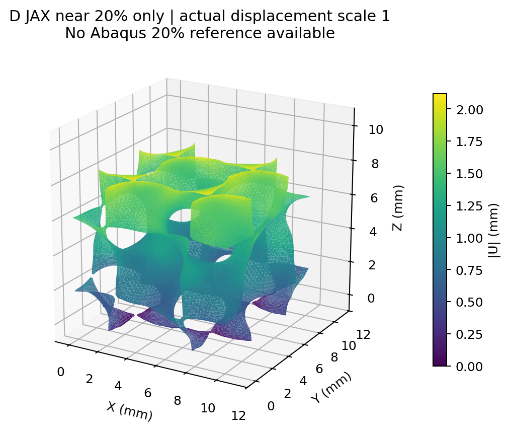

# D共同中面端部压板：参考路径失败，保留完整证据

**Abaqus在约18.4%压缩时因壳单元16329过度畸变停止；JAX状态为complete，完整20%与保载完成=True。本轮D的完整20%成对验收不可评价。** 没有重算Abaqus，没有修改材料／网格／加载参数。D/JAX是原计划尚未提交的第四条路径，沿用原D总预算时钟。

L10 mm、t0.5 mm、NH E10 MPa/ν0.3/密度1e−9 tonne/mm³；N32 HEX27/27点、HRZ、连续占据η1e−4、界面0.05 mm、objective_void/C²。Abaqus S3R壳截面5点。4 ms平滑下压20%及0.2 ms保载、XY周期与自由横向伸缩。每端254中面节点（含2相切点），JAX自身占据参考面积每端26.750596 mm²聚合到同一初始位置，kn320 MPa/mm。没有Z周期、全壁面／自接触或新增设计总梯度。

在D/JAX提交前固定0–2%、0–10%、0–15%三个诊断窗口。下表RMS以**各窗口自己的Abaqus峰力**为分母，不能与G/P全20%RMS直接排名，也不能代替D全20%验收。超过15%的原ODB历史仍在图中展示，但不以失效前末段作为完整可靠参考。主指标的完整20%分母、功与保载差均留空，避免用失效尖峰稀释误差。

| 预先固定诊断窗口 | 本窗口壳峰 N | 曲线RMS／窗口峰 | 窗口加载功偏差 |
| --- | ---: | ---: | ---: |
| 0–2% | 1.46126 | 1.112% | -1.915% |
| 0–10% | 6.86138 | 1.075% | -1.872% |
| 0–15% | 8.98625 | 2.123% | +0.209% |

| 压缩量 | JAX上板总反力 N | Abaqus上板总反力 N | 相对偏差 |
| --- | ---: | ---: | ---: |
| 2% | 1.43154 | 1.46126 | -2.034% |
| 5% | 3.46619 | 3.54554 | -2.238% |
| 10% | 6.77317 | 6.86138 | -1.286% |
| 15% | 9.83751 | 8.98290 | +9.514% |

初段2%、5%、10%的总力差约−2.03%、−2.24%、−1.29%，但15%时已增至约+9.51%。**响应分歧先于壳最终的数值失败，不能把全部中后段差异归咎于致命增量。** 累积窗口RMS可能被接近的初段稀释，应同时看15%点差、曲线形状和位移模式。现有证据不足以单独归因于JAX内力、壳网格、实体／壳运动学、接触离散或耗散；本轮不通过调参拟合这段曲线。

ODB历史最后为3.088015 ms／18.3664%，未保存致命增量的历史能量；最后特殊位移场约3.08961 ms。原生STA在3.090 ms列出稳定步长1e−14 s、动能及总能量6.154e8 Nmm，明确未完成。ODB、原始历史／位移数组及STA均保留，不能仅凭ODB历史有限而忽略最终数值失败。这个失败尚不能归因于某一个物理因素，也不能作为JAX不准确的证明。

变形采用原壳节点位置的JAX Q2插值，并在相邻Abaqus正常输出帧之间按时间插值；没有刚体对齐、曲线缩放或位移放大，也没有将Abaqus场外推到20%。实际F/J不夹断、低占据负J能量保留；有限采样与局部稳定步长JVP不等于全过程稳定、自接触或设计总梯度验证。

正式输入、原路径、有效态、失败证据与启动收据分别保存在本目录input、jax、abaqus、checks；本构型总墙钟75.09 min，沿用原100min预算时钟；分项见analysis/costs.json。当前停止追加求解，后续应先分析D失效单元位置与变形模式，再决定是否另立壳参考修复方案。

只读网格定位：报错单元初始质心约(4.119, 7.794, 0.466) mm，三边约0.1533, 0.0161, 0.1664 mm，面积位于原网格约3.69%分位。它靠近底端且较细长，这是后续定点检查的线索；初始形状及有限位移帧不足以独立认定失效原因。详见analysis/failed_element_geometry.json。

### 位移场与接触范围的补充判断

同一中面节点上，以同一物理时间比较JAX Q2位移和Abaqus帧间插值位移；下表相对值是位移差RMS／壳位移RMS，不做刚体对齐、幅值缩放或面积加权。

| 保存态附近压缩量 | 位移差RMS mm | 相对壳位移RMS |
| --- | ---: | ---: |
| 5% | 0.02907 | 10.17% |
| 10% | 0.07474 | 13.05% |
| 15% | 0.23365 | 26.70% |

**D的宏观反力在初段接近，但位移场差已经较明显，15%达到约26.7%。** 不能把0–15%累计力RMS2.12%解释为局部变形、应变或应力也已准确。该场差先于壳最终失败，是另一个必须保留的未解问题；末态失效并不能解释或消除它。P的20%同定义场差约1.38%，因此本轮支持G/P受控前向响应，D的模式迁移仍未通过完整验证。

D/JAX完整路径零回退，采样能量与外功差／最大采样外功约5.85e−6，主要材料区φ≥0.01的最小实际J约0.274；低占据虚域最小J约−3.22保留。末动能／内能约0.619%，这些数值状态不自动证明全过程准静态或物理模型准确。20%时有限宽端面φ≥0.5采样点越板约0.278 mm，而末保载端部接触罚穿透约0.00973／0.00894 mm；两者含义不同，不能将中面端部简化当作完整有限厚度接触验证。

最终整理成本补记：D从原输入准备到计算、初次分析及最终图像／位移场解释复核共80.12 min；其中成对计算及初次分析75.09 min，时钟未重置，最终仍在100 min以内。
