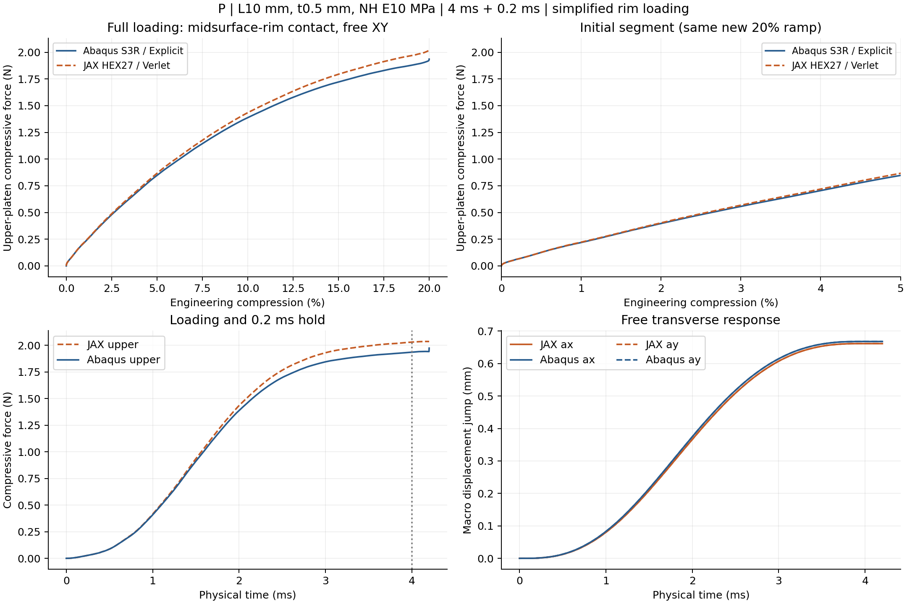
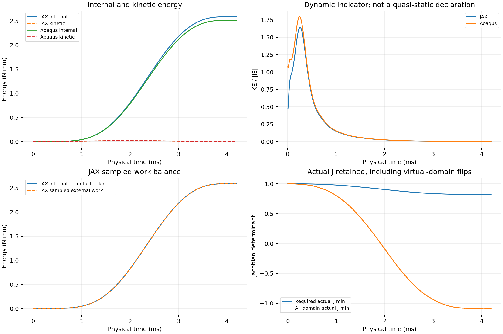
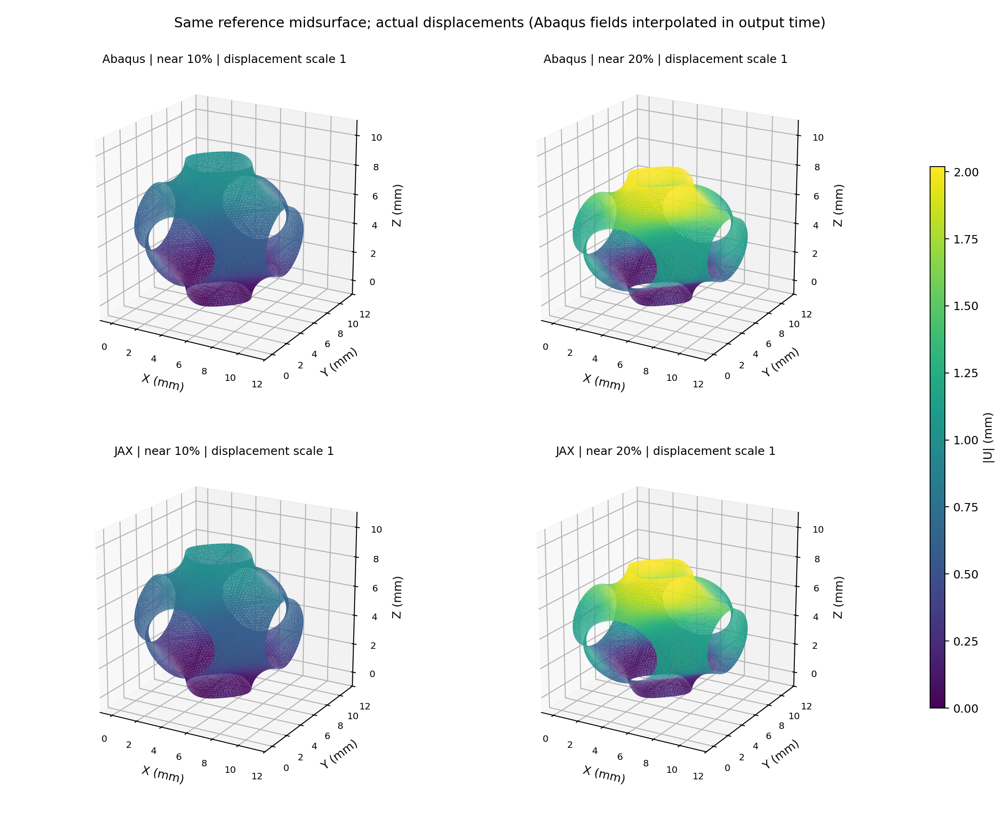

# P共同中面端部压板20%：实际结果

**完整20%及保载完成；全曲线RMS 2.782%，加载功差 +3.649%，保载均力差 +4.802%。三个预定约10%目标均达到。** RMS分母为本次P壳加载峰1.936012 N，比较到20.0000%；RMS不是逐点误差上限。G固定峰仅供附加追溯。

L10 mm、t0.5 mm、NH E10 MPa/ν0.3/密度1e−9 tonne/mm³；JAX N32 HEX27/27点、连续占据、η1e−4、界面0.05 mm、HRZ/objective_void/C²；壳S3R/截面5点。两端从零状态以4 ms平滑压缩至2 mm，保载0.2 ms，XY周期与横向宏观伸缩自由，无Z周期、无壁节点固定点。

沿用G的共同中面端部加载理想化。壳中面Z=0/L节点接触压板，壳截面厚度仍0.5 mm；JAX自身占据端面面积聚合到相同初始节点位置，kn320 MPa/mm，面积守恒。端部节点数[116, 116]，接触参考面积[7.606506830629928, 7.606506830629928] mm²。壳/实体运动学、罚律、接触插值、连续占据和惯性离散仍不同，没有全壁面／自接触；此对照不认证完整有限厚度接触、准静态全过程或设计总梯度。

| 压缩量 | JAX上板力 N | Abaqus上板力 N | 相对偏差 |
| --- | ---: | ---: | ---: |
| 2% | 0.402826 | 0.397012 | +1.464% |
| 5% | 0.866932 | 0.847143 | +2.336% |
| 10% | 1.434415 | 1.387773 | +3.361% |
| 15% | 1.794479 | 1.721835 | +4.219% |
| 20% | 2.030682 | 1.936012 | +4.890% |

实际F/J不夹断，低占据负J能量保留。动能与跳跃单独解释；数值有限、材料域正J及有限保存帧不能证明无自接触。详细步长、回退、能量账目和分段误差见metrics.json；保存态位移采用同一时间插值比较，无刚体对齐、曲线缩放或位移放大。

本构型实际总墙钟44.59 min（100 min目标：True）。分项与预算停点见costs.json；若路径不完整，不据局部曲线宣布全20%通过。JAX末有效态与原路径、Abaqus原生INP/ODB保留。正式输入位于`/home/xuehu/projects/tpms_jax/validation/platen_xy_PD_20261010_r52/P`，原生目录`E:\ABAQUS\2026temp\Abaqus_Work\tpms_jax_abaqus/r52_P_midsurface_end_20pct_20261010`。
