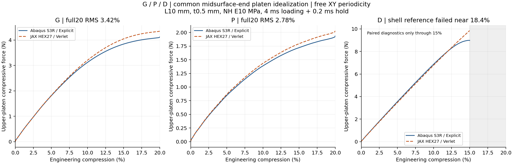

# P、D跨构型验证：共同中面端部压板／XY周期／20%

更新2026-10-10。**P完成20%与保载，曲线RMS2.78%、加载功差3.65%、保载均力差4.80%，三项达到约10%工作目标。D的Abaqus壳在约18.4%压缩时因单元16329过度畸变停止，完整20%成对验收不可评价；D/JAX完成20%和保载。** 各构型的曲线、变形、能量与实际范围分别见[P报告](P/README.md)、[D报告](D/README.md)；不能把一个构型的接近外推到所有TPMS。本次没有新设计AD或训练。

| 构型 | 完整20%＋保载 | 全曲线RMS | 加载功偏差 | 保载均力偏差 | 三项约10%目标 |
| --- | --- | ---: | ---: | ---: | --- |
| G | 是 | 3.419% | 3.859% | 5.761% | 达到 |
| P | 是 | 2.782% | 3.649% | 4.802% | 达到 |
| D | 否 | 未取得 | 未取得 | 未取得 | 不可评价：参考失败 |

全曲线RMS以各自本次Abaqus加载峰为分母，是力差均方根而非逐点误差上限；功、保载均力分别以各自新壳结果为分母。D三个完整路径指标留空，不能以参考失败宣布通过或判定JAX不准确。G为此前已完成的独立实验，仅加入图表比较，未重算或改写。

D的Abaqus壳在约18.4%压缩时因单元16329过度畸变停止，完整20%成对验收不可评价；D/JAX完成20%和保载。 D在提交JAX前固定0–2%、0–10%、0–15%诊断窗口，逐项结果见D报告；窗口指标以自身窗口峰为分母，不能与G/P全20%直接排名。图中D仅画至15%的成对诊断，完整JAX及失效前ODB历史另见D报告。ODB未写入致命增量的历史能量，STA最终动能／总能量6.154e8 Nmm与失败特殊帧另行保留。没有自动重算、改网格或更换材料。

D初段2%、5%、10%点差约−2.03%、−2.24%、−1.29%，15%已增至约+9.51%；分歧早于最终数值失败，不能都归于致命增量。G/P均主要持续增载，因此它们的通过尚未验证复杂后屈曲的通用准确性。当前结论是共同加载下的前向能力已从G迁移到P，D中后段仍需可靠参考与模式分析，不能宣布所有TPMS已验证通过。

位移场补充：P在20%同中面节点位移差RMS约0.01684 mm／1.38%；D在10%与15%分别约0.07474 mm／13.05%、0.23365 mm／26.70%。相对值以各自壳位移RMS为分母，不做刚体对齐。D总力初段接近仍不能代表变形模式准确，分歧早于最终壳失效；完整表及定义见D报告。

## 实际条件与接触范围

L10 mm、t0.5 mm、NH E10 MPa/ν0.3/密度1e−9 tonne/mm³；JAX N32 HEX27/27点、HRZ、连续占据／η1e−4／界面0.05 mm／objective_void/C²。Abaqus S3R壳截面5点；P沿用质量修整后的三角连接，D沿用原网格，JAX均保留原距离表面与Gauss数组。相同厚度不等于相同体积分数。

两端采用4 ms五次平滑下压2 mm及0.2 ms保载，XY周期、横向宏观伸缩自由、宏观剪切零，无Z周期和额外壁节点固定点。沿用G中面端部节点接触理想化：P每端116节点、D每端254节点（含2个端面相切节点）；JAX自身占据加权面积聚合到相同初始位置，kn320 MPa/mm，不调材料、厚度、η或阻尼拟合。

壳截面厚度仍参与刚度与质量；接触不覆盖完整厚度端面，也没有全壁面接触、自接触或周期镜像接触。两端的运动学、罚律、接触插值及惯性离散仍不同。约10%是本范围的工作目标，壳不是绝对真值；曲线接近不自动认证真实接触或有效设计总梯度。

## 成本与失败记录

| 构型 | 从原输入准备计时的总分钟 | 是否在100min内 |
| --- | ---: | --- |
| P | 44.59 | 是 |
| D | 75.09 | 是 |

按P后D、各自Abaqus后JAX执行，无资源竞争、参数扫描或额外短程动力筛选。P首次准备中将Element Output误当Element卡，启动前检查捕捉后修复；没有提交错误INP或求解。失败准备文件逐字节归档，沿用原P时钟；修复耗时计入上表。D在Abaqus失败后仍执行原计划尚未提交的第四条JAX路径，沿用原D时钟，未追加Abaqus尝试。失败原路径与ODB保留，不冒充完整成对20%。

D失败记录提取、定位和处置占用了额外非求解时间，10min准备／分析预留有所超出；这部分已计入原100min总墙钟，详见costs.json中的other_elapsed。JAX65min、Abaqus25min和每构型总100min限额均未延长或重新计时。

## 文件入口

正式批次`/home/xuehu/projects/tpms_jax/validation/platen_xy_PD_20261010_r52`。每构型input保存实际参数、端面及端部接触数组，abaqus保存独立INP、提取路径与位移帧，jax保存原路径与有效状态，analysis保存图表／指标／成本，checks保存时钟、启动收据和输入审计。原生INP／ODB在E:/ABAQUS/2026temp/Abaqus_Work/tpms_jax_abaqus/r52_P_midsurface_end_20pct_20261010及D对应目录。

protocol_planned.json是启动前快照，protocol.json为授权执行记录，当前实际停点只见status.json。原G、r50及历史失败数据保持原字节。完整实施源码与后处理变换凭据均在正式仓库，Windows仅为阅读副本。下轮任务需根据本轮证据另行决定，不自动追加。

最终整理成本补记：D从原输入准备到计算、初次分析及最终图像／位移场解释复核共80.12 min；其中成对计算及初次分析75.09 min，时钟未重置，最终仍在100 min以内。
