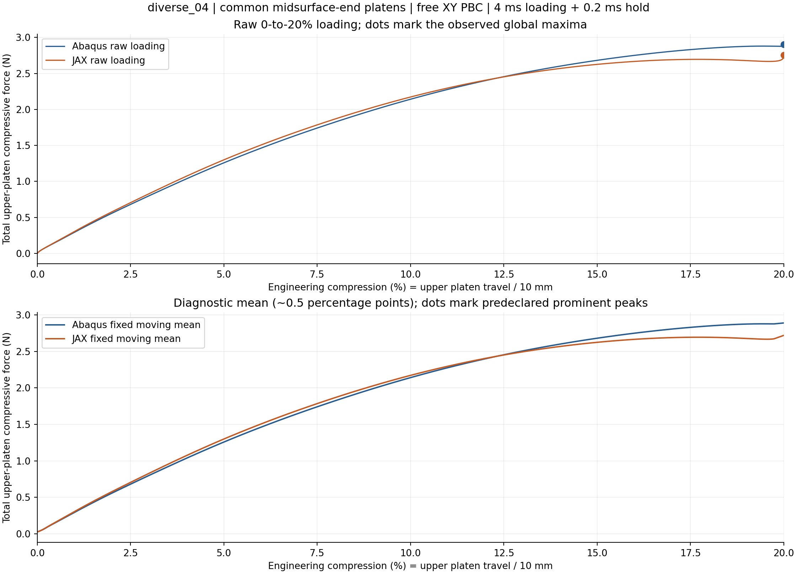
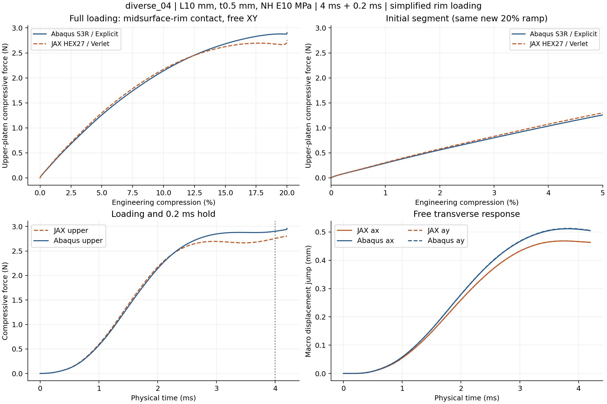
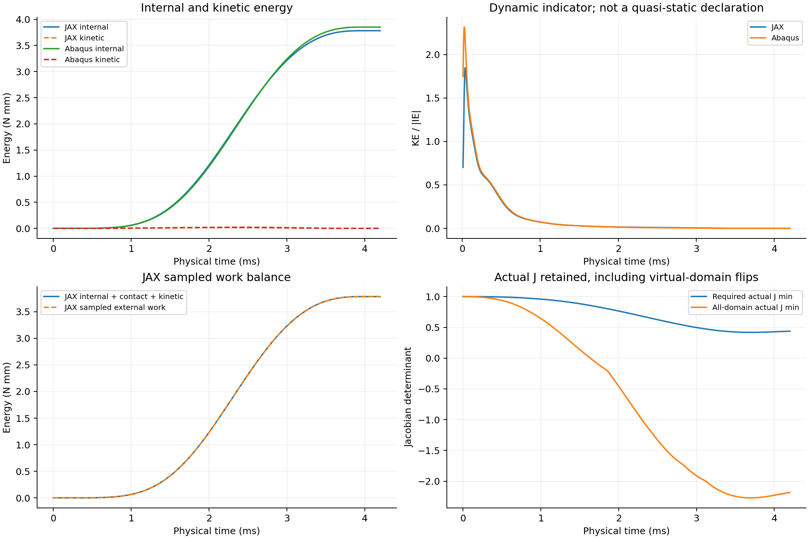
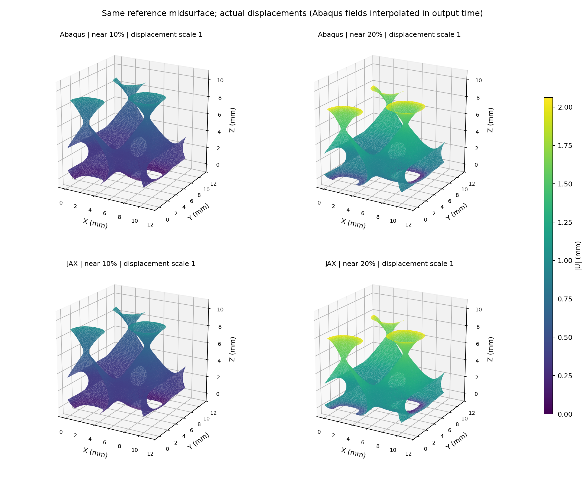

# diverse_04：共同中面端缘压板／XY周期／20%对照

2026-10-12。两端完整20%及保载完成。 本次主要比较上压板总反力随压板总压缩量的变化，原始峰、诊断平滑峰分别报告；没有新梯度或训练。

全曲线RMS／新壳峰值=2.700%；加载功差-1.031%；保载后半段均力差-4.706%。当前共同窗口到20.0000%。分母为new shell full loading peak 2.902437 N；RMS不是逐点误差上限。

## 峰位与曲线

| 求解器 | 原始全局最大力所在压缩量 | 最大力N | 类型 |
|---|---:|---:|---|
| JAX | 20.0000% | 2.756563 | 加载端点；不是内部峰 |
| Abaqus | 20.0000% | 2.902437 | 加载端点；不是内部峰 |

原始全局最大力的位置差（JAX−Abaqus）-0.0000个百分点，峰力差-5.026%。若最大值在加载端点，不能把它命名为已捕捉的屈曲峰。至少一端未捕捉到满足预定显著性规则的内部峰；不计算两端首峰位置差。

平滑仅用于区分主要降载与局部振荡：固定工程压缩网格约0.02个百分点间隔、25点中心均值，显著峰要求prominence不小于自身曲线峰的10%，峰间至少25点。所有合格峰都列在peak_summary.csv，不事后挑最接近的一对；原始曲线指标不平滑、不缩放、不平移。该规则是曲线诊断，不能仅凭反力峰证明两个模型走了同一屈曲分支。

| 压缩量 | JAX上板总力N | Abaqus上板总力N | 相对差 |
|---|---:|---:|---:|
| 2% | 0.577614 | 0.557873 | +3.54% |
| 5% | 1.299739 | 1.258215 | +3.30% |
| 10% | 2.172137 | 2.141242 | +1.44% |
| 15% | 2.625370 | 2.681474 | -2.09% |
| 20% | 2.756563 | 2.902437 | -5.03% |

## 建模条件与可比性

复用原diverse_04的8372节点／15914三角中面和原N32积分点占据场，不重新拟合几何。L10 mm、t0.5 mm、NH E10 MPa／ν0.3／密度1e−9 tonne/mm³。JAX仍为HEX27／27点、HRZ、η1e−4、界面0.05 mm、objective_void/C²；Abaqus为同中面的S3R壳、截面5点。两端物理加载时长均4 ms、保载0.2 ms，五次平滑下压2 mm。

仅XY周期，宏观横向伸缩自由、宏观剪切零，没有Z周期或壁节点额外固定。263条独立节点关系形成1578条壳方程；上下每端162个中面节点接触压板。JAX把自身连续占据端面面积聚合到同一批端缘位置，面积守恒、Q2插值、kn320 MPa/mm；Abaqus端缘节点接触忽略接触厚度，截面厚度仍保留。两端运动学、罚律、接触插值和惯性离散不同；不是同离散问题。

没有全壁面、自接触或周期镜像接触。实际F/J不夹断，主体正J保护及软域能量保留。允许物理跳跃与动能升高；数值失败、步长缩小和能量失衡另行报告。对照只回答共同简化加载下的计算能力，不认证真实完整有限厚度接触。

## 原始文件与解释边界

正式批次`/home/xuehu/projects/tpms_jax/validation/platen_xy_diverse04_20261012_r54/diverse_04`，参数在input/protocol.json、INP在abaqus/platen_20pct.inp、原路径在abaqus/result.json与jax/result.json。原生Abaqus目录`E:/ABAQUS/2026temp/Abaqus_Work/tpms_jax_abaqus/r54_diverse04_midsurface_end_20pct_20261012`，保留platen.inp／platen.odb及dat/msg/sta。

analysis/metrics.json沿用G/P/D对照口径；analysis/peak_metrics.json及CSV记录本次峰定义与原始来源哈希，costs.json记录含准备／编译／提取的实际成本。若有中断，只认实际保存的有效范围，不外推未计算峰。原XYZ结果保留，但旧时长、横向约束及停止范围可能不同，不能把新旧差异全部定量归因于取消Z周期或接触简化。

## 综合判断与数值健康

**diverse_04两端完整20%及保载完成；曲线RMS／壳峰2.700%，加载功差-1.031%，保载均力差-4.706%。总墙钟41.01 min。** 三个预定约10%宏观工作目标：均达到。两端均无符合预定规则的显著内部降载峰；原始最大力位置为JAX 20.0000%、Abaqus 20.0000%。不能以全局最大值代替同一屈曲事件的峰位核对。

本次把原diverse_04体内参数保持为既有N32连续占据模型，换成与G/P一致的共同中面端缘压板、XY周期与自由横向伸缩。在这套限定边界下，宏观响应接近与否按本次三项指标判断。相较旧XYZ模型，接触、Z约束及横向宏观自由度同时改变；这是加载条件迁移验证，不能据此把旧误差全部归因于单一因素。没有显著内部峰时，也不能声称已证明复杂跳跃屈曲的峰位预测准确。

JAX实际推进51467步，无效状态回退0次；已接受保存样本中材料域实际J最小0.418396，全域最小-2.270757。采样功平衡缺口／最大采样功0.0001%；末端动能／内能0.0111%。这些是有限样本的健康检查，不是全过程无自接触或全局稳定性证明。Abaqus能量、周期残差与端缘穿透见metrics.json。

中面位移比较在同一实际时间进行，JAX用Q2插值，Abaqus在相邻输出帧间插值，没有刚体对齐或位移放大。相对位移RMS以对应Abaqus中面位移RMS为分母；总位移一致不等于局部应变或局部分支均已认证。

| 保存检查点 | 位移差RMS mm | 相对位移RMS |
|---|---:|---:|
| 5%附近 | 0.007198 | 2.969% |
| 10%附近 | 0.021737 | 4.310% |
| 15%附近 | 0.061269 | 7.794% |
| 20%附近 | 0.120442 | 10.653% |

20%附近中面位移相对RMS差为10.65%，高于宏观力曲线差；尚不能宣布局部响应完全一致。共同端缘接触没有阻挡后续进入板面的其他壁点：同一保存时间的中面越板最大值JAX 0.0824 mm、Abaqus 0.0119 mm；JAX有限宽切口φ≥0.01点越板最大0.3843 mm。这些位置不同于受选端缘罚穿透，不能混作接触精度。没有完整壁面或自接触。

执行墙钟从本次输入生成起计，包含准备、编译、求解、提取和自动分析；前置代码审阅、适配开发和文档维护不计入求解执行成本。复用G绘图器带出的旧G归一化字段已从本轮指标表中移除，原派生表原字节另存checks；本次唯一分母是新diverse_04壳加载峰，原始两端曲线不改。

本轮至此停止。每30分钟自动检查保持暂停；r53梯度失败、门槛和未启动的三参数反向保持，不由本次前向通过代替。无Git提交。
