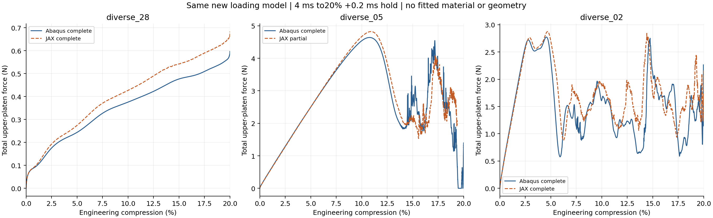
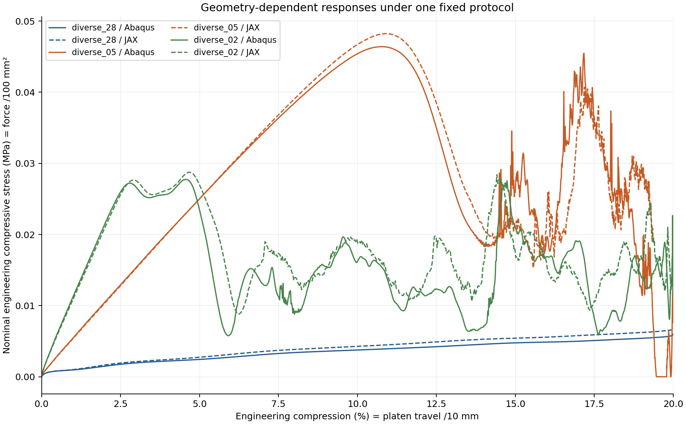
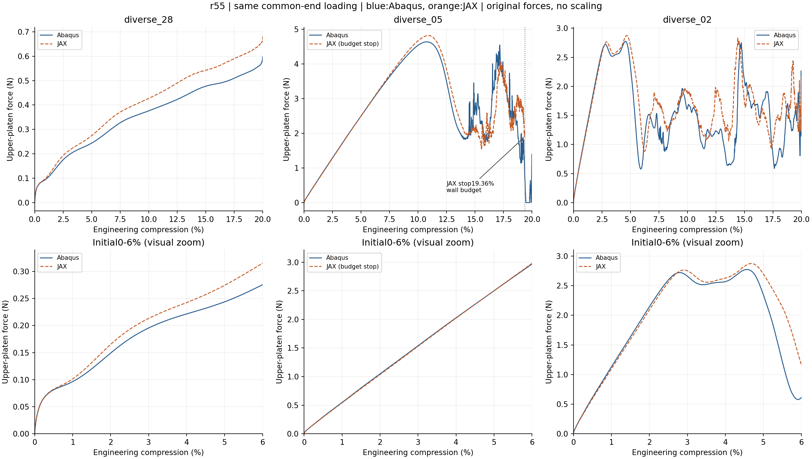

# 三种diverse构型：共同中面端缘压板／XY周期20%对照

2026-10-12。三组成对尝试已结束，不自动重算或扩展。 比较diverse_28、diverse_05和diverse_02，考察同一方法能否迁移到不同的周期薄壁构型。原diverse_04的结果仍单独保存在r54，本轮不重算。

|构型|20%＋保载|曲线RMS／壳峰%|加载功差%|保载均力差%|首个显著峰差／百分点|总墙钟min|
|---|---|---:|---:|---:|---:|---:|
|[diverse_28](diverse_28/README.md)|完整|+9.265|+13.986|+14.862|—|+31.761|
|[diverse_05](diverse_05/README.md)|JAX预算停在19.36%；壳完整|+8.012|+1.430|—|+0.140|+67.805|
|[diverse_02](diverse_02/README.md)|完整|+15.010|+12.722|+30.185|+0.120|+61.097|

差值方向为JAX−Abaqus；功／保载相对差分别除以本组新壳的功／均力。RMS是两条曲线之差的均方根除以本组新壳加载峰，不能理解为每一点误差均在该百分比内。未完整路径只能评价实际共同窗口；完整20%工作目标需要两端均完成并且曲线RMS、功、保载三个量均约10%以内。局部模式和数值健康必须另读。

名义应力=上压板总压缩反力／100 mm²，工程压缩量=上板位移绝对值／10 mm；不是壁材料局部应力或局部应变。每张单独报告还包含原曲线、固定显著峰、横向伸缩、能量与实际J，以及可提取的10%／20%变形。全局最大值落在20%端点时，不能称为已捕捉屈曲峰；没有合格内部峰则不强行核对峰位。

## 固定条件与选样依据

三组均L10 mm／t0.5 mm、Neo-Hookean E10 MPa／ν0.3／密度1e−9 tonne/mm³；JAX N32 HEX27／27点／HRZ、η1e−4、占据过渡宽0.05 mm、objective_void/C²，原虚域和实际J保护不变。Abaqus同一三角中面S3R壳，厚度0.5 mm、截面5点；从G/r54逐字复用材料、压板、接触、加载和输出控制。无质量缩放，两端物理加载4 ms到20%、保载0.2 ms，横向宏观伸缩自由、宏观剪切零，仅XY周期。

几何来自用户原模型。diverse_28和05为Fine/T0p02/MS9；02为r3_smoke/batch_001，原网格的周期性与拓扑经本轮重新检查。各自新占据场在其实际HEX27积分点生成，壳与背景使用同一来源中面及物理厚度，不复用其他构型的占据。旧曲线仅用于选样：其峰约8.14%、4.39%、1.87%，但材料／加载／质量等不一致，不能用来预言或验收新曲线。

共同端缘简化只在初始中面上下端缘施加载荷：JAX占据切面面积权重聚合到对应壳端缘位置、Q2插值；壳端缘节点接触厚度为零，截面厚度仍保留。这减少端部定义干扰，但不是完整有限厚度壁面接触，也没有自接触。壳／实体单元运动学、罚接触和惯性离散仍不同。约10%只是限定研究工作目标，壳不是精确真值；前向接近不能证明梯度或任意构型均可靠。

## 输入、证据和执行边界

正式批次`/home/xuehu/projects/tpms_jax/validation/platen_xy_diverse_batch_20261012_r55`。sources分构型保存原中面与实际高斯场；各构型独立保存input/protocol.json、abaqus/platen_20pct.inp、abaqus/result.json、jax/result.json和analysis；原生ODB在`E:/ABAQUS/2026temp/Abaqus_Work/tpms_jax_abaqus/r55_<kind>_midsurface_end_20pct_20261012/platen.odb`。Windows各构型阅读文件夹含参数、INP、曲线CSV、图和报告。

每组100 min总预算：JAX65、Abaqus25、其余10。顺序、各端一次尝试，数值失败或超时保留有效部分与原因，不根据差异大小提前停算，不自动变参数重试。本轮不做新AD／FD、训练或Git，heartbeat保持PAUSED。受保护旧科学文件见checks/source_guard_before/after.json，原r53失败与门槛不改。

## 人工核对后的研究判断

本轮给出的结论不是“三种构型都算失败”，也不是“已经普遍达到10%”。三组Abaqus完成20%及保载；JAX的diverse_28和02也完整完成，05在65分钟单端预算到达时停止于19.36%。它没有非有限数值、主体翻转或失控减步的停止记录；保留完整有效前缀，但20%与保载尚无成对证据。三组总墙钟160.84 min，含自动准备／编译／检查／求解／提取／分析，下面的人工结果审阅成本另记，不重写原成本。

### 三种不同响应确实被计算出来

第一排显示各自实际完成的加载路径，05竖线标出JAX预算停止位置；Abaqus05仍显示自身完整加载。第二排只是0–6%视觉放大，不增加验收窗口或修改既定指标。跨构型已覆盖持续增载、约11%显著降载、约4.5%显著降载并多次起伏的响应。这比只考察一种平顺曲线更有价值，但也揭示了当前方法的适用边界。

**diverse_28：变形接近，幅值持续偏高。** 两端曲线持续增载，无满足事前10%显著度规则的内部降载峰；20%处的最大力不能当作屈曲峰。2%、5%、10%、15%、20%处JAX总力分别偏高10.72%、12.54%、13.59%、13.79%、14.65%；曲线RMS／壳峰9.26%，功+13.99%，保载均力+14.86%。虽然RMS小于10%，另两个预定量未达标。20%附近中面总位移相对RMS差仅0.60%，说明宏观变形近，但位移指标包含受控位移与宏观分量，并不能认证局部应变、曲率或应力也只有0.60%误差。这组更像平顺加载中的系统性反力偏高，而非峰位错移。

**diverse_05：初段和主要峰接近，峰后仍分歧，末段因预算缺失。** 2%、5%、10%力差为−1.17%、+0.05%、+2.86%。原始主峰在JAX10.9007%／4.8232 N、Abaqus10.7701%／4.6405 N，差+0.1306个百分点／+3.94%；按既定平滑显著峰规则为10.90%与10.76%，差+0.14个百分点。必须区分“0.14个百分点”与“14%相对误差”。共同已算0–19.36%窗口的RMS／壳峰8.01%、功+1.43%，但15%瞬时力差−18.04%，不能用积分量接近掩盖瞬时差异。中面位移相对RMS差约5%／10%／15%时为4.85%／5.09%／12.18%，峰后局部响应差异增长。没有完整20%与保载结果，不能宣布本组完整通过或数值算法失败。

**diverse_02：首个显著峰接近，后屈曲动态路径差异更大。** 原始主峰JAX4.6867%／2.8749 N、Abaqus4.5497%／2.7741 N，差+0.1371个百分点／+3.63%；固定平滑规则下为4.66%和4.54%，差+0.12个百分点。2%力差−2.45%，说明早期增载可以接近；5%已经位于主要降载附近，瞬时力差+14.92%，不能笼统称为整个“小压缩区间”都准确。完整曲线RMS／壳峰15.01%、功+12.72%、上板保载均力+30.18%，未达到三个约10%工作目标。峰后多次起伏的时序和谷值不同，20%附近中面总位移相对RMS差10.75%。当前不能把峰位接近升级为整个后屈曲过程通过。

### 保载力差不能直接当成静态刚度差

保载只是停止移动压板，不表示结构已经静止。diverse_02预定后半段0.1 ms保载窗口：JAX上板均力1.9812 N、下板1.5609 N；Abaqus上板1.5218 N、下板1.5552 N。下板相对差约+0.37%，但JAX上下板均力相差约0.4203 N，而Abaqus约−0.0333 N。这说明同一短窗内两端的整体竖向加速度／动量变化不同。因此上板30.18%的差仍是本协议的真实未通过指标，但不能把它直接解释为静态承载能力偏高30%。下板恰接近也不能被事后改选为验收指标。冻结的上板、窗口、分母和未通过记录全部保持。

05在实际共同末时刻约3.358 ms，两端动能／内能约31.7%（JAX）和30.0%（Abaqus，同时间附近样本）；02完整末时刻约5.49%和5.96%。这些比值说明峰后是带惯性的动态响应，不是静态平衡曲线。不能仅凭动能升高否决跳跃现象，也不能据此自动证明全部差异均由惯性产生。动态窗口均力／动量与冲量计算另存reviewed_dynamic_windows.json，未增加任何求解。

### 能支持什么、尚不能支持什么

主体要求正体积的积分点在采样中最小实际J分别为28：0.7317、05：0.1142、02：0.3344，均正；三组没有拒绝推进块，JAX采样能量／功缺口分别约0.00091%、0.0161%、0.0198%。这些支持已保存路径具有基本数值一致性，但不是全过程、任意网格或真实接触的准确性证明。低占据虚域负J仍保留并计能，未做实际F／J夹断。05的停止是预定预算，02和28完成并不自动意味着力学验证通过。Abaqus本身也有离散误差；02全局能量漂移约1.008%，不能把参考当作无误差真值。

28／05／02的自身积分占据体积，相对壳中面面积×厚度仅差−0.35%／−0.71%／−0.57%。这使“几何总量相差十几个百分点”不受当前数据支持，但不能排除占据在厚度方向的分布、薄壁弯曲积分或局部运动学差异。总量接近不等于弯曲刚度接近。

目前最合理的研究判断是：固定背景网格方法已经能迁移到多种周期薄壁构型并生成有区别的受压响应，且在05和02上给出了接近的首次显著峰；但反力幅值精度和后屈曲动态路径还具有构型依赖性。结合已有G／P／diverse_04，受控前向可行性仍有证据，通用构型0–20%都在10%以内的结论尚不成立。本轮没有新梯度，已有参数梯度的通过范围与失败不改变；前向接近不自动认证设计梯度。

### 若继续，优先研究两类差异，暂不提交

下一轮应避免把所有现象归成同一个5%偏硬，更不宜用统一模量或厚度修正系数拟合。首先可为05剩余加载和保载另定预算，复用最后状态补齐范围，不能把当前未完成记作失败或通过。其次，28的平顺系统偏硬适合在无惯性初段定位薄壁有效刚度／积分／壳实体运动学及端缘传力；02和05的峰后差异则应结合既有上下板反力、动量、能量与变形，区分动态相位／惯性和分支差异。若另做时长或保载试验，需要独立冻结单一因素、保持原指标，不从结果中挑最接近的窗口。以上只是后续建议，本轮计算已停止，未自动增加任务。

本轮仍是共同中面端缘加载，无全壁面有限厚度接触或自接触。两端单元、罚律、接触插值和惯性离散不相同，不能声称已排除端部或所有物理模型影响；各具体来源仍需受控实验才可确立。原输入、源码、曲线、失败、指标与图片保持，新增人工审阅派生内容单独记录。

## 与用户原Abaqus模型的区别（2026-10-12追加核查）

已找到25条历史曲线并只读核对8个实际ODB。新旧中面／三角网格及XY周期方程一致，但原弹塑性材料E484MPa、相对密度10%对应壳厚、摩擦0.6／全外表面自接触，与本轮E10MPa超弹性、统一t0.5mm、无摩擦共同端缘简化不同。旧曲线不能当作本轮同参数参考；本轮通过范围不扩展为原模型已复现。[完整模型核查与新旧曲线](analysis/original_model_audit/README.md)。未新增求解。
