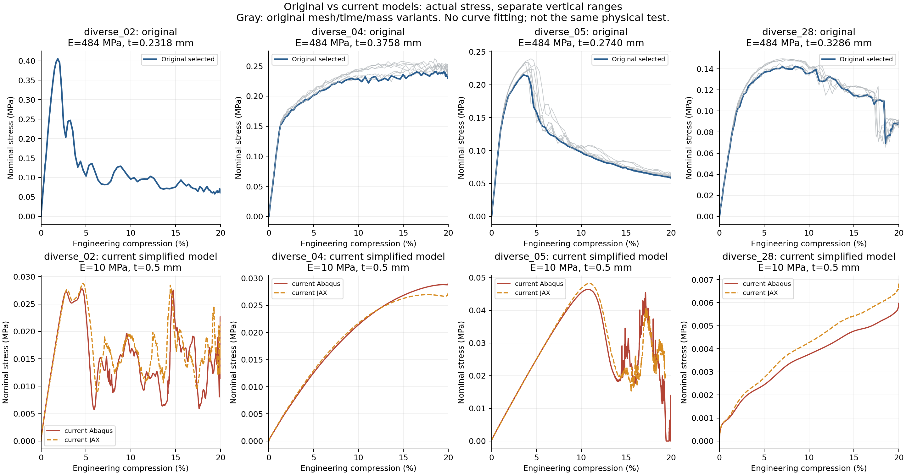
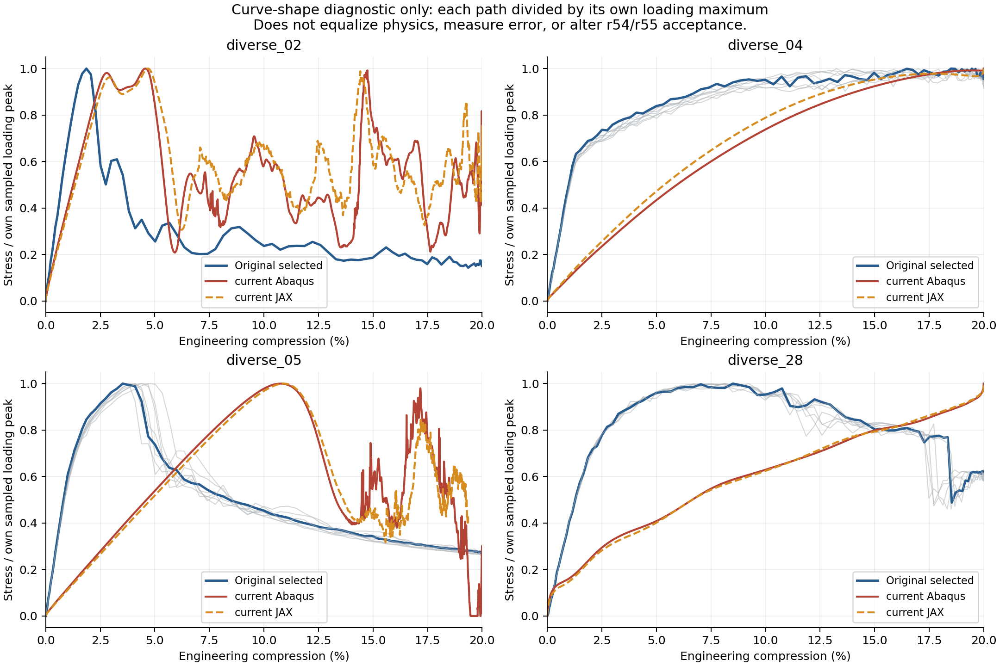

# 原Abaqus模型与本轮简化模型：为什么曲线不同

2026-10-12，只读核查。检索了`F:/auto_abaqus/work/para_aly`中的全部四构型曲线，找到04／05／28各8套，共24套；02在该目录没有找到，在`F:/auto_abaqus/work/r3_smoke/batch_001/diverse_02`找到1套。合计25条历史曲线，清单及参数在[model_audit.json](model_audit.json)。本轮没有提交新动力学作业，没有AD／FD、训练或Git。

**用户的记忆是正确的：原曲线与本轮曲线的形状确实不同。新旧模型都采用压板和XY周期，但材料、实际厚度、接触对象、摩擦、自接触、加载时长和部分质量条件不同，不能把本轮结果解释成原模型的复现。** 本轮用于比较统一简化超弹性条件下JAX背景实体和Abaqus壳的响应；它的已有一致性结论保留在该范围内，不自动扩展为原弹塑性压缩模型已经验证。

## 找到的文件及实际ODB核对

原04／05／28主目录为`F:/auto_abaqus/work/para_aly/{Fine,Coarse}/{T0p01,T0p02}/{MS0,MS9}/diverse_XX`，其中T0p01／T0p02对应0.01／0.02 s加载，MS0无质量缩放，MS9为固定质量因子9。每组`abaqus/physical.inp`通过Include引用`blocks/material_section.inc`、`contact.inc`、`step_loading.inc`等；仅看根INP不够。`results/stress_strain.csv`和`history.csv`保存曲线和能量。02使用上述r3_smoke目录，加载0.001 s，材料还带不同的塑性硬化表。

本说明选取Fine/T0p02/MS0的04／05／28与r3_smoke的02作为明确标记的原参考，同时绘出其他历史条件，避免误把某套参数当成唯一旧结果。本轮04为r54，02／05／28为r55，沿用各自冻结输入。**只读打开这4套旧ODB及4套新ODB，按INP参考点标签识别真实上压板RF3／U3，独立重算采样最大值，和对应CSV一致。** 记录在[odb_readonly_check.json](odb_readonly_check.json)。ODB中的实际材料和截面也与各自输入一致。第一次读取脚本假定集合在rootAssembly而遇到KeyError；修正为按实际INP标签识别historyRegion，未修改ODB或重新求解。

两边名义量均为`压缩应变=−U3/10 mm`、`名义压应力=−RF3/100 mm²`。本轮CSV把压缩力存为正数，故应力为`force_N/100`。不存在此处混用壁材料面积、把百分数当小数或把内部节点力当上板总力的问题。旧结果约101个历史点，本轮约2101个点，输出频率不同会改变可见高频细节，但不能解释整体峰后路径和平台形状的改变。

## 哪些部分相同，哪些不同

四组的原细网格／新壳三角连接完全一致；参考坐标最大差仅1.78×10⁻¹⁵ mm，为浮点舍入。**XY周期方程作为节点／自由度／系数的集合完全相同**，分别为02：3504、04：1578、05：2382、28：1452条。所有配对的Z坐标相同，没有Z向宏观控制项；位移差的宏观控制自由度RP_X.U1、RP_Y.U2没有被边界条件固定。它们可随响应变化，不是横向零应变。壳转角周期方程也保留。没有证据表明这轮曲线变化来自拿错中面、三角网格改变或误加XYZ周期。

| 条件 | 原模型 | 本轮r54／r55 |
|---|---|---|
| 单胞与压缩目标 | 高10 mm，压板下压2 mm | 相同 |
| 壳单元 | S3R，厚度方向5积分点 | 相同 |
| 基材弹性 | E=484 MPa，ν=0.4 | Neo-Hookean初始E=10 MPa，ν=0.3 |
| 塑性 | 04／05／28：8 MPa初始屈服、单点理想塑性；02：8 MPa初始屈服并带硬化表 | 无塑性，仅超弹性 |
| 壳厚 | 按壳中面面积×厚度满足名义相对密度10%，各构型不同 | 统一0.5 mm |
| 基材密度 | 1.1×10⁻⁹ tonne/mm³ | 1.0×10⁻⁹ tonne/mm³ |
| 压板／周期 | 上下刚板，XY周期，宏观横向伸缩自由 | 相同大类；同一XY方程 |
| 接触对象 | General Contact，ALL EXTERIOR，包含结构自接触 | 上下端缘节点对刚板的Contact Pair，无全壁面／自接触 |
| 壳接触厚度 | 按通用接触表征；日志存在自动厚度缩减和初始调整 | 中面端缘节点零接触厚度；截面厚度仍0.5 mm |
| 摩擦 | 0.6 | 无摩擦 |
| 压缩历程 | 平滑下压20%；04／05／28常见10或20 ms，02为1 ms；无额外保载 | 平滑4 ms下压20%＋0.2 ms保载 |
| 质量缩放 | MS0无；MS9固定因子9 | 无 |
| 刚板 | 18×18 mm，多片刚性R3D4 | 20×20 mm，刚性R3D4；初始Z均0／10 mm |
| 求解精度与输出 | 已查原MS0为单精度；101历史点 | 已查本轮为双精度；约2101历史点 |

当前JAX使用N32／HEX27连续占据实体及人工弱域，Abaqus仍是上述S3R壳。共同中面端缘压板的意义是尽量统一两者载荷作用位置，不是恢复旧全外表面、摩擦、自接触的原模型。当前没有这些接触机制的前向或梯度认证。

| 构型 | 原细网格壳厚mm | 本轮壳厚mm | 本轮／原厚度 | 本轮名义壳相对密度（面积×厚度／胞体积） |
|---|---:|---:|---:|---:|
| diverse_02 | 0.23180 | 0.50000 | 2.157 | 21.57% |
| diverse_04 | 0.37585 | 0.50000 | 1.330 | 13.30% |
| diverse_05 | 0.27401 | 0.50000 | 1.825 | 18.25% |
| diverse_28 | 0.32859 | 0.50000 | 1.522 | 15.22% |

原四组名义相对密度均10%。上述面积×厚度是壳模型的名义体积近似，不等同于精确偏置实体体积或JAX积分占据体积。本轮统一t/L=5%的选择有之前用户授权，但并未保持原相对密度。因此，同一diverse编号只表示同一中面构型，不能代表完整力学模型相同。

## 曲线对照：形状变化在Abaqus自身就已出现

上排是原Abaqus，蓝色选取上述明确参考，灰色为其他网格／时长／质量条件；下排是本轮Abaqus红线和JAX橙虚线。各面板纵轴范围独立，均为未经缩放的名义应力MPa。05的JAX仅到19.36%，没有外推到20%或补画保载。

第二图把每条曲线分别除以自身加载最大值，只用于观察形状。**这不是物理参数等价、不是误差评估、不是拟合，也不替代r54／r55原总力验收。** 灰色保留所有找到的旧变体。图中02峰后多次起伏、05旧峰显著早于新峰、28旧降载与新持续增载的差别很清晰。

| 构型 | 原所选曲线采样最大值位置／应力 | 新Abaqus采样最大值位置／应力 |
|---|---|---|
| diverse_02 | 1.8655%／0.40533 MPa | 4.5497%／0.027741 MPa |
| diverse_04 | 18.5100%／0.24026 MPa | 20%端点／0.029021 MPa |
| diverse_05 | 3.5268%／0.21499 MPa | 10.7701%／0.046405 MPa |
| diverse_28 | 8.5065%／0.14244 MPa | 20%端点／0.0059714 MPa |

这是原始采样全局最大值的描述，**不保证是同一屈曲事件**；04旧曲线接近平台，平台上采样最大点不能直接命名为唯一屈曲峰。新04／28为20%端点，按原规则无显著内部降载峰。若查看Fine/T0p02/MS9，原05峰在4.3929%、28在8.1394%，与MS0不同；不能把不同质量条件的数字混在一起。表格原数值在[raw_peak_comparison.csv](raw_peak_comparison.csv)。

## 如何解释，哪些解释已有证据

首先，材料改变不是简单改一个力的倍数。原弹塑性基材会屈服并累积不可逆变形，本轮超弹性没有相应塑性耗散。所选旧ODB导出历史的末端ALLPD／ALLIE，02约76.25%、04约89.06%、05约81.09%、28约77.19%。这直接表明旧计算中塑性耗能显著，不能将其当作纯弹性曲线乘一个E比值来复现。屈服后的切线刚度改变、结构屈曲与摩擦／接触会共同决定形状；目前不能仅从宏观曲线把每种机制单独分解。02还具有不同于其他三组的材料硬化表。

其次，厚度本身会改变结构的稳定性和变形模式。局部线弹性板弯曲刚度与t³有关，而膜内刚度与t有关，因此本轮比原来厚33%～116%并非微小改动。该关系只是解释厚度敏感性的局部近似，不能直接拿t³推算整个TPMS的屈曲峰。更厚的壁可能推迟某些失稳，但本次同时改变了材料与接触，尚不能认证峰位变化主要由厚度造成。

第三，端部与后续接触所对应的问题不同。原通用接触允许结构其他外表面在下压时接触压板，也包含自接触，摩擦0.6会限制端部切向滑移；本轮仅加载初始中面端缘且无摩擦，不阻止其他壁点越板，也没有内部壁面自接触。这些改变可影响弯曲约束、失稳分支和峰后承载。原28日志另明确警告接触厚度自动缩减，最显著缩减因子约0.0649，并报告初始接触调整；这不是壳截面厚度变成了该值，也不能把原通用接触视为理想、无误差的全厚接触真值。

第四，加载快慢必须结合材料、厚度和质量判断。原10／20 ms与本轮4 ms均是物理秒，不存在“JAX的毫秒不是Abaqus的毫秒”。但弹性波速和结构固有周期会随刚度与质量变化，原E为本轮48.4倍，部分旧组又有9倍质量缩放，所以不能只看时长数字就认定两组处于相同动态程度。本轮不含旧塑性耗散机制，峰后振荡可能更明显；尚未做单一因素对照，不能宣称加载时长是主要来源。旧101点和新2101点的采样疏密也会影响看到的高频起伏。

刚板尺寸、单／双精度和输出频率是已确认的其他差异。它们没有在本次单独测试，不能被主观指定为无影响或主导原因。源INP、实际ODB、原曲线之间没有发现提取错位；但这种核查也不是对全部物理假设与全过程数值精度的证明。

## 对研究结论的修正与后续选择

应区分两类问题。第一类是“本轮JAX与本轮Abaqus差多少”，原r54／r55报告回答了统一简化超弹性问题中的跨离散差异，成功、未通过和预算停止证据均不变。第二类是“能否复现用户原弹塑性TPMS压缩曲线”，这要求原厚度、材料塑性、接触／摩擦／自接触、质量和加载历程对齐，目前尚未验证。不能用第一类中接近的结果，宣称第二类已完成，也不能用两个不同物理模型的曲线差别直接认定JAX实现算错。

下一步若目标是重现原曲线，建议先选择一个明确的原条件并冻结为目标模型，确认需要保留哪些实际机制；再以Abaqus为内部桥梁，按单一因素逐渐连接原模型与当前简化模型。厚度与本构差异应优先明确，因为两者直接改变研究对象；接触差异已有前期证据，不能同时混改。恢复原弹塑性、自接触等并非当前JAX程序已经具备的功能，需另行实现和验证，不能仅改一个配置就声称等价。本次只完成说明与准备，没有启动桥梁试算或扩展原规划。

本轮原源码、输入、曲线、失败、指标和图不改。只读文件哈希凭据见[read_only_receipt.json](read_only_receipt.json)，8个实际ODB均以readOnly=True打开；绘图与核查配方保留为本目录两个轻量脚本。
