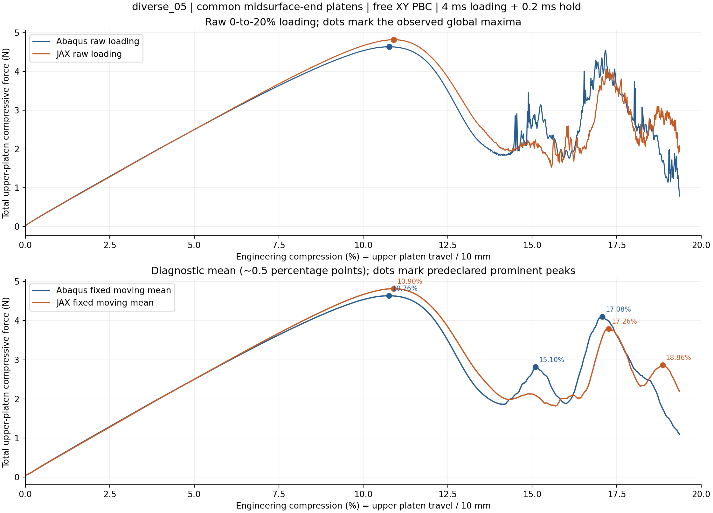
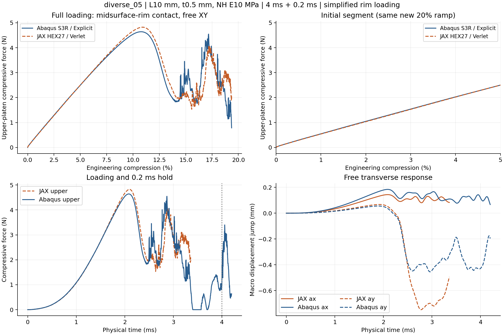
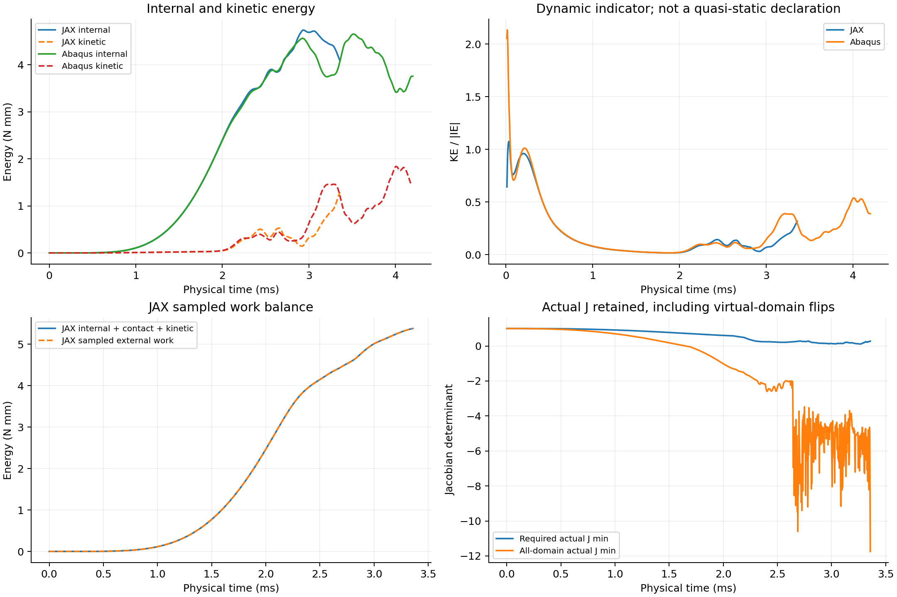
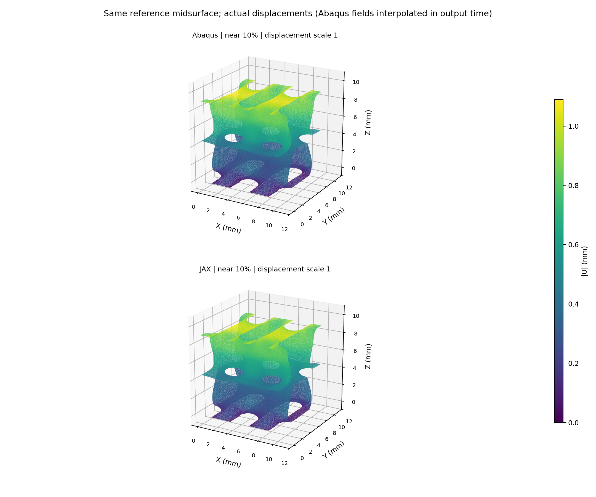

# diverse_05：共同中面端缘压板／XY周期／20%对照

2026-10-12。存在不完整路径，仅比较实际共同窗口，不能作完整20%验收。 本次主要比较上压板总反力随压板总压缩量的变化，原始峰、诊断平滑峰分别报告；没有新梯度或训练。

共同已完成0–19.36%窗口的曲线RMS／新壳共同窗口峰值=8.012%；加载功差+1.430%；未形成完整保载对照。当前共同窗口到19.3601%。分母为new shell common achieved loading window peak; not full20 acceptance 4.640504 N；RMS不是逐点误差上限。

## 峰位与曲线

| 求解器 | 原始全局最大力所在压缩量 | 最大力N | 类型 |
|---|---:|---:|---|
| JAX | 10.9007% | 4.823185 | 窗口内峰；是否屈曲需结合变形 |
| Abaqus | 10.7701% | 4.640504 | 窗口内峰；是否屈曲需结合变形 |

原始全局最大力的位置差（JAX−Abaqus）+0.1306个百分点，峰力差+3.937%。若最大值在加载端点，不能把它命名为已捕捉的屈曲峰。预定平滑规则下首个显著内部峰：JAX 10.900%，Abaqus 10.760%，差+0.140个百分点。

平滑仅用于区分主要降载与局部振荡：固定工程压缩网格约0.02个百分点间隔、25点中心均值，显著峰要求prominence不小于自身曲线峰的10%，峰间至少25点。所有合格峰都列在peak_summary.csv，不事后挑最接近的一对；原始曲线指标不平滑、不缩放、不平移。该规则是曲线诊断，不能仅凭反力峰证明两个模型走了同一屈曲分支。

| 压缩量 | JAX上板总力N | Abaqus上板总力N | 相对差 |
|---|---:|---:|---:|
| 2% | 1.035023 | 1.047293 | -1.17% |
| 5% | 2.501393 | 2.500215 | +0.05% |
| 10% | 4.669979 | 4.540072 | +2.86% |
| 15% | 2.130819 | 2.599841 | -18.04% |

## 建模条件与可比性

复用原diverse_05的11624节点／21998三角中面，在自身实际N32积分点生成占据场，不拟合几何或体积分数。L10 mm、t0.5 mm、NH E10 MPa／ν0.3／密度1e−9 tonne/mm³。JAX仍为HEX27／27点、HRZ、η1e−4、界面0.05 mm、objective_void/C²；Abaqus为同中面的S3R壳、截面5点。两端计划均4 ms加载、0.2 ms保载，五次平滑下压2 mm；Abaqus完成，JAX达到65分钟单端预算后停在19.36%，没有完成末段与保载。

仅XY周期，宏观横向伸缩自由、宏观剪切零，没有Z周期或壁节点额外固定。397条独立节点关系形成2382条壳方程；上下端分别[248, 248]个中面节点接触压板。JAX把自身连续占据端面面积聚合到同一批端缘位置，面积守恒、Q2插值、kn320 MPa/mm；Abaqus端缘节点接触忽略接触厚度，截面厚度仍保留。两端运动学、罚律、接触插值和惯性离散不同；不是同离散问题。

没有全壁面、自接触或周期镜像接触。实际F/J不夹断，主体正J保护及软域能量保留。允许物理跳跃与动能升高；数值失败、步长缩小和能量失衡另行报告。对照只回答共同简化加载下的计算能力，不认证真实完整有限厚度接触。

## 原始文件与解释边界

正式批次`/home/xuehu/projects/tpms_jax/validation/platen_xy_diverse_batch_20261012_r55/diverse_05`，参数在input/protocol.json、INP在abaqus/platen_20pct.inp、原路径在abaqus/result.json与jax/result.json。原生Abaqus目录`E:/ABAQUS/2026temp/Abaqus_Work/tpms_jax_abaqus/r55_diverse_05_midsurface_end_20pct_20261012`，保留platen.inp／platen.odb及dat/msg/sta。

analysis/metrics.json沿用G/P/D对照口径；analysis/peak_metrics.json及CSV记录本次峰定义与原始来源哈希，costs.json记录含准备／编译／提取的实际成本。若有中断，只认实际保存的有效范围，不外推未计算峰。历史曲线仅用于选样，材料、时长、质量与接触条件可能不同，不能当作本轮成对参考或把新旧差定量归因于单一因素。

## 实际成本、健康指标与局部限制

本组成对总墙钟67.81 min（包括准备／编译／检查／求解／提取／自动分析）；预算100 min，不自动重算。是否完整：JAX False、Abaqus True。JAX实际90,688步，因预定65分钟单端预算停止，不是非有限值或主体负J失败；总组预算100分钟与JAX单端65分钟是两个独立上限。

JAX步数90688；采样主体最小实际J=0.11424589962632506；全域最小实际J=-11.744077316465429；拒绝块0；能量／功缺口=0.00016058695589826118；末端KE/IE=0.31682757075634954。负J弱域保留，不删除其能量；采样并非全过程证明。

Abaqus XY位移方程误差2.384185791015625e-07 mm；末端KE/IE=0.389095788538181；全局能量漂移／功=0.008939992137806526。能量比是无量纲比值，跳跃附近的动能不能单独用于否决响应。

|压缩量|中面位移相对RMS差|JAX全部中面越板mm|Abaqus全部中面越板mm|
|---|---:|---:|---:|
|5%|4.85%|0.00386|0.00237|
|10%|5.09%|0.01631|0.00479|
|15%|12.18%|0.18588|0.16139|

位移差采用同时间JAX Q2中面插值与Abaqus输出时间插值。全部中面越板、JAX有限宽切面越板、选中端缘罚穿透是不同位置的量；后两者详见field_comparison.json与原路径。共同端缘简化不会阻挡所有其他壁点进入板面。宏观工作目标通过不能代替局部模式、有限厚度接触或梯度认证。

自身高斯积分占据体积分数0.181174；壳中面面积×厚度给出的体积分数0.182472，相对差-0.711%。它是几何表达差异，不进行体积或模量拟合。
