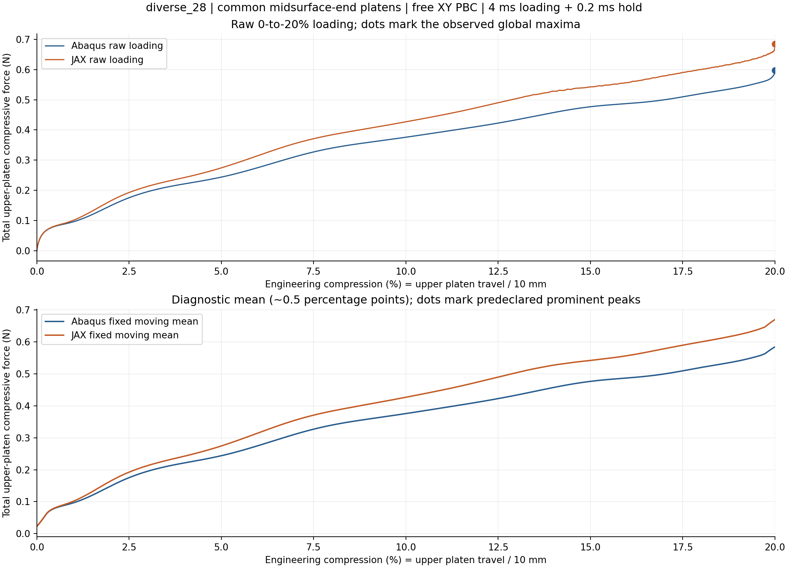
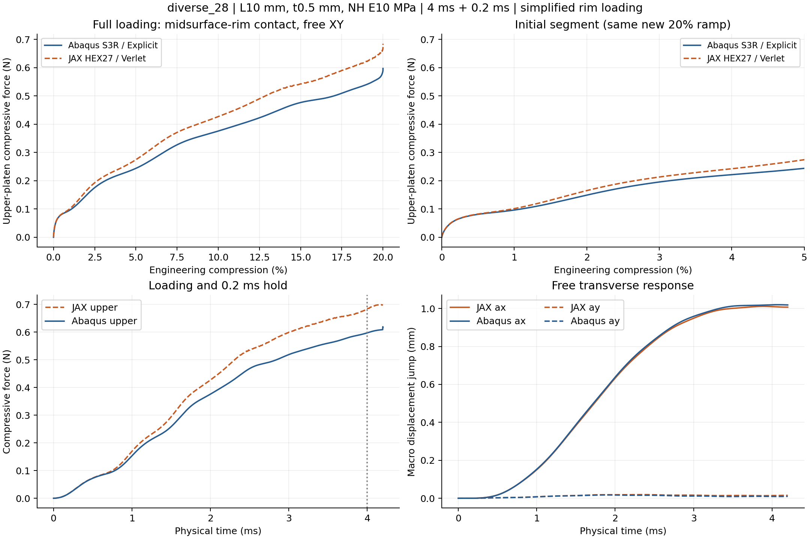
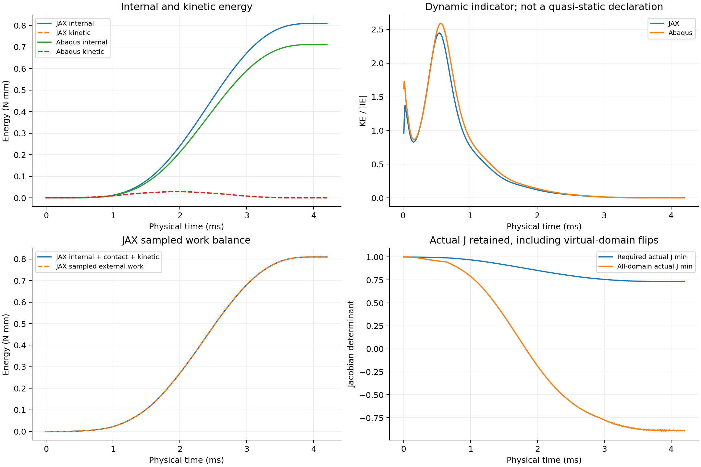
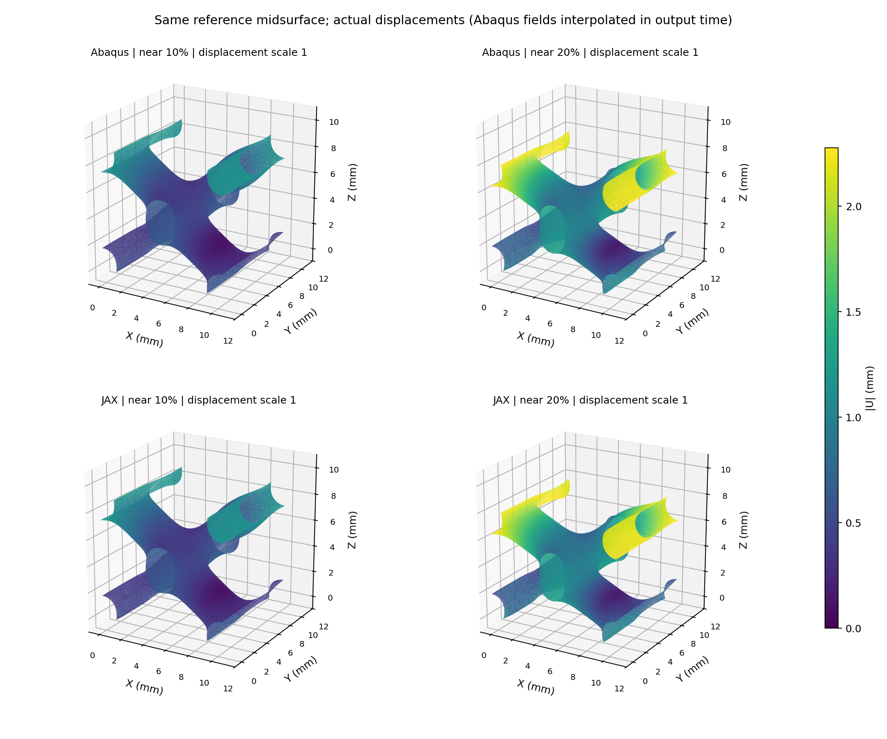

# diverse_28：共同中面端缘压板／XY周期／20%对照

2026-10-12。两端完整20%及保载完成。 本次主要比较上压板总反力随压板总压缩量的变化，原始峰、诊断平滑峰分别报告；没有新梯度或训练。

全曲线RMS／新壳峰值=9.265%；加载功差+13.986%；保载后半段均力差+14.862%。当前共同窗口到20.0000%。分母为new shell full loading peak 0.597145 N；RMS不是逐点误差上限。

## 峰位与曲线

| 求解器 | 原始全局最大力所在压缩量 | 最大力N | 类型 |
|---|---:|---:|---|
| JAX | 20.0000% | 0.684598 | 加载端点；不是内部峰 |
| Abaqus | 20.0000% | 0.597145 | 加载端点；不是内部峰 |

原始全局最大力的位置差（JAX−Abaqus）-0.0000个百分点，峰力差+14.645%。若最大值在加载端点，不能把它命名为已捕捉的屈曲峰。至少一端未捕捉到满足预定显著性规则的内部峰；不计算两端首峰位置差。

平滑仅用于区分主要降载与局部振荡：固定工程压缩网格约0.02个百分点间隔、25点中心均值，显著峰要求prominence不小于自身曲线峰的10%，峰间至少25点。所有合格峰都列在peak_summary.csv，不事后挑最接近的一对；原始曲线指标不平滑、不缩放、不平移。该规则是曲线诊断，不能仅凭反力峰证明两个模型走了同一屈曲分支。

| 压缩量 | JAX上板总力N | Abaqus上板总力N | 相对差 |
|---|---:|---:|---:|
| 2% | 0.165101 | 0.149121 | +10.72% |
| 5% | 0.274376 | 0.243806 | +12.54% |
| 10% | 0.426894 | 0.375804 | +13.59% |
| 15% | 0.542459 | 0.476702 | +13.79% |
| 20% | 0.684598 | 0.597145 | +14.65% |

## 建模条件与可比性

复用原diverse_28的9351节点／17986三角中面，在自身实际N32积分点生成占据场，不拟合几何或体积分数。L10 mm、t0.5 mm、NH E10 MPa／ν0.3／密度1e−9 tonne/mm³。JAX仍为HEX27／27点、HRZ、η1e−4、界面0.05 mm、objective_void/C²；Abaqus为同中面的S3R壳、截面5点。两端物理加载时长均4 ms、保载0.2 ms，五次平滑下压2 mm。

仅XY周期，宏观横向伸缩自由、宏观剪切零，没有Z周期或壁节点额外固定。242条独立节点关系形成1452条壳方程；上下端分别[126, 126]个中面节点接触压板。JAX把自身连续占据端面面积聚合到同一批端缘位置，面积守恒、Q2插值、kn320 MPa/mm；Abaqus端缘节点接触忽略接触厚度，截面厚度仍保留。两端运动学、罚律、接触插值和惯性离散不同；不是同离散问题。

没有全壁面、自接触或周期镜像接触。实际F/J不夹断，主体正J保护及软域能量保留。允许物理跳跃与动能升高；数值失败、步长缩小和能量失衡另行报告。对照只回答共同简化加载下的计算能力，不认证真实完整有限厚度接触。

## 原始文件与解释边界

正式批次`/home/xuehu/projects/tpms_jax/validation/platen_xy_diverse_batch_20261012_r55/diverse_28`，参数在input/protocol.json、INP在abaqus/platen_20pct.inp、原路径在abaqus/result.json与jax/result.json。原生Abaqus目录`E:/ABAQUS/2026temp/Abaqus_Work/tpms_jax_abaqus/r55_diverse_28_midsurface_end_20pct_20261012`，保留platen.inp／platen.odb及dat/msg/sta。

analysis/metrics.json沿用G/P/D对照口径；analysis/peak_metrics.json及CSV记录本次峰定义与原始来源哈希，costs.json记录含准备／编译／提取的实际成本。若有中断，只认实际保存的有效范围，不外推未计算峰。历史曲线仅用于选样，材料、时长、质量与接触条件可能不同，不能当作本轮成对参考或把新旧差定量归因于单一因素。

## 实际成本、健康指标与局部限制

本组成对总墙钟31.76 min（包括准备／编译／检查／求解／提取／自动分析）；预算100 min，不自动重算。是否完整：JAX True、Abaqus True。

JAX步数39862；采样主体最小实际J=0.7317216305220025；全域最小实际J=-0.8979033910323134；拒绝块0；能量／功缺口=9.05178597560355e-06；末端KE/IE=1.7763291382357945e-05。负J弱域保留，不删除其能量；采样并非全过程证明。

Abaqus XY位移方程误差9.313225746154785e-10 mm；末端KE/IE=2.8053089000110698e-05；全局能量漂移／功=0.0018350589412914052。能量比是无量纲比值，跳跃附近的动能不能单独用于否决响应。

|压缩量|中面位移相对RMS差|JAX全部中面越板mm|Abaqus全部中面越板mm|
|---|---:|---:|---:|
|5%|0.84%|0.00067|0.00048|
|10%|0.68%|0.00098|0.00081|
|15%|0.57%|0.00146|0.00126|
|20%|0.60%|0.00185|0.00141|

位移差采用同时间JAX Q2中面插值与Abaqus输出时间插值。全部中面越板、JAX有限宽切面越板、选中端缘罚穿透是不同位置的量；后两者详见field_comparison.json与原路径。共同端缘简化不会阻挡所有其他壁点进入板面。宏观工作目标通过不能代替局部模式、有限厚度接触或梯度认证。

自身高斯积分占据体积分数0.151634；壳中面面积×厚度给出的体积分数0.152163，相对差-0.348%。它是几何表达差异，不进行体积或模量拟合。
