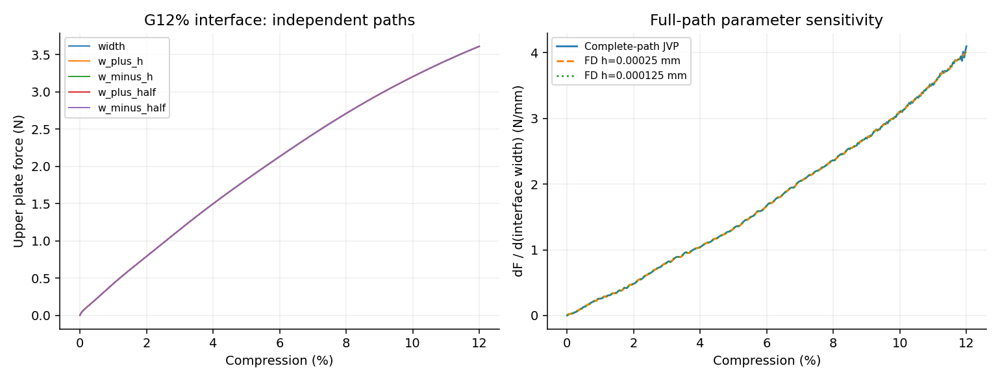

# G12% interface完整界面宽度导数

**主目标加载功梯度通过；末端瞬时力辅助梯度相差1.98%，未过预定1%门槛。** 实际终点压缩11.99955736%。冻结验收目标为loading_work，不能据其通过宣称全部目标通过。

| 目标 | 基线值 | JVP | FD h | FD h/2 | AD/FD差 | 两档FD差 |
|---|---:|---:|---:|---:|---:|---:|
| loading_work | 2.43903709 | 2.13104393 | 2.13103596 | 2.13103956 | 0.000204882% | 0.000168894% |
| terminal_upper_force | 3.61112837 | 4.09923898 | 4.0179435 | 4.01965225 | 1.97994% | 0.0425098% |

加载功单位N·mm，其界面宽度导数单位N；力导数单位N/mm。材料、几何占据、HRZ质量、XY宏观惯性和端部面积均参与求导。

复用前缀时同时载入从零得到的状态、完整参数切向和累计功；保存态不是固定常量，因此这是从零至终点的总导数。每个扰动仍使用自己的独立前缀。新计算成本只含本次延伸，既有前缀成本见5%报告。

固定步长与原20%/4ms五次加载不变；实际终点见上述数值，不对自适应控制决策求导。本终点只验证JVP；实际VJP证据仍限于G5%。

主要材料实际J的采样最小值0.752514；保留全部虚域J和能量。加载功核对通过支持本离散动态路径该目标的局部导数正确性，不能替代Abaqus/实物敏感度、自接触或通用屈曲分支验证。

末端力两档FD相差0.0425%，本次未通过的原因尚未定位。接触集合变化、短时动态敏感度及更小扰动下的差分行为可作为后续诊断方向，目前没有据此确认任何一种原因。按原冻结目标记录主目标通过，并独立保留辅助未通过，不放宽门槛或重选参数。
