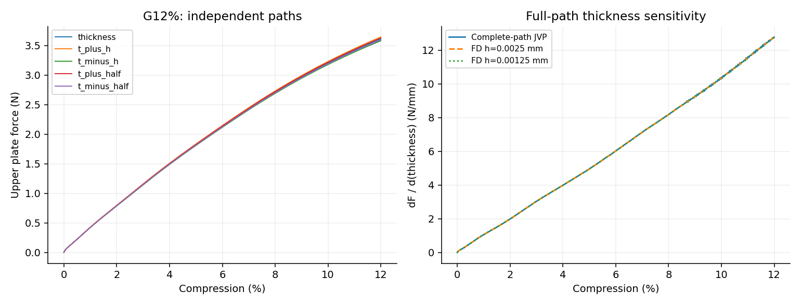

# G12%完整厚度导数

通过预定1%目标；实际终点压缩11.99955736%。

| 目标 | 基线值 | JVP | FD h | FD h/2 | AD/FD差 | 两档FD差 |
|---|---:|---:|---:|---:|---:|---:|
| loading_work | 2.43903709 | 7.39739232 | 7.39769052 | 7.39746247 | 0.000948298% | 0.00308278% |
| terminal_upper_force | 3.61112837 | 12.7789787 | 12.7831761 | 12.7826419 | 0.0286576% | 0.0041793% |

加载功单位N·mm，其厚度导数单位N；力导数单位N/mm。材料、几何占据、HRZ质量、XY宏观惯性和端部面积均参与求导。

复用前缀时同时载入从零得到的状态、完整参数切向和累计功；保存态不是固定常量，因此这是从零至终点的总导数。每个扰动仍使用自己的独立前缀。新计算成本只含本次延伸，既有前缀成本见5%报告。

固定步长与原20%/4ms五次加载不变，取不超过目标压缩的最后一个整步。不对自适应控制决策求导。本终点只验证JVP；实际VJP证据仍限于5%。

主要材料实际J的采样最小值0.746222；保留全部虚域J和能量。通过证明本离散动态路径的局部导数，不能替代Abaqus/实物敏感度、自接触或通用屈曲分支验证。
