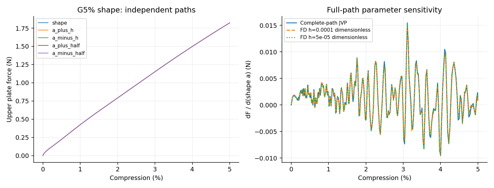

# G5% shape完整周期形态系数a导数

未通过预定1%目标；实际终点压缩5.00000000%。验收目标：loading_work, terminal_upper_force。

| 目标 | 基线值 | JVP | FD h | FD h/2 | AD/FD差 | 两档FD差 |
|---|---:|---:|---:|---:|---:|---:|
| loading_work | 0.479909122 | 0.00067127769 | 0.000673322978 | 0.000674013215 | 0.405856% | 0.102407% |
| terminal_upper_force | 1.82274846 | 0.00135177958 | 0.000783317939 | 0.000936883295 | 44.2847% | 16.3911% |

加载功单位N·mm，其周期形态系数a导数单位N mm；力导数单位N。材料、几何占据、HRZ质量、XY宏观惯性和端部面积均参与求导。

本阶段五条路径均从零完整推进，没有复用前缀。JVP包含真实几何链与完整状态切向，四条FD分别重新查询实际移动曲面，再从零推进。总成本104.22min。

固定步长与原20%/4ms五次加载不变；实际终点见上述数值，不对自适应控制决策求导。本阶段只核对形态JVP；既有G5%完整VJP只覆盖t/w，尚未包括形态链。

主要材料实际J的采样最小值0.903248；保留全部虚域J和能量。加载功核对通过，末端力未通过，所以本阶段整体未通过。不得据此宣布全部形态响应导数有效；这些核对也不能替代Abaqus/实物敏感度、自接触或通用屈曲分支验证。
