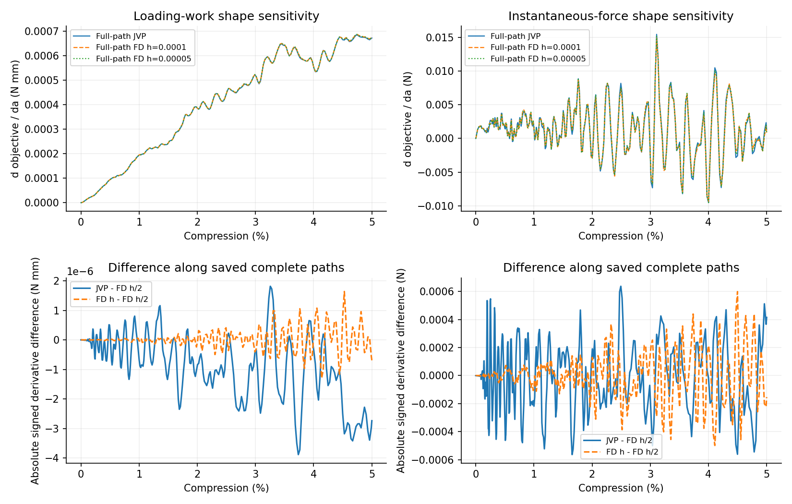

# 构型末端力梯度未通过：已有路径与保存态诊断

原五条完整路径及1%门槛不变：加载功通过，末端瞬时力未通过，所以不启动长反向任务。本诊断没有执行新的时间步。

| 采样压缩 | 目标 | AD | FD h/2 | AD/FD差 | 两档FD差 |
|---:|---|---:|---:|---:|---:|
| 1.00077% | loading_work | 0.0001940262 | 0.0001947001 | 0.34615% | 0.018547% |
| 1.00077% | instantaneous_force | 0.001425992 | 0.001644404 | 13.282% | 5.8759% |
| 2.00432% | loading_work | 0.0003838431 | 0.000384679 | 0.21731% | 0.011009% |
| 2.00432% | instantaneous_force | -0.00273325 | -0.002923839 | 6.5185% | 4.4064% |
| 2.99021% | loading_work | 0.0005217792 | 0.000522203 | 0.081152% | 0.077418% |
| 2.99021% | instantaneous_force | 2.34666e-05 | 9.34491e-05 | 74.888% | 115.23% |
| 4.00157% | loading_work | 0.0005512373 | 0.0005515931 | 0.064513% | 0.03486% |
| 4.00157% | instantaneous_force | -0.009544959 | -0.00952596 | 0.19945% | 2.2388% |
| 5.00000% | loading_work | 0.0006712777 | 0.0006740132 | 0.40586% | 0.10241% |
| 5.00000% | instantaneous_force | 0.00135178 | 0.0009368833 | 44.285% | 16.391% |

5%末端力为1.82274846N；较细差分两条实际力之差只有9.3688e-08N。AD/FD导数绝对差0.0004149N/单位a，仍未过原相对门槛，不能因绝对值小而改标。

按预定形态尺度0.01，无量纲加载功/末端力敏感度为1.3988e-05/7.4162e-06。形态变化确实存在，但这个基线方向的宏观响应一阶变化很弱。

末端逐接触点力导数绝对值之和2.47349N、净和0.00135178N，净和/绝对和0.00054651。正负贡献相互抵消会放大净导数的相对误差；这不是自动证明误差全部来自舍入。

最终观测的状态/字段偏导、FD保存态切向误差和接触活跃集合差异见metrics.json。该偏导仅用于定位问题，不替代原从零完整路径梯度。最终活跃集合相同也不能证明时间历史中始终未切换。较小步长仅重算几何字段，不能据此宣布完整响应梯度通过。
