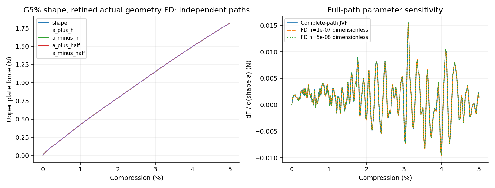

# G5% shape, refined actual geometry FD完整周期形态系数a导数

未通过预定1%目标；实际终点压缩5.00000000%。验收目标：loading_work, terminal_upper_force。

| 目标 | 基线值 | JVP | FD h | FD h/2 | AD/FD差 | 两档FD差 |
|---|---:|---:|---:|---:|---:|---:|
| loading_work | 0.479909122 | 0.00067127769 | 0.000671796507 | 0.000671250833 | 0.00400107% | 0.0812922% |
| terminal_upper_force | 1.82274846 | 0.00135177958 | 0.00127070243 | 0.00149437795 | 9.54232% | 14.9678% |

加载功单位N·mm，其周期形态系数a导数单位N mm；力导数单位N。材料、几何占据、HRZ质量、XY宏观惯性和端部面积均参与求导。

本阶段四条FD均使用实际移动曲面的重新查询，从零完整推进；原G5_shape完整JVP按原字节复用，没有复用有限差分前缀。本阶段新增完整批次70.55min，其中四条FD路径69.98min；共享分析器表中的原JVP33.80min属于历史复用成本，不是本阶段新增成本。

固定步长与原20%/4ms五次加载不变；实际终点见上述数值，不对自适应控制决策求导。本阶段核对形态JVP；已有G5%完整VJP只覆盖t/w，尚未包含形态链。

主要材料实际J的采样最小值0.903264；保留全部虚域J和能量。加载功通过、末端力未通过，整体未通过；不推广到全部形态响应导数，也不能替代Abaqus/实物敏感度、自接触或通用屈曲分支验证。
