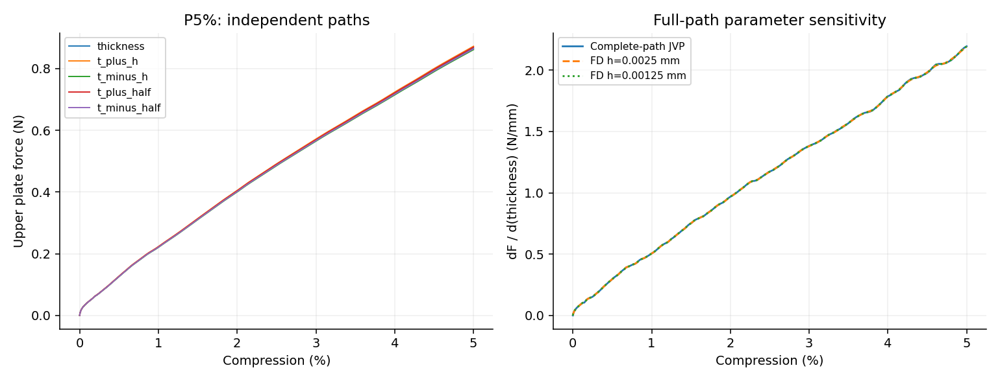

# P5%完整厚度导数

通过预定1%目标；实际终点压缩5.00000000%。验收目标：loading_work, terminal_upper_force。

| 目标 | 基线值 | JVP | FD h | FD h/2 | AD/FD差 | 两档FD差 |
|---|---:|---:|---:|---:|---:|---:|
| loading_work | 0.23632965 | 0.575573644 | 0.575585634 | 0.575574212 | 9.87818e-05% | 0.00198434% |
| terminal_upper_force | 0.866929804 | 2.19404159 | 2.1902093 | 2.19357104 | 0.0214511% | 0.153254% |

加载功单位N·mm，其厚度导数单位N；力导数单位N/mm。材料、几何占据、HRZ质量、XY宏观惯性和端部面积均参与求导。

复用前缀时同时载入从零得到的状态、完整参数切向和累计功；保存态不是固定常量，因此这是从零至终点的总导数。每个扰动仍使用自己的独立前缀。新计算成本只含本次延伸，既有前缀成本见5%报告。

固定步长与原20%/4ms五次加载不变；实际终点见上述数值，不对自适应控制决策求导。本终点只验证JVP；实际VJP证据仍限于G5%。

主要材料实际J的采样最小值0.950053；保留全部虚域J和能量。通过证明本离散动态路径的局部导数，不能替代Abaqus/实物敏感度、自接触或通用屈曲分支验证。
