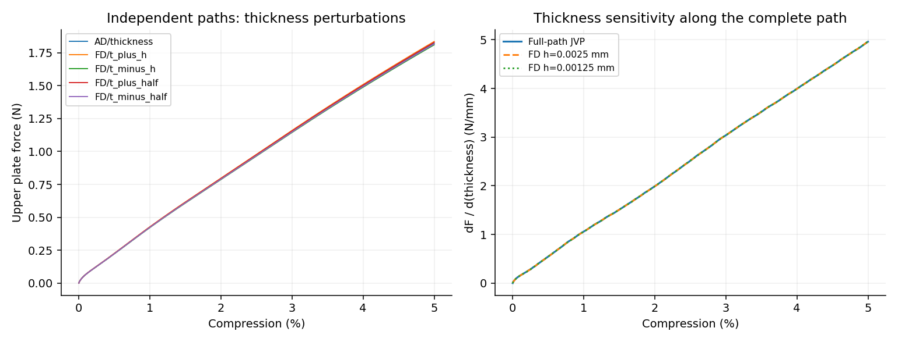

# G5%厚度完整路径梯度结果

第1步通过预先约定的1%导数核对目标。尚未验证反向回传或构型梯度。

| 目标 | 基线值 | JVP | FD h | FD h/2 | AD/FD差 | 两档FD差 |
|---|---:|---:|---:|---:|---:|---:|
| loading_work | 0.479909122 | 1.25814362 | 1.25819769 | 1.2581533 | 0.00076899% | 0.0035281% |
| terminal_upper_force | 1.82274846 | 4.96063233 | 4.96389317 | 4.96371444 | 0.062093% | 0.0036007% |

加载功单位N·mm，其厚度导数单位N；总力单位N，其厚度导数单位N/mm。FD是独立完整路径核对，JVP是自动微分；所有路径固定相同步长和加载前缀，包含占据、质量、宏观投影与端部面积的变化。

总成本约106.57min；数值守卫采样中主要材料实际J最小0.89961。虚域负J与全部材料能量保留。有限采样不等于每时每点的严格证明。

这里求的是既定动态加载路径的敏感度，包含惯性与接触，不等于静力平衡导数。少量参数AD不保证比差分更快，当前先验证正确性；反向回传的多参数优势还须实际验证。

本结果证明限定JAX离散模型的求导实现，不能替代物理设计敏感度或其他构型验证。原20%导数符号失败不变。
