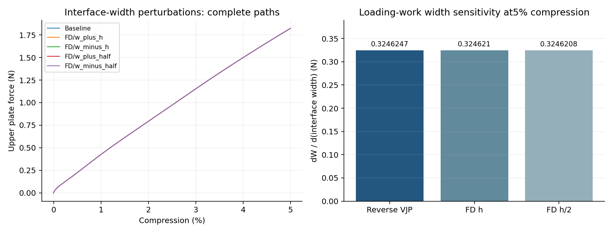

# G5%界面宽度完整反向导数

界面参数核对通过预定门槛；该参数控制数值过渡，不是实体壁厚。

| 目标 | 反向VJP | FD h | FD h/2 | VJP/FD差 | 两档FD差 |
|---|---:|---:|---:|---:|---:|
| 加载功对w导数（N） | 0.3246246775 | 0.3246209529 | 0.3246207677 | 0.00120441% | 5.70388e-05% |

w为0.05mm的10–90%界面宽；厚度0.5mm、中面、材料、N32、固定时间步与原加载前缀保持。w改变Gauss占据、质量/宏观惯性和端缘面积权重；以上变化均进入完整路径反向链。四条FD均从零独立计算。

本定义β=2ln9/w=87.888983mm⁻¹，因此dW/dβ=−w²/(2ln9)·dW/dw=-0.00018467882N·mm²；不能与历史无量纲β混同。

此次反向目标是加载功。末端力的宽度导数仅有差分记录，不称其AD已验证。厚度的功/力JVP与完整功VJP另见上级报告；10%/12%、P和构型系数仍需依规划推进。

通过说明既定JAX离散动态模型的局部导数实现正确；不自动证明Abaqus或实物具有相同敏感度，不靠调整w拟合壳曲线。
