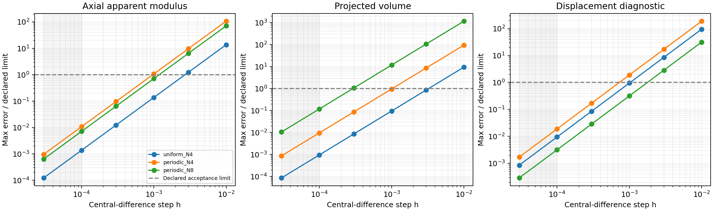
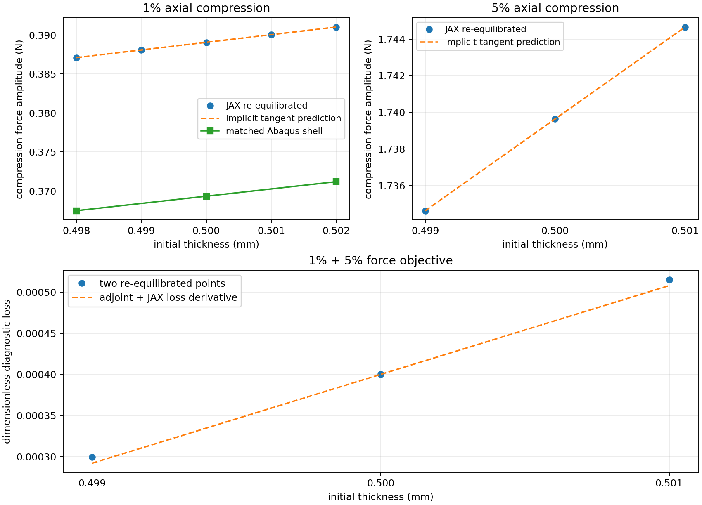
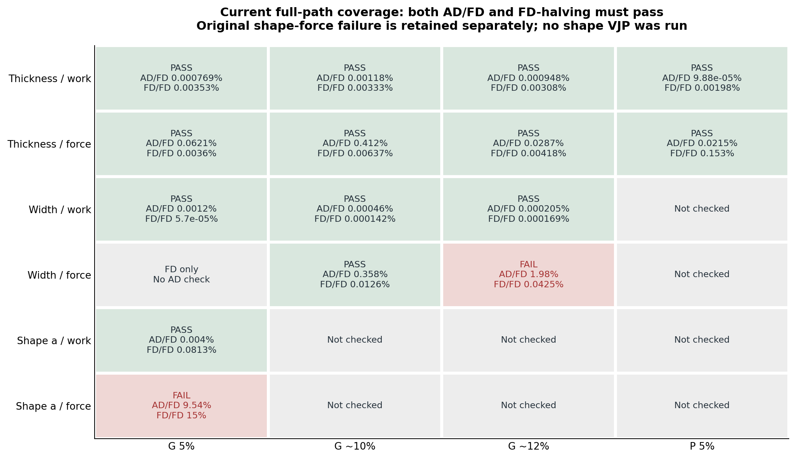
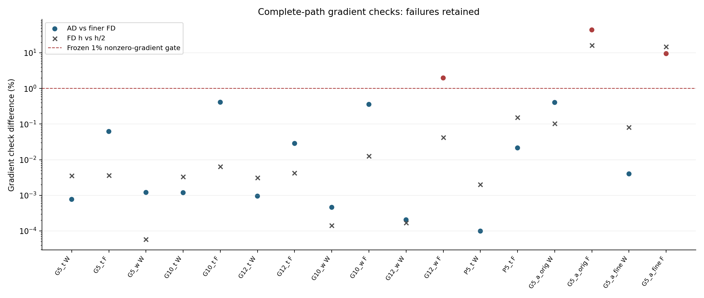
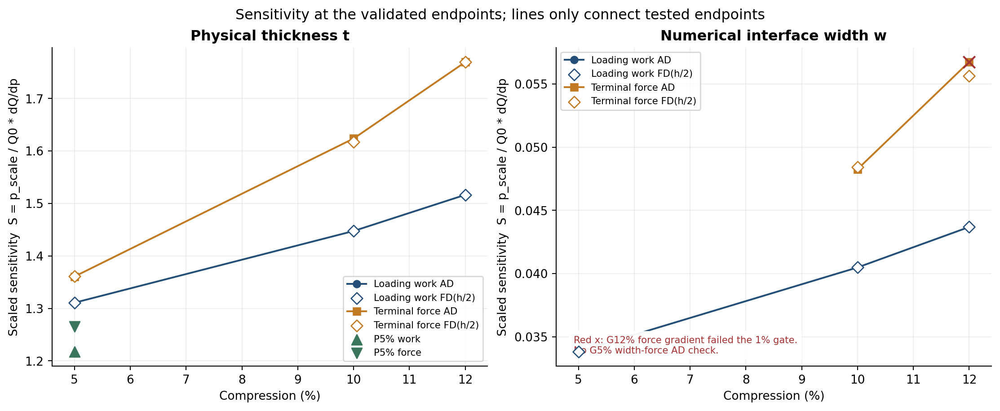
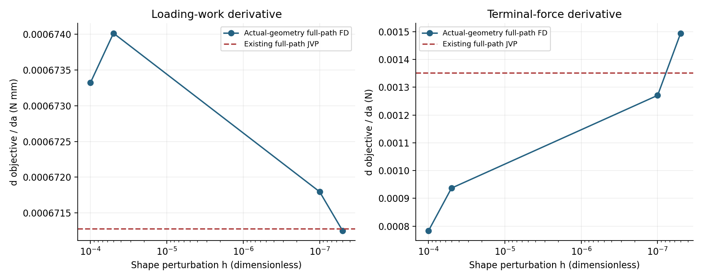
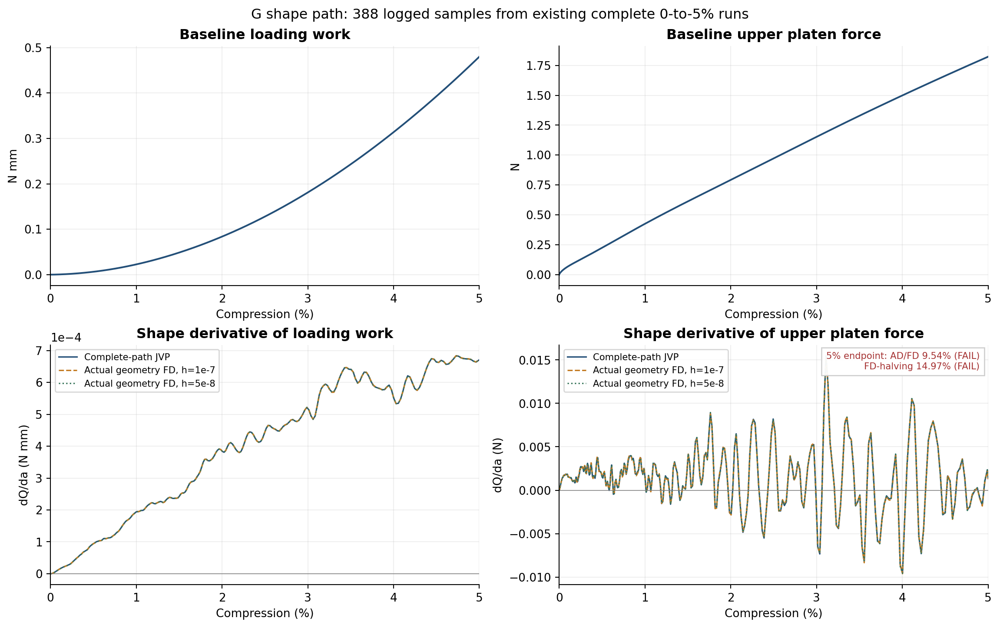
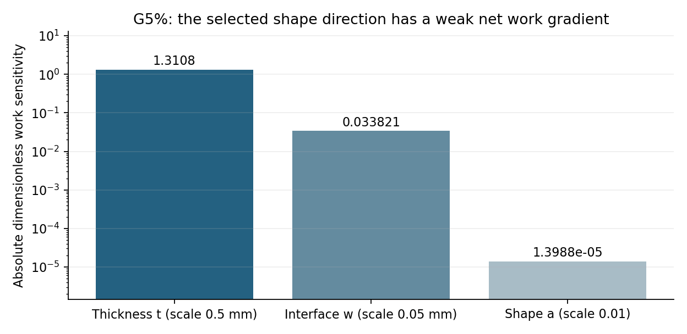

# TPMS梯度传递研究：完整回顾、结果与当前判断

整理日期：2026-10-12。覆盖2026-10-02以来与梯度有关的主要工作，重点为r53共同端缘压板模型。**本次只整理已有数据、重绘曲线并更新文档；没有新增有限元求解、自动微分、差分扰动或Abaqus作业。每30分钟自动检查已暂停。**

我们已经证明：固定背景网格的薄壁TPMS模型能够把厚度、界面宽度以及一个连续形态方向的变化传递到力学响应，而且其中多个完整响应导数能被独立差分复核。G5%加载功还实际完成过对厚度和界面宽度的反向回传。这已超出“理论上可导”的阶段。

边界同样明确：当前形态参数的加载功梯度通过，末端瞬时力梯度未通过；包含形态的完整三参数反向尚未执行。历史20%厚度梯度曾出现符号失败。**项目具有继续研究的实证基础，但尚没有通用构型、完整接触和大压缩梯度均可靠的证据。**

## 1. 梯度工作在整个项目中的位置

长期问题是：能否用JAX-FEM在固定背景网格上计算薄壁TPMS受压响应，并保留足够可靠的设计梯度，服务后续构型／参数学习和逆向设计？当前把训练推后，是为了先确认力学计算和梯度这两个基础环节。

这里有三个不同层次，不能互相替代：

| 层次 | 回答什么 | 当前证据 |
|---|---|---|
| 前向响应 | 给定结构能否算出可信的力—压缩曲线？ | 共同中面端缘加载下G/P的20%整体曲线、功与保载力接近Abaqus壳；D有明显局部模式分歧和参考壳失败 |
| 离散梯度 | JAX回传的是不是自己所计算响应的总导数？ | 厚度、部分界面与形态加载功已有完整路径AD/FD通过证据；存在明确失败 |
| 物理设计有效性 | 沿梯度改变真实结构，参考模型／实验是否也有预期改善？ | 旧1%厚度有独立壳敏感度对照；当前新形态族尚无独立参考敏感度认证，也没有优化或训练成果 |

前向比较中的3%、5%等是不同模型响应之差；本报告的0.004%、1.98%、9.54%等是同一个JAX模型的导数核对差。二者分母、对象和含义不同，不能并成一个“总误差”。

## 2. 我们实际上要回传什么

设计参数记为p，响应记为Q。导数dQ/dp描述基线附近一个小参数变化对响应的一阶影响。例如dF/dt=4.96 N/mm，表示局部增厚0.001 mm时，末端力的一阶预测约增加0.00496 N；它不是允许把壁厚直接增加1 mm后的预测。

仅对固定变形状态中的材料公式求偏导，会漏掉结构随参数改变而发生的位移、速度和接触反力变化。平衡问题满足R(u,p)=0，其总导数可写为：

\[
\frac{dQ}{dp}=Q_p-\lambda^T R_p,\qquad R_u^T\lambda=Q_u^T.
\]

u为平衡位移，R为有限元残差；伴随变量λ用于把位移解对参数的影响传回目标。旧薄壁平衡试验中，漏掉该项会漏掉约20%～30%的厚度反力导数，见第4节。因此“占据函数可导”只是必要环节，不等于整个计算已经可导。

显式动力学则把状态s（位移、半步速度等）逐步推进：sₙ₊₁=Φₙ(sₙ,p)。总导数必须沿所有时间步传播，并包括初始状态／初始加速度的参数依赖。当前链条为：

**几何参数 → 距离与占据 → 内力、质量和端部接触权重 → XY宏观惯性投影 → 全部时间推进 → 压板力与累计加载功。**

JVP是正向自动微分：沿一个参数方向同步推进状态切向，得到该方向的完整响应导数。VJP是反向自动微分：从一个标量目标向前面的状态和参数回传，能够一次返回多个输入方向的梯度。FD为中心差分：(Q(p+h)−Q(p−h))/(2h)，需要重新计算扰动后的模型和响应。这里用FD检验AD，不把FD包装成AD。

少量参数时JVP很实用；大量输入、少量标量目标时VJP有扩展潜力。但完整显式反向需要保存状态或重算。我们已采用分块checkpoint和重算完成一次t/w反向，尚未证明高维设计的实际速度优势。

## 3. 当前模型、变量和目标的确切含义

当前r53沿用G/P薄壁单胞：边长L=10 mm，名义壁厚t=0.5 mm，均质可压缩Neo-Hookean基材E=10 MPa、ν=0.3、密度1e−9 tonne/mm³。背景每轴32个HEX27单元，每单元27个Gauss积分点；HEX27是27节点二次六面体，节点数与积分点数不是同一概念。采用HRZ正集中质量、已保存的objective_void/C²虚域能量和η=1e−4。

两端采用中面端缘等效压板接触，仅XY周期，横向宏观伸缩自由。Abaqus壳也采用中面端缘接触；壳厚仍参与截面刚度和质量。该方案用来减少端部定义的干扰，不包含完整有限厚度壁面或自接触。没有为了拟合壳曲线调整厚度、模量、阻尼或力缩放。

参考Gauss点到周期三角中面的距离d定义连续占据：

\[
\phi=\operatorname{sigmoid}\!\left(\frac{t/2-d}{\ell}\right),\quad
\ell=\frac{w}{2\ln9},\quad \beta=\ell^{-1}=\frac{2\ln9}{w}.
\]

φ近1表示壁内，近0表示孔隙，w=0.05 mm为单侧界面10%到90%的过渡宽。参考占据附着材料点，不随当前空间位置重新分类。该平滑是几何近似，孔隙弱材料是数值处理，不是研究多种真实材料。真实F与J=detF未夹断；主体φ≥0.01保留正J要求，低占据虚域翻转和能量按原规则记录，不能删掉不利项改善能量账目。

| 参数 | 定义／尺度 | 本轮意义 |
|---|---|---|
| t | 0.5 mm；比较尺度0.5 mm | 真实壁厚，保持中面不动 |
| w | 0.05 mm；比较尺度0.05 mm | 数值界面宽度，用于研究表示敏感性，不作为拟合参考的旋钮 |
| β | 87.8889831 mm⁻¹ | w的倒数派生量，不是独立第四变量 |
| a | 无量纲，基线0、预定尺度0.01、局部范围±0.01 | 一个固定端缘的周期中面形态坐标 |
| G/P/D | 离散标签 | 没有本轮意义下对“类别”的普通连续导数 |

在归一化顶点坐标中，形态参数定义为x→x+a sin(2πx)sin²(πz)，y、z不变。它移动内部中面顶点，固定周期缝和上下端缘，保持三角连接；是变形G中面的局部形态族，不保证仍为严格极小曲面，也不覆盖所有解析TPMS系数或拓扑改变。a=0恢复原几何。

两个目标分别为上压板末端总反力F（N）和加载功W=∫F_top dδ（N·mm），δ为正压缩位移。W是压板在加载路径上的输入功；动力学中不等于弹性储能，还可能转化为动能、接触能与耗散。当前梯度使用原20%／4 ms五次平滑加载的前缀，而不是为每个终点重新设定一个加载时间。G5%为24,789步、dt约57.9993 ns、实际时刻1.437744659 ms，无保载；约10%／12%的整步终点为9.99990510%／11.99955736%。

对t/w，dW/dp单位为N，dF/dp为N/mm；对a则分别为N·mm和N。当前求的是固定dt、固定步数下的导数，不包含自适应接受／拒绝、减步和步数取整决策的导数。延伸路径同时带入已有状态、切向和累计功，保留从零历史；只复用状态而冻结其参数依赖会得到不完整导数。

## 4. 梯度研究如何逐步推进，以及早期试验留下了什么

这些试验的加载和几何定义不同，以下按科学问题整理，不把旧阶段的通过直接移植到当前压板模型。

### 4.1 从有限元方程到几何参数：先证明完整伴随链

2026-10-02使用小网格HEX8线弹性Gyroid，参数为周期水平集半宽场(c₀,aₓ,aᵧ,a_z)，目标包括表观模量、投影体积分数和非平稳位移诊断。三组N4/N8检查、132次差分扰动前向完成；末两档步长全部满足事前门槛，最大相对差约0.002480%。

加入非平稳位移目标是有用的：平衡能量对自由位移的偏导可为零，只检验能量有时会漏掉错误的位移回传。位移诊断必须经过伴随链才有正确的非零梯度。这一阶段证明安装版JAX-FEM的周期缩减伴随在所选离散问题上可用，但其半宽参数不是后来恒厚薄壁的物理壁厚。

图1：原2026-10-02图按原字节引用。其门槛和模型保留当时定义，不与r53的1%门槛混用。

### 4.2 数组输入可回传，并不保证输入保留原来的几何响应

最初直接采样连续占据φ再做周期三线性插值：M64数组到N64背景后，刚度相对解析输入偏1.364%，对二值实体参考偏2.615%，未达到当时1%／2%的工作目标。体积分数只微变，但过渡区域体积比例由9.628%扩大到16.579%。小网格数组→插值→FEM的完整伴随最大相对差5.981e−9，却不能据此宣布该数组接口有足够物理保真度。

随后改为采样带符号隐式场，先插值几何量、再进行平滑投影，M64基准的刚度映射差降为0.286%，过渡区约9.642%。三个几何锚点的数组／实体参考差约1.44%～1.61%，达到当时目标；M32不通过记录保留。N8/N32导数核对通过，但N64通用伴随受资源门槛限制未执行。

再后来利用线弹性驻值能量为特定刚度／体积目标构建专用导数，N64两个方向和两步长共8项核对通过，最大相对差4.202e−7。它复用已求得的平衡解，避免额外通用伴随矩阵。这是特定线弹性目标的有效简化，不能推广为任意非线性反力或动力历史的导数规则。

同轮相近用料的壁宽锚点性能跨度不足，新实体G48网格又出现非流形失败，学习示例在前置阶段停止。不能写成训练完成，也不意味着背景可导路线失败。上述数组验证属于旧线弹性模型；当前新薄壁压板、任意生成数组和形态网络仍需独立接入检验。

### 4.3 真正薄壁的平衡厚度导数：证明位移回传不可省

diverse_28、L=10 mm、t=0.5 mm的旧XYZ周期N64薄壁模型，在1%和5%压缩重新求平衡差分后，厚度总导数通过。以下数值沿用旧反力正幅值Q的口径。

| 压缩 | 总导数N/mm | 固定位移偏导N/mm | 漏掉的平衡校正 | AD/FD差 |
|---|---:|---:|---:|---:|
| 1% | 0.979164 | 0.783805 | 19.95% | 0.000147% |
| 5% | 5.012674 | 3.520740 | 29.76% | 0.000202% |

1%另有独立Abaqus壳厚扰动：壳导数0.929534 N/mm，与JAX同向、幅值相差5.339%；5%没有独立壳厚梯度认证。两观察点构成的反力损失导数也通过，AD/FD差0.003116%。这证明目标函数到厚度的链式传递可实现，但只覆盖两个点，没有进行实际优化。

图2：旧XYZ平衡问题的结果，保持原日期和加载定义；不与当前压板结果拼成同一条曲线。

### 4.4 动力学总导数出现过真正失败

旧NH／XYZ显式路径中，10%和15%厚度反力JVP分别为−10.648858、−11.656391 N/mm，与完整路径差分相差约0.0047%。20%保载平均反力却得到JVP +76.093668 N/mm、FD −10.797551 N/mm，连符号都不同。旧负反力符号与本报告正压缩力口径不同，但20%内部符号矛盾是真实失败。

因此，大压缩前向能完成不代表梯度有效；末态静力伴随也不能取代动力历史的总导数。后来C²虚域材料核与局部AD/FD通过，只说明局部公式自洽，不会自动修复或覆盖旧完整20%失败。这些记录保留在原r6/r12目录，没有按新结论改写。

## 5. r53验收方式：从完整扰动路径核对，而非只看一张重合曲线

当前对明显非零导数同时要求：AD与较细FD相对差≤1%，FD(h)与FD(h/2)相对差≤1%。分母采用原协议的较细差分幅值，所有原始值在CSV／metrics.json中。两档FD是为了检查差分自身是否稳定；只取最接近AD的一档不能作为通过。

近零判据事前定义：|FD(h/2)|×参数尺度／目标尺度<1e−6时，改按无量纲绝对差≤1e−5核对AD/FD及FD减半。目标尺度按协议为1 N·mm或1 N；本总表17行均没有进入近零分支。不能因为形态导数小而临时改用更宽松规则。

完整形态FD每条都从零开始，移动真实中面并重新查询距离，不用线性化距离造扰动来验证自己的线性化规则。完整JVP包含全部时间步。几何层、保存态和短块检查单独保存，不计作完整路径通过。

## 6. r53全部梯度核对记录

下表汇总17项“阶段×目标”记录，包含原形态和一次补充，不是17个彼此独立的设计变量。14行通过、3行未通过；其中原／补充形态共享同一条JVP，不重复计作独立AD证据。完整基线、双档FD值、终点和来源见[gradient_table.csv](gradient_table.csv)。

| 阶段／目标 | AD模式 | 梯度 | 单位 | 无量纲S | AD/细FD差 | FD减半差 | 判断 |
|---|---|---:|---|---:|---:|---:|---|
| G5_t／功W | JVP | 1.258143624 | N | 1.310814 | 0.000768987% | 0.003528054% | 通过 |
| G5_t／末端力F | JVP | 4.960632332 | N/mm | 1.360756 | 0.06209285% | 0.003600736% | 通过 |
| G5_w／功W | VJP | 0.3246246775 | N | 0.03382147 | 0.001204408% | 5.70388e-05% | 通过 |
| G10_t／功W | JVP | 5.084342619 | N | 1.447507 | 0.001184933% | 0.003331261% | 通过 |
| G10_t／末端力F | JVP | 10.40444304 | N/mm | 1.623742 | 0.4119534% | 0.006370908% | 通过 |
| G12_t／功W | JVP | 7.397392321 | N | 1.516458 | 0.0009482977% | 0.003082777% | 通过 |
| G12_t／末端力F | JVP | 12.77897867 | N/mm | 1.769389 | 0.02865758% | 0.004179297% | 通过 |
| G10_w／功W | JVP | 1.421952654 | N | 0.04048284 | 0.00045958% | 0.0001421731% | 通过 |
| G10_w／末端力F | JVP | 3.092588639 | N/mm | 0.04826367 | 0.3582104% | 0.01259442% | 通过 |
| G12_w／功W | JVP | 2.131043927 | N | 0.04368617 | 0.000204882% | 0.000168894% | 通过 |
| G12_w／末端力F | JVP | 4.099238978 | N/mm | 0.05675842 | 1.979941% | 0.04250982% | **未通过** |
| P5_t／功W | JVP | 0.5755736439 | N | 1.217735 | 9.878182e-05% | 0.001984337% | 通过 |
| P5_t／末端力F | JVP | 2.194041589 | N/mm | 1.265409 | 0.02145107% | 0.1532545% | 通过 |
| G5_a_original／功W | JVP | 0.0006712776899 | N mm | 1.39876e-05 | 0.4058563% | 0.1024071% | 通过 |
| G5_a_original／末端力F | JVP | 0.001351779583 | N | 7.416161e-06 | 44.28474% | 16.39109% | **未通过** |
| G5_a_refined／功W | JVP | 0.0006712776899 | N mm | 1.39876e-05 | 0.004001074% | 0.08129221% | 通过 |
| G5_a_refined／末端力F | JVP | 0.001351779583 | N | 7.416161e-06 | 9.542323% | 14.9678% | **未通过** |

图3：绿色表示在所列终点满足两项门槛；红色表示未通过；灰色表示没有该项验证。G5%宽度末端力只有FD记录，没有独立AD核对。图中形态格使用补充结果，原失败仍在上表。连接几个终点不能证明整个参数域或所有压缩点都通过。

图4：所有17项核对的原总览，1%线保持原门槛。保留失败可以区分“方法链已建立”和“这个目标已经可用”。

## 7. 厚度与界面结果说明了什么

厚度是当前证据最完整的真实几何变量：G5%、约10%、约12%和P5%的功与末端力JVP均通过。G加载功厚度导数由1.2581增至5.0843、7.3974 N，末端力导数由4.9606增至10.4044、12.7790 N/mm；后者随压缩变化，不能用一个初始刚度导数描述全部响应。

为比较不同单位，采用无量纲敏感度S=(p_scale/Q₀)dQ/dp。G加载功的厚度S在5%／10%／12%约为1.31／1.45／1.52；局部厚度增加1%，一阶预测功增加约1.31%／1.45%／1.52%。这属于局部设计信息，不是已经优化所得收益。

界面宽度的功S约0.0338／0.0405／0.0437，明显小于厚度，但并非零。它表明平滑表示对力学响应确有影响，也可以得到可复核的导数；不是应把w调到某个值去拟合Abaqus。G约12%的宽度末端力AD/FD差1.98%，尽管FD减半差仅0.0425%，仍未通过。该点说明导数可靠性与目标选择有关，并不简单等于“压缩不到12%就全部没问题”。

图5：AD与细FD在多数点近乎重合；红叉保留G12%宽度末端力失败。线只连接已测试终点，P只有5%点。两面板纵轴范围不同，跨变量的尺度比较应读S数值。

β与w是一一对应的同一自由度，链式换算为dQ/dβ=−w²/(2ln9)·dQ/dw。G5%加载功dW/dβ≈−0.0001846788221 N·mm²；若采用β₀作尺度，则Sβ=−Sw。符号相反来自倒数变换，不是梯度矛盾。完整值见[derived_beta.csv](derived_beta.csv)，它继承w的通过范围，不增加独立验证。

## 8. 构型梯度如何接入，以及为什么还不算全部通过

原距离缓存由JAX外部三角几何程序计算；把缓存数组传进JAX，只能得到对该数组及下游参数的导数，不能自动知道移动中面会怎样改变距离。我们为固定三角连接、局部唯一最近点建立解析距离JVP：d′=−n·ΣλᵢVᵢ′，其中λᵢ是最近点在三角面上的重心权重，n从中面最近点指向查询点，Vᵢ′是顶点运动方向。

实现使用JAX自定义JVP连接外部距离查询；不是在AD规则内部使用中心差分。几何层还核对占据、HRZ质量、XY惯性和端部面积等链，基线及短链对偶通过。保持端缘固定使接触采样位置与归并拓扑不动，但面积／占据变化仍参与求导。这里的特殊端缘固定选择降低了第一轮形态求导复杂度，也限制了结论范围。

原形态扰动h=1e−4和5e−5时，完整加载功核对差0.40586%、FD减半0.10241%，通过；末端力差44.2847%、FD减半16.3911%，未通过。低成本几何诊断发现原扰动跨过窄的最近三角面切换区；h=1e−7时字段核对差约0.000115%。这支持缩小扰动作一次有界补充，不说明最近面编号切换本身必然意味着距离不可导。

补充只新增四条真实几何FD，h=1e−7、5e−8；复用原33.80分钟JVP。加载功核对差降到0.004001%，FD减半0.081292%，通过；末端力虽由44.28%降至9.54232%，但FD减半仍达14.9678%，没有形成满足门槛的收敛证据。改善是有意义的，不能把“比原来更接近”改写为“通过”。

图6：包含原和补充四个已计算扰动尺度。功导数在小扰动下接近JVP，瞬时力没有相同的稳定证据；不继续自动增加FD阶梯。

## 9. 从曲线、局部贡献和保存态能得到哪些更具体的判断

图7：从已有五条完整路径提取388个日志采样点重绘，无新增时间推进；不是每个时间步都保存。上排基线功和力持续增加，下排形态功导数较平稳，形态力导数则明显振荡并多次变号。导数三条线整体很接近，但图幅会掩盖末端小净导数的相对差，仍须读取表中的9.54%／14.97%，不能用视觉重合代替验收。

这个形态方向对宏观目标的一阶影响很弱：a尺度0.01下，功S≈1.39876e−5，力S≈7.41616e−6。它们比厚度方向小很多，但只说明所选a方向在当前基线附近弱，不说明所有构型变化都不重要。端缘固定与结构对称性可能参与这种弱响应，目前没有定量分离，也未验证有限幅值的二阶效应。

末端156个上端活跃接触点的力导数，绝对值之和约2.47349 N，净和仅0.00135178 N，即净值约为绝对和0.05465%。这相当于多个较大的正、负局部贡献高度抵消，净导数很容易受到微小状态差异影响。最细FD两条路径的最终力差仅约1.494e−10 N，而基线力约1.82275 N；这个差量对累积误差敏感。抵消是观察到的事实，“全部由浮点误差造成”则还没有证据。

原／补充路径的最终活跃接触集合相同；把保存态FD切向代入最后一步反力观测，可以复现对应完整FD。这将差异定位到已累积的状态切向，排除了“只改最后一步力提取就能解决”的简单解释。最终集合相同不能证明整个历史没有接触开闭或近切换事件。已有中间采样也显示力导数差的敏感性：约3%时净导数接近零、相对差显著放大，而约4%的所采样点两项核对较好。它们用于定位，不另作全区间认证。

目前较有依据的解释是：**弱形态方向、局部贡献抵消和动态振荡共同使瞬时力导数的核对条件较差；原较大扰动还受到几何最近面切换区影响。** 历史接触切换、几何局部非光滑和浮点累积各自占比尚未分离；不能据现有数据断言存在某个AD实现错误，也不能宣布所有数值实现都已排除问题。

功是沿压缩位移的积分，正负的高频导数变化可在积分中抵消，所以同一条历史上W′比F′更稳定是合理解释，并与图7相符。它支持先研究积分型性能目标，不证明任何积分目标都会自动通过，也不能以功通过代替瞬时峰值、局部应力或接触敏感度通过。诊断原件见[保存态诊断](../G5_shape_refined_diagnostic/README.md)和[几何诊断](../G5_shape_geometry_diagnostic/README.md)。

图8：采用事前尺度比较t/w/a。a基线为零，使用0.01尺度，不能用a₀=0乘导数后误称无敏感性。

## 10. 实际反向回传做到哪里，成本如何

G5%加载功已有一次真正包含全部时间步的VJP：

\[
[dW/dt,dW/dw]=[1.258143623833,\ 0.324624677509]\ \mathrm{N}.
\]

厚度VJP/JVP相对差2.9482e−12（无量纲；换成百分比再乘100），宽度VJP/FD差0.0012044%，均通过对应核对。该反向对t和w有效，不包含a。使用分块checkpoint／重算使完整路径反向能在现有机器完成，实际90.89分钟。几何短链对偶通过不等于三参数完整反向已经跑过。

| 阶段 | 新增分钟 | 口径 |
|---|---:|---|
| G5_t | 106.57 | 准备与五条完整路径 |
| G5_w | 70.77 | 四条完整FD，共享已有反向证据 |
| G10_t | 41.06 | 新增求解路径计时，不含外层构建/分析与既有前缀 |
| G12_t | 16.46 | 新增求解路径计时，不含外层构建/分析与既有前缀 |
| G10_w | 74.62 | 新增求解路径计时，不含外层构建/分析与既有前缀 |
| G12_w | 16.50 | 新增求解路径计时，不含外层构建/分析与既有前缀 |
| P5_t | 75.29 | 新增求解路径计时，不含外层构建/分析与既有前缀 |
| G5_a_original | 104.22 | 五条完整路径；原结果完成时刻减冻结启动时刻，含33.80min JVP |
| G5_a_refined | 70.55 | 四条新增完整FD与分析，排除原JVP复用成本 |
| G5_W_reverse_t_w | 90.89 | 一次实际完整反向，覆盖t/w |

形态补充批次70.55分钟，其中四条FD路径合计69.98分钟；原33.80分钟JVP按原字节复用，不再计新增成本。延伸阶段只记新增后缀，不重复累计已有前缀。部分旧报告记录含外层构建／分析的整批时间，比表内路径计时约多0.5分钟；口径都保留，没有选更短数字掩盖成本。原数据见[costs.csv](costs.csv)。

这些是验证实验成本，不是每次设计评价都必须执行一组FD。以后正常使用已认证梯度不必逐次做双档FD，但改变模型／目标／参数域仍需代表性复核。当前只有少量参数，不能宣称AD普遍比差分快；在高维设计中，反向一次返回多输入梯度的潜力尚需实测内存、成本和可靠性。

## 11. 对整个科研目标的客观判断

**受控薄壁TPMS的背景有限元计算与有限范围设计梯度，已经有足够实证支持继续这条路线。** 其依据不是单次曲线看起来相似，而是：G/P共同加载前向对照较好；多个厚度总导数跨压缩终点、跨到P构型通过；一次实际t/w反向完成；独立的几何形态链进入完整动力加载功并通过双档FD。

与此同时，“一定程度替代Abaqus”应限定为已测试的几何、材料、加载理想化和宏观目标。共同端缘压板下G/P的20%曲线RMS差分别3.42%／2.78%，功差3.86%／3.65%，保载均力差5.76%／4.80%；D的局部模式在10%／15%已分歧13.05%／26.70%，参考壳18.4%失败。不能用G/P整体量接近覆盖D、完整有限厚度接触或自接触。

梯度方面，当前最扎实的是厚度及G限定范围的加载功；形态加载功已具备完整正向导数核对证据，但完整形态反向、其他连续形态方向、网络输出到当前动力模型以及参考模型的形态敏感度均未验证。历史20%厚度符号失败说明大变形梯度仍是独立问题。

因此，现状不构成“路线不可行”的证据，也不足以承诺通用大变形逆设计已经可用。不需要因为当前一个弱形态瞬时力核对失败就换方向；也不宜据功通过跳过反向和物理敏感度验证直接训练。下一阶段若继续，应围绕清楚定义的性能目标补齐最短缺口，而非再堆叠大量未区分原因的扫描。

## 12. 实际停点、保留建议与未验证事项

原四步执行情况：第1步参数整理和P5收口完成；第2步形态几何链完成；第3步完整形态核对整体未通过（功通过、力失败）；第4步数值总表完成，但包含a的实际完整VJP未启动。因此四步没有全部完成。原协议、1%门槛、近零门槛和原／补充失败均保持。

用户已明确选择先看总结、不启动新完整反向；每30分钟heartbeat id=tpms已暂停，本次不新增计算。后续若用户选择继续，保留以下研究建议，均不是当前执行队列：

1. 将已通过的G5%加载功明确作为独立反向目标，记录目标范围调整，保留原瞬时力失败；复用既有分块反向，先核对[t,w,a]短块对偶和成本，再实际做完整三参数VJP，并分别对JVP／双档FD核对。
2. 若瞬时力必须作为设计目标，先研究完整历史的接触切换、弱方向抵消及可分辨尺度；不继续盲目缩小FD，不放宽原门槛。窗口平均力或曲线积分是可研究的新目标，不能直接替换原目标并重标原失败。
3. 待数值链可靠后，再选少量真实几何扰动检查独立参考模型的敏感度方向和幅值，随后才讨论优化／训练。不把所有构型与大压缩同时加入下一轮。

中面偏移c、其他形态系数、材料E／ν／密度、η、接触罚刚度及加载时间未作为本轮设计变量验证；G/P/D类别是离散变量。P10%／12%、D梯度、自接触、拓扑改变、二阶导数、任意体素输入和完整20%反向均无本轮通过结论。训练、新Abaqus和Git提交未进行。

## 13. 文件位置、原始证据和本次整理内容

正式程序仅在WSL `/home/xuehu/projects/tpms_jax`。本批正式证据为`validation/platen_xy_gradients_20261011_r53`；Windows阅读副本为`output/r53_platen_xy_gradients_20261011`。本页是唯一的梯度详细综合报告；根状态页只维护结论与停点，方法页维护理论和假设，主规划维护是否继续及条件。

| 文件／目录 | 内容 |
|---|---|
| [gradient_table.csv](gradient_table.csv)、[metrics.json](metrics.json) | 原17项总表及原来源哈希，未重算或改写 |
| [derived_beta.csv](derived_beta.csv)、[costs.csv](costs.csv) | 原派生量与分口径成本 |
| [shape_saved_path.csv](shape_saved_path.csv) | 本次从5条已有完整路径提取的388个日志采样点 |
| [summary_provenance.json](summary_provenance.json)、[plot_receipt.json](plot_receipt.json) | 本次资料来源及重绘图哈希，零新FE／AD／FD |
| [plot_existing_results.py](plot_existing_results.py) | 只读CSV的绘图配方，不导入力学求解器 |
| ../../input/、../../AD/、../../FD/及G10／G12／P5／G5_shape* | 正式冻结输入、实际路径、保存态与失败；完整大数组留WSL |
| ../../tools/ | 实际轻量参数、形态和反向适配；没有复制通用框架 |
| ../../status.json | 批次实际状态，旧字段须结合全局停点解释；t/w旧反向通过不等于形态反向通过 |

早期原报告位于正式仓库的`validation/design_gradient_20261002`、`near_term_20261003`、`geometry_interface_20261003_r2`、`learning_bridge_20261003_r3`、`thin_target_20261004_r5/step4_thickness_a01`、`large_compression_20261005_r6/gradient20_path_20261005`及`void_continuation_20261006_r12`。ROUND2_REPORT现位于`docs/history/scientific_reports_20261005/ROUND2_REPORT.md`；旧报告中的当时“下一步”不自动成为新任务。所读报告／图的哈希见本页来源清单。

本次对当前背景、状态、规划、入口和地图去重，修正过时的“正在计算／下一项”表述；正式README和文档使用各自正确的相对路径。已完成Windows临时编辑稿`work/r53_stage`归档到`history/organization_gradients_20261012/staging/r53_stage`，保留文件清单和逐字节校验；正式tools不移动。旧周总结、Word／PPT和原始失败按日期冻结，不用新结论覆盖。

整理前文档原字节、93项输入／适配源码／结果JSON／metrics／原总表CSV及共享力学源码的校验清单、整理配方和最终收据在`history/organization_gradients_20261012`（Windows）；正式维护收据在`docs/history/gradient_consolidation_20261012`。原大数组、日志、INP、ODB未移动或删除，本次没有重新逐个哈希所有大型数组。当前结果入口见[批次索引](../../README.md)。
