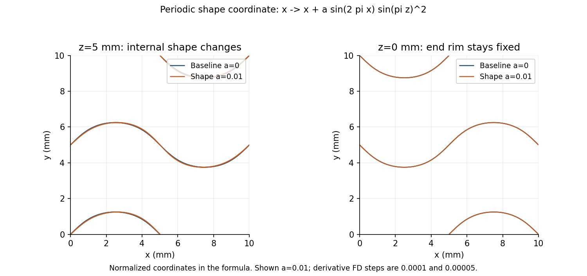
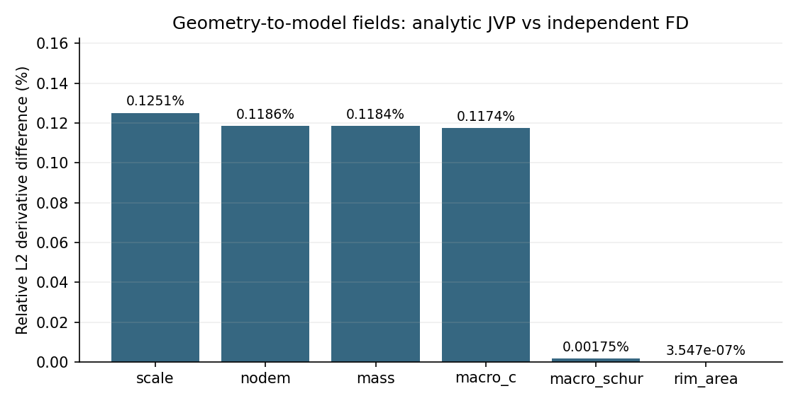

# G周期形态系数：几何求导链核对

几何层通过预定门槛；尚无完整压缩响应的构型梯度结论。

以原G中面为基线，在归一化坐标中令 x → x + a sin(2πx) sin²(πz)，y、z不变。a无量纲，基线0，局部范围±0.01（最大移动0.1mm）。该形态族保持三角连接、周期性和上下端缘；它不保证变形后仍是严格极小曲面，也不代表所有解析系数均已验证。

距离采用实际移动三角面的最近点查询。唯一最近点处，距离导数等于负法向与最近点顶点速度插值的点积；占据、HRZ质量、XY投影惯性和端缘权重继续由原共享实现求导。差分步长0.0001及0.00005，每次重新查询实际移动的曲面。

| 字段 | AD/FD L2差 | 两档FD L2差 | 近零 | 通过 |
|---|---:|---:|---|---|
| scale | 0.125074% | 0.0302508% | False | True |
| nodem | 0.11857% | 0.0133757% | False | True |
| mass | 0.118404% | 0.0133556% | False | True |
| macro_c | 0.117366% | 0.0133368% | False | True |
| macro_schur | 0.00175017% | 0.00486929% | False | True |
| rim_area | 3.54679e-07% | 3.85139e-07% | False | True |

基线距离最大差0（归一化）；字段JVP/VJP对偶差6.211e-16；几何核对耗时0.80min。

最近三角面可能切换，距离在多个最近点并存处未必光滑。原始全域距离差作为诊断保留，门槛按实际占据及质量等模型字段确定；不把远离实体的距离导数误差直接当作力学误差。完整动力学仍须独立JVP与两档FD，之后再验证完整反向。

