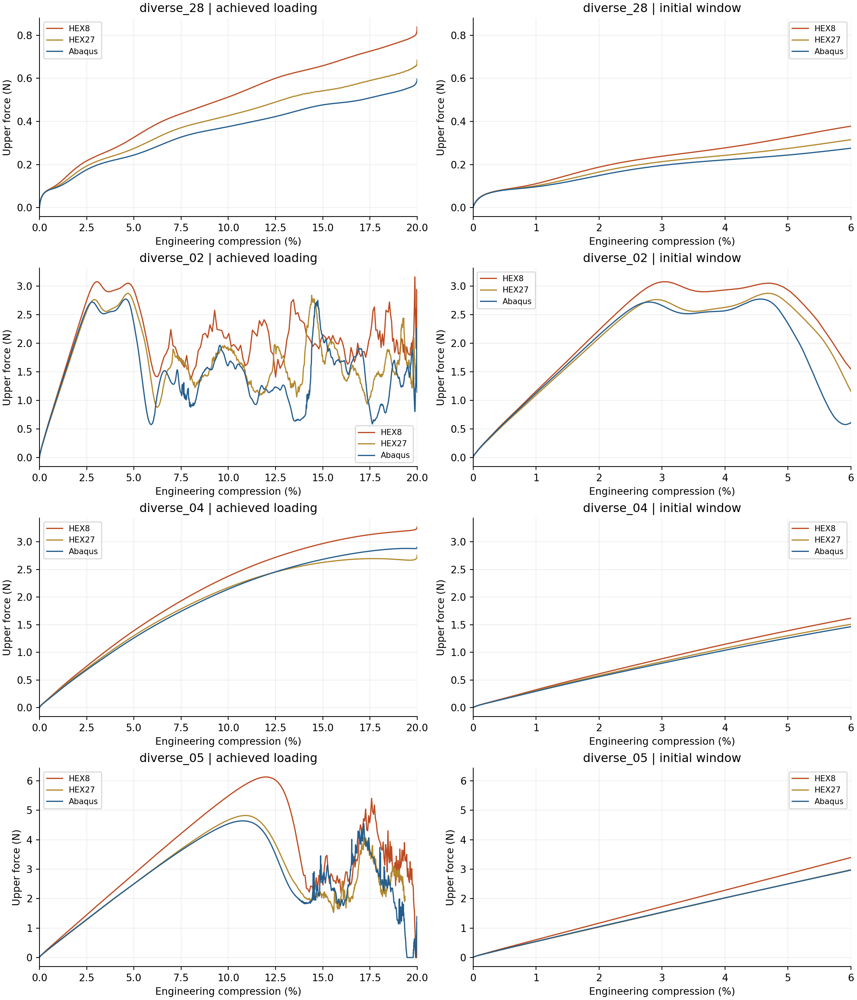
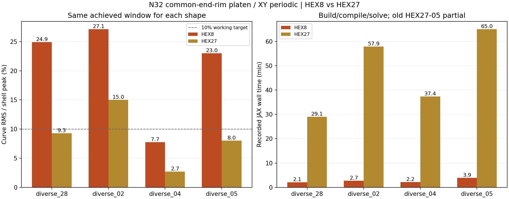

# 当前压板模型：四种构型HEX8测试结果

四种HEX8均已从零完成20%压缩及0.2ms保载；只新增JAX计算，复用r54/r55已有Abaqus壳与HEX27路径。**HEX8明显更快，但四组宏观三目标均未全部通过，当前N32下不建议替代HEX27作为薄壁TPMS的默认离散。**

本轮沿用10mm单胞、0.5mm恒厚中面距离模型、NH E=10MPa/ν=0.3/密度1e−9 tonne/mm³、eta=1e−4、w10–90=0.05mm、objective_void/C²。上下共同中面端缘压板、XY周期、横向宏观伸缩自由、4ms平滑压缩2mm＋0.2ms保载、kn=320MPa/mm，无摩擦、自接触、质量缩放。实际F/J不夹断。

HEX8使用8节点三线性位移与2×2×2全积分，每个方向32个单元，共32768单元、35937节点、33792个XY周期节点类。占据在自身8个实际高斯点计算；正行和集中质量与精确投影惯性重新建立。原HEX27使用27节点、27积分点与HRZ质量。端缘接触点、参考权重、方向、phi及壳标签逐项原值保留，仅重建Q1节点插值。因此这是两套离散方案比较，不是只改变插值阶次的严格单因素实验。

| 构型 | HEX8曲线RMS% | 原HEX27曲线RMS% | HEX8加载功差% | HEX8保载均力差% | 新JAX min |
|---|---:|---:|---:|---:|---:|
| [diverse_28](diverse_28/analysis/README.md) | 24.93 | 9.26 | 37.38 | 38.49 | 2.11 |
| [diverse_02](diverse_02/analysis/README.md) | 27.14 | 15.01 | 35.82 | 45.50 | 2.67 |
| [diverse_04](diverse_04/analysis/README.md) | 7.74 | 2.70 | 10.69 | 12.24 | 2.19 |
| [diverse_05](diverse_05/analysis/README.md) | 24.43 | 8.01 | 30.15 | 102.69 | 3.90 |

RMS是整段力曲线差的均方根除以同窗口壳加载峰，不是逐点误差上限；功差和保载差方向均为JAX−壳，分母为壳自身对应量。新HEX8四组均完整；旧HEX27的05仅到19.36%，上表该旧RMS仍保留原共同窗口。下图左侧对05把新HEX8也截到同一旧窗口，避免范围差影响比较。保载窗为4.1–4.2ms，属于动态短窗；尤其02/05上下板力不平衡，05末端KE/IE约43.4%，不能把保载上板差直接叫静态刚度差。

## 初段与峰位：更快没有保住原有响应一致性

| 构型 | HEX8的2%上板力差% | HEX27的2%上板力差% | HEX8首次显著峰相对壳/百分点 | 占据体积相对HEX27变化% |
|---|---:|---:|---:|---:|
| diverse_28 | 25.89 | 10.72 | — | 0.122 |
| diverse_02 | 4.16 | -2.45 | -1.48 | 0.339 |
| diverse_04 | 9.48 | 3.54 | — | -0.389 |
| diverse_05 | 11.35 | -1.17 | 1.22 | 0.495 |

2%指标为同一动态路径的F(2%)/(0.2mm)割线比，不是另做无惯性线性刚度求解。峰位为1001点压缩网格、25点移动均值、平滑峰10%显著度、25点最小间距规则，沿用原r54实现；原全局最大值另存CSV。无显著内部峰的04/28不强配屈曲事件。02的HEX8首显著峰约3.06%，壳约4.54%，原HEX27约4.66%；不能拿HEX8约19.88%的全局最大值和壳4.55%的第一次降载峰直接当作同一屈曲事件。

**02需额外谨慎：**曲线有约3%与约5%的双峰/平台，显著度算法会因两个峰的相对高度而选择不同首峰；本轮未做逐帧局部模式配对，不能仅凭3.06%−4.54%就认定同一物理屈曲提前1.48个百分点。整体路径偏离已由RMS/功和曲线证明。05则单个主峰清楚：原始主峰HEX8为12.0178%/6.1314N，壳10.7701%/4.6405N，位置晚1.2477个百分点、峰力高约32.1%；原HEX27为10.9007%/4.8232N。

## 能得出的判断及其限度

1. 新加载定义改善了端部比较，但不能消除背景离散误差。保持相同端缘权重后HEX8仍明显偏离，28的平顺偏硬尤其清楚；02的峰平台和峰后动态路径也有变化。
2. 实现核对已排除明显的节点编号、XY配对、单位、零态、内力紧凑计算、正质量和接触虚功错误。每组准备凭据均通过；共享材料、r51/r54/r55源码和参考原字节核对保持。四组未出现拒步，主体采样实际J仍为正；低占据翻转及能量未删除，详见健康图。代数通过不能等同薄壁响应准确。
3. 最可能的解释仍包括Q1对薄壁弯曲/局部模式的表达限制及8点对薄壁材料分布的采样；集中质量和接触插值也随方案变化。t/h=1.6、w/h=0.16，材料跨厚度分布和弯曲杠杆臂敏感。占据体积相近不保证弯曲刚度相近。本轮不能把全部偏差唯一归为锁定或积分点数。
4. 建议保留HEX27作为当前主线；HEX8本轮可以跑通且很省时，但尚不足以作定量替代。若下一步要区分原因，只需先选平顺的28做一个HEX8＋27积分点受控诊断；这是建议，未提交。无需马上重跑整个批次，也不反调厚度、模量或阻尼拟合壳。

一阶全积分单元在弯曲下可能因寄生剪切而偏硬，这一风险见[Abaqus官方单元选择说明](https://docs.software.vt.edu/abaqusv2025/English/SIMACAEGSARefMap/simagsa-c-ctmsummary.htm)。这是解释方向的理论支持，并未证明本轮全部误差都来自剪切锁定；当前连续占据界面和惯性离散也参与变化。

本轮结果不推翻已验证的HEX27/JAX路线，也不证明任意更精细的HEX8一定不可用；它否定的是“在当前N32和这套8点全积分条件下，直接换成HEX8仍能保住现有响应精度”的预期。

## 成本、文件和停止状态

顺序协调器记录总墙钟12.66min（各组准备、JAX及自动分析）。每组冻结准备5min、JAX40min、分析2min上限，全部提前结束；实施代码准备的人时不计入求解墙钟。HEX8与HEX27记录成本口径及状态见decision_table.csv；旧05的65min为预算停止的部分路径，不称完全相同工作量的加速比。

正式目录：`/home/xuehu/projects/tpms_jax/validation/platen_xy_hex8_20261012_r56`；Windows阅读副本：`output/r56_platen_xy_hex8_20261012`。每组input为自身Gauss场与端缘插值，jax为原路径/状态，checks为检查/日志/收据，analysis为曲线/指标/峰表。共享正式材料程序未复制成第二套实现，原快照未改。

批次protocol.json从旧模板继承了部分描述性Q2文字；实际冻结input/protocol.json、HEX8构建、顶层contact_control和本报告明确为Q1端缘插值，原接触位置/权重不变。操作参数以每组input与jax/input为准，不把继承的描述性文字当作Q2执行证据。

当前无新计算队列；梯度和heartbeat保持暂停，未新增Abaqus、AD/FD、训练或Git。
