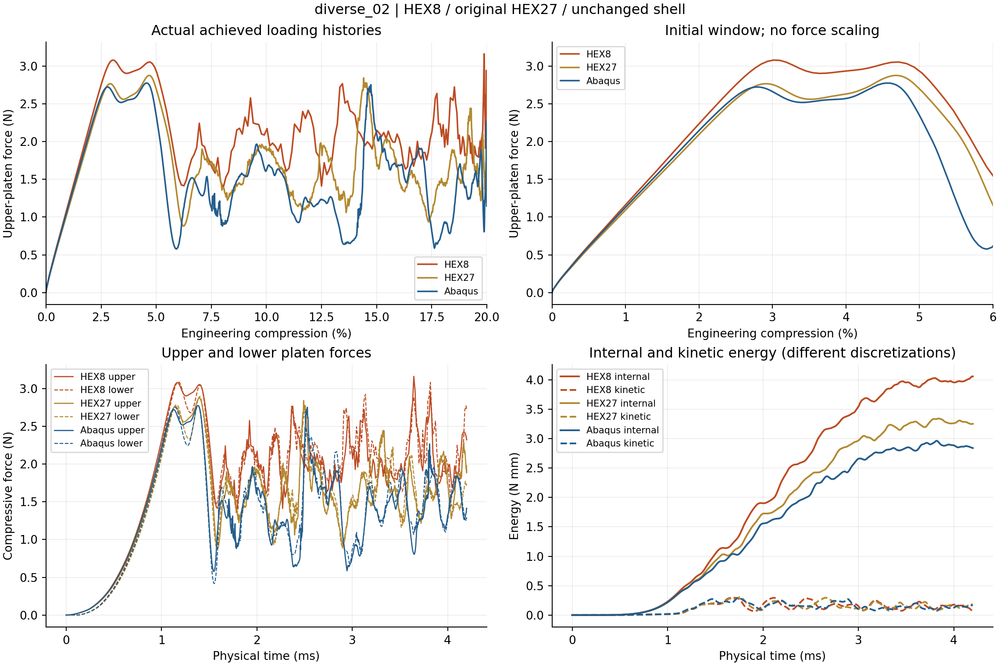
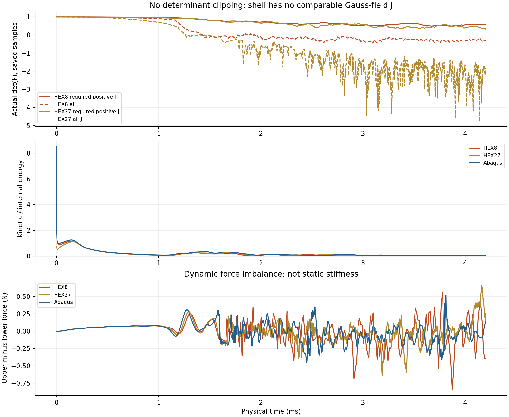

# diverse_02：HEX8／原HEX27／原Abaqus壳只读对照

本报告只读取保存路径，没有FEM、AD/FD、参数匹配、力缩放、曲线平移或时间扭曲。原壳及原HEX27数据不改写。
原参考目录：`/home/xuehu/projects/tpms_jax/validation/platen_xy_diverse_batch_20261012_r55/diverse_02`。新HEX8状态：`complete`；结果complete=True。
三曲线共同加载范围0–20.0000%；HEX8–壳与HEX27–壳各自共同窗口另列，不能把旧05的缺失20%／保载补成已完成。

| 比较（左减右） | 共同末压缩% | RMS／壳峰% | 加载功相对右侧差% | 4.1–4.2ms上板均力差% | 2%割线刚度比 | 首显著峰差/百分点 |
|---|---:|---:|---:|---:|---:|---:|
| HEX8_vs_Abaqus | 20.000 | 27.139 | 35.818 | 45.498 | 1.042 | -1.480 |
| HEX27_vs_Abaqus | 20.000 | 15.010 | 12.722 | 30.185 | 0.976 | 0.120 |
| HEX8_vs_HEX27 | 20.000 | 19.251 | 20.490 | 11.763 | 1.068 | -1.600 |

RMS分母继承r54：本比较实际共同窗口内壳原始上板峰；原壳自身完整加载峰另存在metrics.json。功为上板力对上板行程积分。HEX8–HEX27的功相对差分母为HEX27，同时另存除以壳功的差值。2%割线刚度定义F(2%)/(0.02L)，仅为初始段诊断量。

峰位同时保留原始全局最大值和固定平滑显著内部峰；端点最大值不称屈曲峰，没有合格峰则不强配。平滑只用于诊断，原始力／功／RMS不平滑。

| 求解器 | 保存末时间ms | 保存末压缩% | 采样主体最小实际J | 采样全域最小实际J | 末KE/IE% | 保载上板均力N | 保载下板均力N | 上下差N | 计算墙钟min |
|---|---:|---:|---:|---:|---:|---:|---:|---:|---:|
| HEX8 | 4.200 | 20.000 | 0.489 | -0.445 | 1.836 | 2.214 | 2.215 | -0.001 | 2.599 |
| HEX27 | 4.200 | 20.000 | 0.334 | -4.761 | 5.486 | 1.981 | 1.561 | 0.420 | 57.888 |
| Abaqus | 4.200 | 20.000 | — | — | 5.962 | 1.522 | 1.555 | -0.033 | — |

保载是原4.1–4.2ms短动态窗口，不能把上板力差叫静态刚度差；上下力差、动能与保存态实际J须一起读。实际J仅检查已接受保存样本，低占据区负J仍保留；不是全过程安全证明。

| 准备指标 | 原值（未拟合） |
|---|---:|
| HEX8占据体积分数 | 0.21519908 |
| HEX27占据体积分数 | 0.21447228 |
| 占据体积相对变化% | 0.339 |
| HEX8总质量tonne | 2.152775569887507e-07 |
| 上下端参考接触面积mm² | [17.606647146184827, 17.606647146184827] |
| 每单元积分点数 | 8 |
| 准备墙钟s | 15.786 |

体积分数、质量（HEX8行和／HEX27 HRZ）、接触面积、输入哈希和准备／计算成本按checks/preparation.json、jax/input.json等原字段完整收入metrics.json的evidence；不调整厚度、占据或质量使其匹配参考。HEX8积分点、位移插值及质量分布随离散改变，不应说成完全同一离散模型。

本轮只回答已声明的共同中面端缘／XY周期模型下离散变化的影响，不认证完整有限厚度壁面接触、自接触、任意构型或设计梯度。全部三项约10%工作目标判断只适用于完整HEX8–壳或HEX27–壳对照；HEX8–HEX27只作离散差异诊断。

原路径、共同窗口CSV、峰表、指标、哈希和健康量均保存在本目录。
