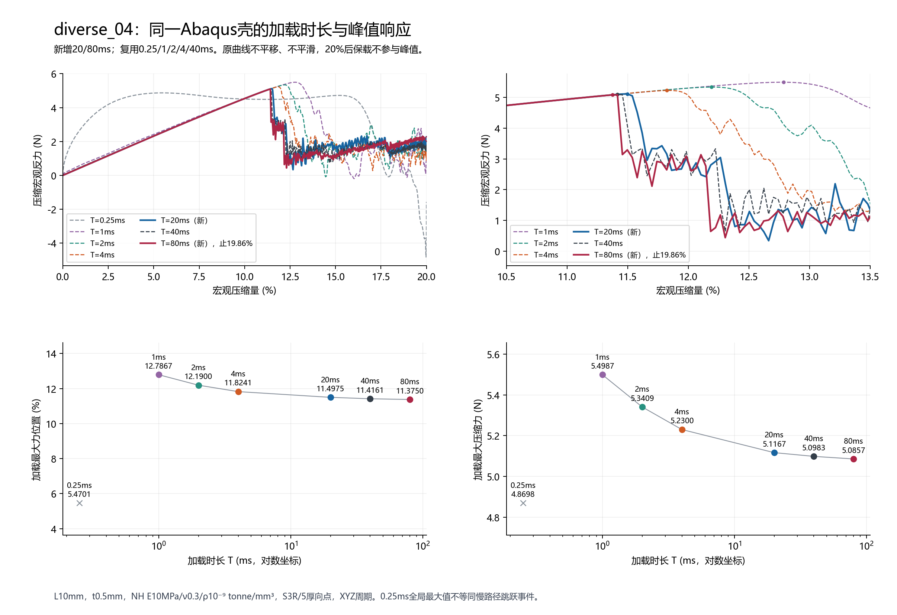
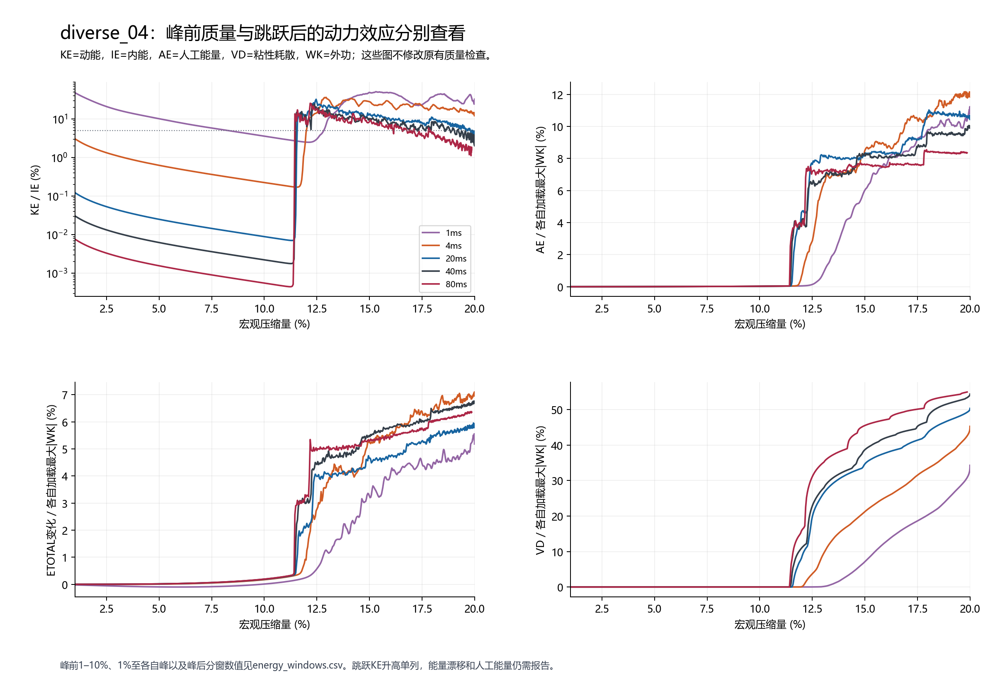
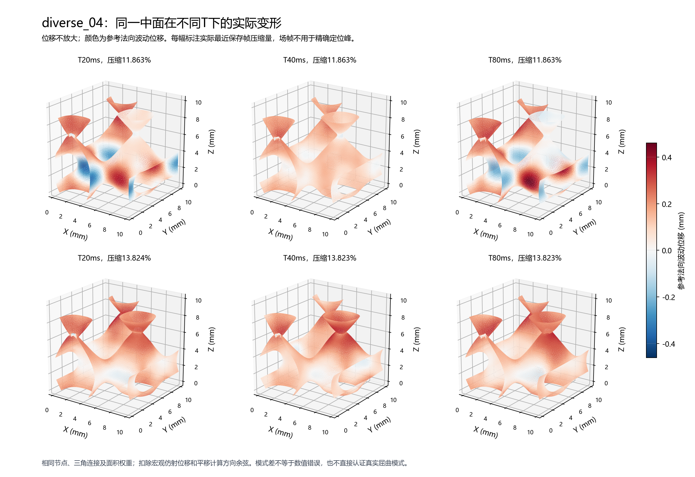

# r48：Abaqus壳加载时长与峰值稳定性

本轮直接检验diverse_04壳参考自身的速率敏感性。新增T20/80ms两项壳分析，复用T0.25/1/2/4/40ms；无新JAX前向、N32/N64接续或AD。T是物理加载时长，不是计算耗时或稳定时间步dt。

## 研究判断怎样区分

Abaqus/Explicit求解动力平衡。给定模型的动力解可以数值自洽，而峰值仍随加载时长变化；不能把某个T的动力峰直接当静态屈曲真值。当前材料没有引入应变率本构，惯性、变形历史和默认体积粘性仍可带来T效应。[SIMULIA的准静态说明](https://docs.software.vt.edu/abaqusv2025/English/SIMACAEGSARefMap/simagsa-m-Quasi-sb.htm)要求分辨加速引入的动力效应。

屈曲还可能受微小扰动和触发模式影响。官方[柱屈曲示例](https://docs.software.vt.edu/abaqusv2025/English/SIMACAEBMKRefMap/simabmk-c-sscxsec.htm)说明高度对称模型可延迟触发，速率也可能改变模式。本轮没有植入缺陷、改阻尼或换网格；T稳定只支持当前离散壳的内部一致性，不证明真实薄壁或任意构型准确。

## 同模型对照与实际执行

沿用diverse_04中面、L10mm、t0.5mm、8372节点/15914个S3R、5个厚向点；NH E10MPa/ν0.3/密度10⁻⁹ tonne/mm³，XYZ周期波动和转角周期、横向宏观应变0。每作业4CPU、double=both、默认体积粘性，无质量缩放、接触或塑性。新INP只改幅值时间、总步时间、历史输出间隔三行，反向替换逐字节恢复原T4ms输入。完整目标为20%+0.1T保载，共同墙钟40min，单项20ms/80ms上限15/30min，预算不足不自动延期。

- T=20ms：求解完成，求解墙钟10.78min，总含提取10.89min；原生目录 `E:\ABAQUS\2026temp\Abaqus_Work\tpms_jax_abaqus\shell_rate_convergence_20261009_r48_T0p020000`。
- T=80ms：未完整完成，求解墙钟30.15min，总含提取30.15min；原生目录 `E:\ABAQUS\2026temp\Abaqus_Work\tpms_jax_abaqus\shell_rate_convergence_20261009_r48_T0p080000`。
  原停止：Frozen wall budget reached; no retry or extension。有效路径范围见表，不补成完整20%或完整保载。

两作业并行，总UTC墙钟30.15min；CPU时间与墙钟不同，不能把两个单项墙钟相加当本轮总耗时。

## 峰值与覆盖范围

| T (ms) | 记录最大力位置 (%) | 记录最大压缩力 (N) | 后续持续降载10%位置 (%) | 峰邻点最大间距 (百分点) | 加载完整20% |
| ---: | ---: | ---: | ---: | ---: | :---: |
| 0.25 | 5.4701 | 4.86983 | 16.2547 | 0.0431 | 是 |
| 1 | 12.7867 | 5.49874 | 13.3672 | 0.0352 | 是 |
| 2 | 12.1900 | 5.34091 | 12.5882 | 0.0419 | 是 |
| 4 | 11.8241 | 5.22999 | 12.0646 | 0.0422 | 是 |
| 20 | 11.4975 | 5.11670 | 11.5787 | 0.0407 | 是 |
| 40 | 11.4161 | 5.09832 | 11.4975 | 0.0410 | 是 |
| 80 | 11.3750 | 5.08570 | 11.4567 | 0.0409 | 否，至19.8629% |

0.25ms的加载全局最大值来自明显不同的快速动力响应，不能直接与慢路径跳跃事件等同。所有位置来自实际保存历史；没有曲线平移、拟合、平滑或外推。最大值后有三条连续低于90%的记录才报告持续降载位置；有限窗口内的观察峰不保证未知未来全局最大值。

## 运行前固定的放慢判据

| 放慢序列 | 峰位变化 (百分点) | 峰力变化 (%) | 峰位≤0.2个百分点且峰力≤2% |
| --- | ---: | ---: | :---: |
| 20→40ms | -0.0814 | -0.3593 | 通过 |
| 40→80ms | -0.0410 | -0.2475 | 通过 |

两次逐次放慢均满足本轮工作标准，支持当前离散壳的慢加载观察峰对T相对稳定。该标准不是行业精度认证，也不将峰位的百分点差写成相对百分比。

## 峰前与跳跃后质量分开看

| T (ms) | 峰处KE/IE (%) | 峰处AE/|WK| (%) | 峰处VD/|WK| (%) | 峰处ETOTAL漂移/|WK| (%) |
| ---: | ---: | ---: | ---: | ---: |
| 20 | 0.03222 | 0.08931 | 0.00161 | 0.63734 |
| 40 | 0.00235 | 0.06968 | 0.00072 | 0.53535 |
| 80 | 0.00052 | 0.06699 | 0.00036 | 0.51831 |

KE为动能、IE为内能、AE为人工能量、VD为粘性耗散、WK为外功。完整1–10%、1%至各自峰及峰后加载的统计见energy_windows.csv，窗口取实际覆盖范围。原提取器全部检查与失败保存在rate_summary.csv，未因峰前较好而改判全20%质量。跳跃后动能上升可以是动力现象，但人工能量、能量漂移及变形模式仍需报告。

## 变形场与模式范围

用同一节点/三角连接/面积权重，扣除宏观仿射位移和面积平均平移。方向余弦接近1表示位移方向相近，不是准确率；它不验证临界特征模态。实际场帧比历史反力稀疏，实际压缩量写在图与表里，不能用它精确定位峰。

| 实际最近目标 | T比较 (ms) | 两实际压缩量 (%) | 面积加权方向余弦 | 波动位移差RMS (mm) |
| --- | --- | --- | ---: | ---: |
| 10% | 40/80 | 9.8128/9.8127 | 1.000000 | 0.000004 |
| 11.4% | 40/80 | 11.8627/11.8626 | 0.807548 | 0.146834 |
| 12% | 40/80 | 11.8627/11.8626 | 0.807548 | 0.146834 |
| 14% | 40/80 | 13.8235/13.8233 | 0.958120 | 0.079971 |

## 综合判断与采样限制

40→80ms峰位变化0.0410个百分点，与峰附近相邻历史记录约0.041个百分点的间距相当。因此支持“慢加载观察峰已相对稳定”，不把11.3750%当作无限精度静态临界点。20/40/80ms峰处KE/IE分别约0.0322%/0.00235%/0.000519%，峰处人工能量/外功均小于0.1%；峰前质量明显优于1ms。

峰后则不能同样认证：20/40/80ms实际覆盖的峰后窗口内，人工能量最大值除以该窗口最大绝对外功约11.03%/10.06%/8.55%，ETOTAL漂移相对同分母约5.95%/6.76%/6.38%。这些数值保留原失败，不能仅用加载变慢宣布全20%曲线准确。粘性耗散也在跳跃后显著累积；本轮没有改变默认体积粘性，不能由此唯一归因峰位差。峰后动能跃升不单独用作否决，数值能量问题也不归为“正常跳跃”而忽略。

同约9.813%保存帧的40/80ms波动位移方向余弦接近1；约11.863%帧为0.80755，约13.823%为0.95812。跳跃后时相/变形差异仍存在，不能把峰位趋稳写成整个动力路径或模式完全一致。

## 对当前JAX差异意味着什么

本轮没有改变JAX结果。原二值N32 T4ms峰15.2387%，同T壳11.8241%，仍差3.4146个百分点；慢壳稳定与否都不能抹去这项同T事实。若慢加载壳峰趋稳，加载时长不是全部错位的充分解释；若不趋稳，当前壳参照的不确定性需要先界定。两者都不能仅据不吻合宣布整个JAX方法失效，或认定Abaqus算法错误。

当前壳仍有实体/壳运动学、离散化、缺陷触发和未建接触等模型范围；本轮只隔离T，不认证这些方面。下一步先讨论本轮结果，不自动新增T160ms、JAX路径、质量缩放、缺陷或训练。

## 文件与保护

正式目录 `/home/xuehu/projects/tpms_jax/validation/shell_rate_convergence_20261009_r48`；Windows阅读镜像为当前目录。原生INP/ODB在表列E盘新目录，原作业不动。protocol.json是运行前协议；batch_receipt.json和各case/launch_receipt.json是实际执行；rate_summary.csv、slow_pairs.csv、energy_windows.csv、mode_comparison.csv为可追踪数值；三图都有PNG/SVG。531项保护记录（含原349项及r47图集）字节保持，生产源码零修改。准备阶段一次反向字符串检查拒绝已保存在preparation_attempt01.json，修复为精确整行替换；它发生于作业提交前，不是FEM失败。
